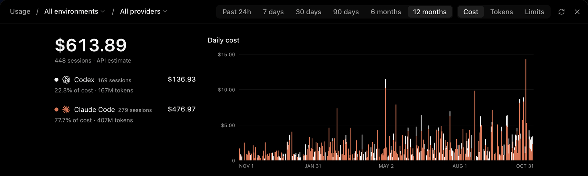
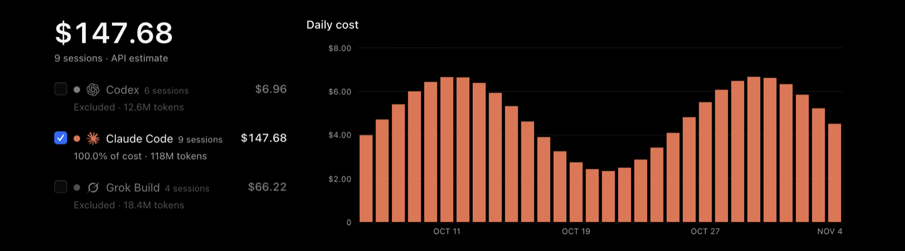
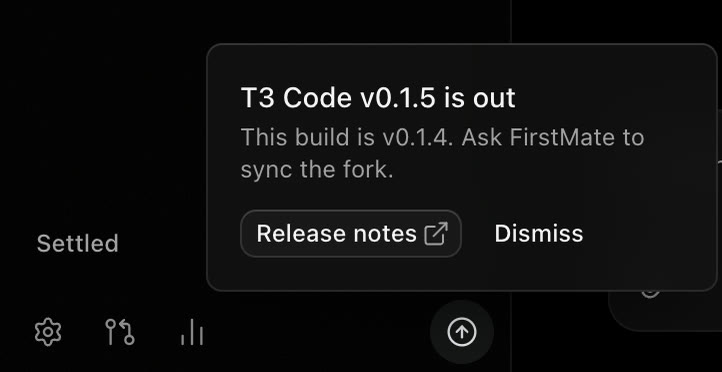
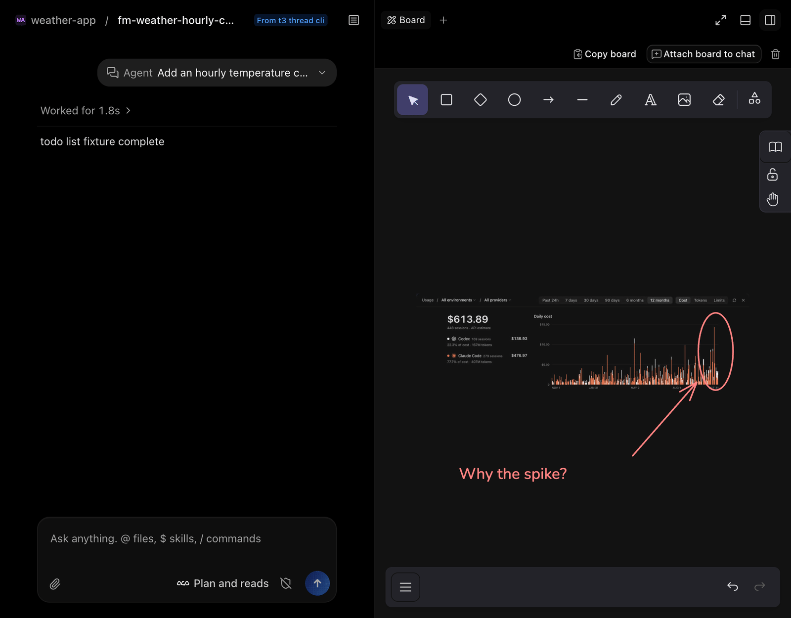
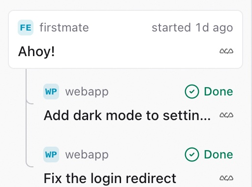
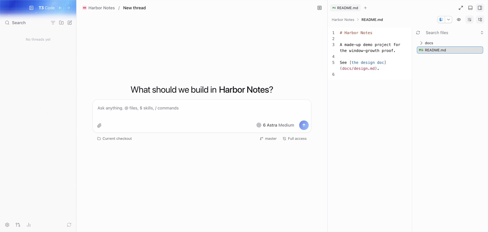
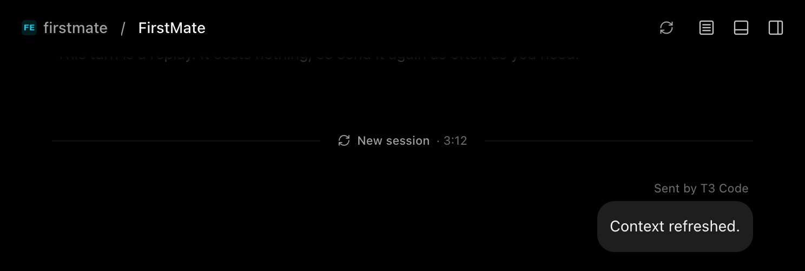
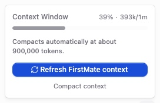

# Fork changes

This fork tracks `pingdotgg/t3code` `main`. Each feature section says what it
does, shows a picture where one helps, then what each upstream sync must carry
forward. Keep this list current. Pictures live in `fork/media/` and show
made-up data. Earlier fork work is archived on the local branch
`archive/fork-legacy-2026-10-19` and is out of scope for syncs; take from it
only on request.

## Desktop identity

The fork's desktop app runs beside the official T3 Code on one Mac. Neither app
can read or migrate the other's database.

|                          | Official                                         | Fork                                        |
| ------------------------ | ------------------------------------------------ | ------------------------------------------- |
| App name                 | T3 Code (Alpha, Beta)                            | T3 Code (Fork)                              |
| Bundle id                | `com.t3tools.t3code`                             | `com.t3tools.t3code.fork`                   |
| Data folder              | `~/.t3`                                          | `~/.t3-fork`                                |
| Electron profile         | `~/Library/Application Support/t3code-v2` (Beta) | `~/Library/Application Support/t3code-fork` |
| First backend port tried | 3773                                             | 3873                                        |

The values are in `apps/desktop/src/forkIdentity.ts`. The app name is
`productName` in `apps/desktop/package.json`. `T3CODE_HOME` still overrides the
data folder.

Three things are still shared with the official app:

- The `t3code://` link scheme. Both apps register it, so macOS picks which app
  opens sign-in and prompt links.
- The default Tailscale Serve port, 443. Do not turn on Tailscale Serve in both
  apps at the same port.
- The managed policy (`/Library/Application Support/T3Code/policy.json` or the
  `com.t3tools.t3code` managed preferences). A policy written for the official
  app restricts the fork too, except that the fork ignores its update feed
  (`limits.updates.feedUrl`), so it never gets one
  (`apps/desktop/src/updates/DesktopUpdatePolicy.ts`). Upstream's `t3 update`
  command does follow that feed, but the app never runs it: its server is
  desktop-managed (`apps/server/src/cloud/selfUpdate.ts`).

## Usage reaches twelve months



The Usage page on web and desktop has 6 months (`Cmd+Shift+5`) and 12 months
(`Cmd+Shift+6`) periods. Every period draws one stacked bar per day or hour,
because upstream's overlapping lines turn into a smear over long ranges. The
mobile app already draws bars and still
stops at 90 days. The server keeps parsed usage for 367 days instead of 92, so
usage stays after Claude Code deletes old transcripts. History older than what
is on disk or in the saved usage today cannot be recovered; twelve months builds
up from when this build first scans.

Upstream's "N malformed or inconsistent usage record(s) were skipped" sentence
shows as a small muted footnote at the bottom of the page instead of a notice
at the top (`apps/web/src/components/usage/UsagePage.tsx`).

## Usage rows can be muted



On the Usage page, click a provider's dot, icon or name to mute it; click again
to bring it back. The row looks like plain text until you hover it. Muting grays
the row and leaves it in the list, showing what that provider would have added.
Everything else drops it: the headline, the other rows' shares, the chart, the
totals, the by-type bars and the breakdown.

This is a second control on upstream's own filter, the provider menu in the
Usage header, and they share one saved setting. Keep that setting
(`hiddenProviders`) as the single source when syncing, and keep what the fork
adds: `excludedProviders` in `apps/web/src/state/usage.ts` and the rows in
`apps/web/src/components/usage/UsagePage.tsx`. Upstream's filter also hides a
provider's Limits cards, so a row muted here hides them too. The mobile app
has no row toggles.

## Archived usage

Usage includes copies of history from machines and accounts that no longer run
T3. The server setting `usageArchiveDirs` lists the archive folders. It
defaults to `["~/.t3-usage-archive"]` and can be changed in
`~/.t3-fork/userdata/settings.json`. Code: `apps/server/src/usage/usageArchive.ts`.

- Each folder directly under an archive folder is one host, and its name is
  the host label. Inside it, the copy keeps the original machine's layout, such
  as `<host>/home/.claude/projects`.
- These are read: Claude `projects/`, Codex `sessions/`, Grok
  `.grok/sessions/`, and a T3 server's saved usage
  (the newest `usage-scan-cache*.json` in a folder, version 3 on).
  Saved usage still has usage whose transcripts were deleted. Version 3 caches
  are priced at standard speed. OpenCode, Pi and Antigravity copies are not
  read.
- Archived usage is parsed and deduplicated like live history. Live
  directories are read first, so usage that is both live and archived counts
  once and stays credited to the live source.
- A remote that still runs T3 and is connected would be counted again next to
  its archive copy. Archive a host after T3 is removed from it.

## App-bundled CLIs are updated by their app

On macOS, a provider CLI whose real path is inside an app bundle
(`*.app/Contents/...`) is left to that app. An example is ChatGPT.app's Codex,
which `~/.local/bin/codex` links to. T3 shows no Update button for it and never
runs its updater. Without this, Codex offers an update that fails, because
`codex update` cannot update ChatGPT's copy and exits 1. This works like
upstream's handling of WinGet's Claude, in
`packages/provider-core/src/server/maintenanceResolver.ts`.

## `~` in a provider's executable path

A provider path that starts with `~` works for every provider. Upstream's Grok,
Pi, fx, Antigravity, Kiro and ACP registry drivers use a configured path such as
`~/.local/bin/grok` as written. Processes launch without a shell, so
the provider shows as not installed. Here each of those drivers expands a
leading `~` with `expandHomePath` before probing, spawning, resolving
maintenance or reporting status, as Codex, Claude, Muse and OpenCode do upstream.
Cursor never runs its `binaryPath`, so it is unchanged. When a sync finds upstream
expanding `~` in these drivers, keep upstream's.

## Idle agent release is a server setting

The server setting `providerSessionIdleTimeoutMinutes` (whole minutes from 1 to
1440, default 30, `null` is Never) replaces the hardcoded 30-minute idle
release. It has no control in the app: edit
`~/.t3-fork/userdata/settings.json`, for example
`"providerSessionIdleTimeoutMinutes": null`. The running server picks the
change up, including for agents already idle. Firstmate's environment sets it
to Never. This is the server half of upstream
https://github.com/pingdotgg/t3code/pull/25624, without its web and mobile
controls. When a sync finds the PR merged, or an upstream equivalent, drop
this copy and keep upstream's.

## Upstream release indicator



The fork has no update feed, so it never hears about upstream releases. When
`pingdotgg/t3code` publishes a stable release newer than this build, the
sidebar update icon shows "T3 Code vX.Y.Z is out", with links to the release
notes on GitHub and a Dismiss that holds until the next newer release. Nothing
downloads or installs; the captain asks FirstMate to sync the fork. It checks
at start-up and every 6 hours, keeps the last result when GitHub is
unreachable, and stays off whenever an update feed is configured or the
desktop updater is running. Code: `apps/web/src/state/upstreamRelease.ts` and
`apps/web/src/components/sidebar/SidebarUpstreamRelease.tsx`; a later "Ask
FirstMate to update" button belongs in that popover.

## Board



A quick annotation canvas that opens as a "Board" tab in a chat's right panel,
from the panel's launcher or "+" menu (W) or "Open board" in the command palette.
It is Excalidraw (MIT), loaded only when the tab shows. Screenshots pasted with
Cmd+V while focus is in the panel land in the middle of the view. The board is
saved in the client's IndexedDB, one board per client, shared by every chat's
Board tab. "Attach to chat" sends the selection, or the whole board, as a PNG to
the composer of the chat beside the panel, and "Copy" puts the same PNG on the
clipboard. The canvas is marked
`data-editable-canvas` and `role="application"` so its keys (tool letters, Cmd+Z,
Delete) are not taken by type-to-focus or thread undo. Code:
`apps/web/src/components/board/`.

Shared files it touches, for syncs: the `board` surface kind in `rightPanelStore.ts`
(and `closedViewStore.ts`), the launcher and "+" menu entries and tab title and icon
in `RightPanelTabs.tsx`, `RightPanelSurfaceContent.tsx`, `useRightPanelActions.ts`,
the props in `ChatView.tsx` and `PullRequestsPage.tsx`, a command palette item, the
selector in `lib/editableFocus.ts`, the Excalidraw font asset path in
`apps/web/vite.config.ts`, and licence notices. Excalidraw's canvas fonts are
served from the app because the desktop CSP blocks the CDN Excalidraw would
otherwise use. Excalidraw pins Radix Tabs 1.0.2, whose React peer range stops
at 18, and upstream's `strictPeerDependencies` refuses that, so an override in
`pnpm-workspace.yaml` moves it to a 1.1 release that accepts React 19. The
mobile app has no board.

## FirstMate crew in the sidebar



A FirstMate session and the worker threads it launches are grouped above the
sidebar inbox and kept out of Working. The main session is a two-line card: its
project and status, then "started 3h ago" where a crewmate shows its title,
because age is what says a long session is due for a fresh one. It never shows a
branch line. Its crewmates hang below it as a tree that collapses to a count. A
pinned coordinator (see below) gets this card even with no crew; without any
coordinator the sidebar is unchanged.

The FirstMate and crew cards have no hover Snooze or Settle (the context menu
still has both, and snoozing or settling takes a thread out of the group). They
drag only as chat context, and crewmate turns raise no sound or notification. A
fresh page load on the home route opens a coordinator whatever its run status,
the most recently updated if there are several, because a restart ends every
run. A thread's Lineage panel lists its Crew or Coordinator.

Upstream counts a background command as work only when the agent marks it with
`t3_background_wait`, so an unmarked one leaves a thread reading Done. A
crewmate's card reads Waiting while any background task runs, marked or not,
because crew usually end their turn to wait on a pipeline run. Other threads
and auto-settle keep upstream's rule. Code: `threadWaitsOnBackgroundWork` in
`packages/client-runtime/src/state/models.ts`.

A coordinator can put a short status on a crewmate's card, such as "Waiting for
captain" or "Testing": `t3_thread_update` with `action:'set_status_label'` and
`statusLabel` (32 characters at most), and `action:'clear_status_label'` to take
it off. The label sits where Working, Done or the age would, so the title stays plain.
Approval, Input, Request, Limited, Failed and Woke still show over it, because a
label can lag behind a thread that needs the user. A label is stored with the
thread (`statusLabel`), thread reads report it, forks drop it, and changing it
does not count as activity. Upstream decoders ignore the field; web and desktop
show it, and mobile has no crew cards. Code: `resolveCrewStatusLabel` in
`apps/web/src/components/sidebar/coordinatorGroup.logic.ts`.

A crew card reading "Testing" also shows how long it has read that, with the
same running timer Working uses. Upstream only times a thread's own run, so a
card has no clock for anything else; a FirstMate worker in a validation run is
usually idle while it waits, so without one the card cannot say how long the
run has taken. The thread stores when its label was first set
(`statusLabelSince`). FirstMate re-sends the label about once a minute, so the
same label keeps its time, and only a new label or clearing it resets it.
Other labels, including "Waiting for captain", show no timer. Code: the crew
label slot in `apps/web/src/components/sidebar/SidebarThreadRow.tsx`.

A crew thread names its coordinator at launch: `t3_thread_launch` takes an
optional `parentThreadId`, stored as the thread's `crewOf`. MCP thread reads
report it as `parentThreadId` with `relationshipToParent: "crew"`. It stays out
of the thread's `lineage`, which upstream-built clients such as the App Store
mobile app decode strictly; one unknown lineage value there stops their whole
thread list from syncing. Crew stored in lineage by earlier builds is read back
as `crewOf`. FirstMate passes its
main session's id, and a secondmate's workers pass the secondmate's, which
stays grouped with its own coordinator. The parent must be a thread the caller
can read; naming it grants nothing on it. Unlike `delegate_task` children, a
crewmate's Stop and archive stay independent of its coordinator. Threads
launched without a parent stay out of the group, and mobile does not group
crew. Code: `apps/web/src/components/sidebar/coordinatorGroup.logic.ts`.

A server restart ends the coordinator's session, and nothing inside it can wake
it again. So on each start T3 sends every idle coordinator with unarchived crew
one note, attributed to T3 Code: when the server restarted, which crew had a run
cut, and to run `bin/fm-session-start.sh`. Once a project has a pinned
coordinator, an unpinned one gets the note only if the restart cut one of its
crew's runs. Archived, settled or snoozed coordinators get
none, and neither does one whose own run the restart cut (its restart
continuation wakes it). The project's continue-after-update setting
(`continueThreadsAfterServerUpdate`) switches it off. A thread pinned with
`t3_thread_configure` `coordinator: true` (one per project; pinning moves it,
`false` unpins) gets the note after every start even with no crew or while busy,
thread reads report `coordinator`, and `orchestrator_capabilities` reports
`coordinatorRestartNote`. Forks and side chats drop the pin and the crew link, so
forking FirstMate cannot make a second coordinator. Code:
`notifyCrewCoordinators` in `apps/server/src/orchestration-v2/RestartContinuation.ts`.

## Sidebar cards stay two lines

This one applies to every thread. Upstream gives a card with no branch but a
linked pull request or running terminal a third line holding just that badge and
the model icon. Here the meta line appears only for a branch, machine label or
diff; otherwise those badges sit right-aligned on the title line, which truncates
before them. Folder multiline rows follow the same rule. Code:
`isThreadMetaLineEmpty` in `apps/web/src/components/Sidebar.logic.ts`.

## The window grows for the right panel



In the desktop app, opening the right panel (a file link, the Files list, any
surface) widens the window to the right by the panel's width, so the sidebar
and chat keep the widths you chose. Closing it takes the same width back off.
Upstream's panel shares the window, so the window never moves or resizes on
its own. The fork changes that on purpose: the window is kept at a chosen
width, and opening a document used to squeeze the chat to make room.

- One panel width is remembered on desktop (`t3code:preview-panel-width`)
  instead of one per thread; the browser keeps upstream's per-thread widths and
  never resizes anything.
- Near the screen's right edge the window moves left only as far as it must
  and moves back on close. A screen too narrow for the full width grows as far
  as it can and the panel takes the rest, as upstream does. Full screen and
  maximized windows are left alone.
- A hand resize while the panel is open is kept: closing takes off only what
  opening added. The window's saved size leaves the panel's width out, so a
  restart with the panel open grows once.
- The window follows whether the panel is showing, so switching between a
  thread with the panel open and one without resizes it.

Code: `apps/desktop/src/window/PanelWindowGrowth.ts` (the width arithmetic and
its tests), the `setRightPanelOpen` bridge method, and the effect in
`apps/web/src/components/chat/ChatRightPanel.tsx`.

## Refresh context on the FirstMate thread



The FirstMate thread keeps one id and one chat for its whole life, while the
agent session behind it is replaced on demand. The thread header of a pinned
coordinator thread (`t3_thread_configure` `coordinator: true`) has a Refresh
context button, greyed out while a turn runs. Clicking it:

1. sends one `/stow` turn to the current session, attributed to T3 Code;
2. when that turn completes, sends `Context refreshed.` with upstream's
   `freshContext`, the same fresh session `/clear` starts. Upstream ends the old
   session before the new turn starts, draws its "New session" divider above the
   message, and keeps earlier turns out of the new session. `Context refreshed.`
   is not `ahoy`, so FirstMate does not run Bearings on the new session.

The old process must be gone before the new session opens, because FirstMate's
session lock belongs to the live process and a session that loses it comes up
read-only. Upstream's fresh send queues the old session's detach ahead of the
new turn on the same thread, and the fork's Claude adapter waits for its CLI
process to exit whenever a session closes, for every release path.

If the `/stow` turn fails, is stopped, or the agent is still busy (background
work in the session), nothing is swapped and a notice under that turn says so.
A server restart in the middle of a refresh drops it; press the button again.
Mobile has no button but shows upstream's divider. Idle compaction and the idle
release of the agent are unchanged. The fork's first version wrote its own
event, `thread.session-replaced`; nothing writes it now, and the contracts keep
it so stored events still decode. Code: `thread.session.refresh` in
`apps/server/src/orchestration-v2/Orchestrator.ts`,
`apps/server/src/orchestration-v2/SessionRefreshService.ts`, and
`ChatHeader.tsx` on the web.



The Context Window box under the composer's context meter offers the same
refresh on that thread. Upstream's full-width Compact context button becomes a
primary Refresh FirstMate context button, greyed out with the header's wording
while a turn runs, and compacting drops to a small Compact context link under
it with its usual availability. Upstream offers compacting because that is how
a long session continues; FirstMate keeps its state in files and stows before a
refresh, so a fresh session is the better default there. Every other thread
keeps upstream's box unchanged. Code: `onRefreshContext` in
`apps/web/src/components/chat/ContextWindowMeter.tsx`, passed down from
`ChatView.tsx`.

## Per-thread environment and instructions

An agent that launches a thread can give it its own environment variables and
instructions. `t3_thread_launch` takes optional `environment` (env vars, at most
64 and 16 KB, never T3's own names) and `instructions` (kept in the agent's
system context, at most 16,000 characters), stored on
the thread so they survive idle release, restarts and forks, though not
delegated children. Values sit in the database, so they must not be secrets. Each
adapter applies them through the channel it already has and declares what it
supports; a launch or later turn that binds something its provider cannot
apply is refused. Kiro's adapter declares neither, so it refuses both. Cursor
takes instructions only, because it runs inside the server process. The other
providers take both. `t3_thread_configure` reads them back with the effective
runtime mode, and `orchestrator_capabilities` reports `threadEnvironment`,
`threadInstructions` and an ACP registry instance's `agentId`. Code:
`apps/server/src/orchestration-v2/RuntimePolicy.ts`.

OpenCode 2 shares one server per instance, so its adapter sets each session's
own environment instead (`PUT /api/session/:id/environment`). That replaces the
server's environment in the session's shells, is kept in memory only, and is not
inherited by subagent sessions. So T3 sends every session, subagents included,
the environment it started the server with minus `OPENCODE_PASSWORD`, plus the
thread's variables. It sends this again after the server restarts. An external
server (`serverUrl`), on either OpenCode adapter, has an environment T3 does not
know or cannot reach, so it takes instructions only. Code:
`packages/provider-opencode/src/server/v2/adapter.ts`.

## Agents answer approvals over MCP

Claude asks for some commands even with full access (its own safety checks and
the user's ask rules). An agent driving T3 over MCP, such as FirstMate, can
answer those so the user never has to. `t3_pending_request` `list` returns
`approvals` next to question `requestIds`, each with its `kind`, `detail`,
`reason` and `override` (`provider_check`, `ask_rule` or `null`); `respond`
takes `decision: "allow" | "deny"` and optional `feedback` on deny, and sends
the same command the Approve and Decline buttons do. Only a full-access caller
other than the asking thread may answer one. The resolved request and its
timeline row record `respondedBy: "agent"`, which web and mobile show as
"answered by agent". `orchestrator_capabilities` reports `approvalResponses`.
Code: `apps/server/src/mcp/toolkits/thread/handlers.ts`.

## Stopped turns close their approvals

Upstream closes only a stopped turn's questions, so an approval such as a Claude
command prompt stays pending forever: the app keeps showing a prompt for a tool
call that no longer exists, and the thread reports a pending request. Here a turn
that ends interrupted, failed or cancelled expires every pending request it
raised. A turn that completes still closes only its questions, because a
background subagent's approval can still be live then. These requests close as
`expired`, not `cancelled`, and the guard that keeps a just-committed answer from
being overwritten covers every request kind. Code: `expireTurnRequests` in
`apps/server/src/orchestration-v2/ProviderEventIngestor.ts` and
`guardRequestClosures` in `EventSink.ts`.

## Waits end on a question or approval

T3 sends an MCP client no event when a thread starts waiting on a question or
approval, so FirstMate used to re-list every watched thread's pending requests
once a second, at about 40 ms of server CPU per check. Now `t3_thread_wait`
takes `settleOnPendingRequest: true` and also returns, at once, when a
question or approval appears that the caller does not know of: one outside
`knownRequestIds`, or, without that list, one not pending when the wait
started. It listens to the thread's `runtime-request.updated` events on the
subscription the wait already holds, so it costs nothing while idle. The
result then carries `settledBy` (`run_ended`, `timeout` or `pending_request`)
and, for a pending request, `pendingRequests` in the shape
`t3_pending_request` `list` returns. Callers without the flag see no change.
Clients detect it by the field in the tool's `tools/list` input schema.
Code: `apps/server/src/orchestration-v2/ThreadManagementService.ts`
(`waitForThread`).

## MCP can mark a thread read

A thread card reads Done until the thread is opened in a client, because Done
clears through `thread.visit`, which only a client sent. `t3_thread_organize`
now has `action: "mark_read"`, the opposite of `mark_unread`: it dispatches
`thread.visit` with `visitedAt` set to now, so the thread reads as seen. It does
not count as the user opening the thread. Clients detect it by `mark_read` in the
tool's `tools/list` `action` enum. Upstream main had no equivalent at
`337c5858c3`. Code: `apps/server/src/mcp/toolkits/thread/handlers.ts`.

## FirstMate's sign-in lasts 10 years

Upstream gives every MCP sign-in a 30-day pass, most likely so a leaked or
forgotten pass does not stay valid forever. Here the pass for the client named
`firstmate` lasts 10 years; every other client stays at 30 days. Anything able to
read that pass on this machine already runs as the owner and could mint a new
one, and a pass can still be revoked, so the short life added little and a
renewal job was more machinery than it saved. The match is on the exact label
`firstmate`, which is the `client_name` FirstMate signs in with. Code:
`apps/server/src/auth/EnvironmentAuth.ts` (`FIRSTMATE_SESSION_TTL`).

## Telemetry off by default

The fork sends no product analytics and no T3 Connect relay traces unless you
opt in. `T3CODE_TELEMETRY_ENABLED` governs both and defaults to `false` here
(upstream defaults it to `true`): `AnalyticsService.ts` and
`isRelayTracingEnabled` in `packages/shared/src/otelEnvironment.ts`. To turn them
on, set `T3CODE_TELEMETRY_ENABLED=true` in the server's environment. The desktop
app starts its server before it reads your login shell, so a shell-profile
export does not reach an app opened from the Dock: run
`launchctl setenv T3CODE_TELEMETRY_ENABLED true` and restart the app, or start
the app from a terminal that has the variable set. Your own OpenTelemetry export
and the mobile app's crash reports have their own settings.

## Version

The fork keeps upstream's version number. The desktop app sets up an SSH or
WSL remote by downloading upstream's `t3` release for its own version
(`apps/desktop/src/main.ts`), so a version upstream never released, such as
`0.1.5-fork.1`, has nothing to download. The app name, bundle id and
data folder tell the fork apart. A sync to an upstream nightly keeps the stable
version its source carries (upstream stamps nightly versions only when it
builds): a `-nightly.` version would turn the build into upstream's "T3 Code
(Nightly)", with its icons and update track.

## Build

```sh
node scripts/build-desktop-artifact.ts --platform mac --target dmg --arch arm64
```

The build is unsigned, so electron-builder ad-hoc signs it. It writes
`release/T3-Code-<version>-arm64.dmg` and a `.zip`. Leave
`T3CODE_DESKTOP_UPDATE_REPOSITORY` and `GITHUB_REPOSITORY` unset. With neither
set, the app has no update feed and cannot update itself into the official
app.
Settings → About → Update track (Stable or Nightly, from upstream 0.1.5) then
only saves the track for this app, which says to reinstall it yourself. It
still moves connected machines that run upstream's `t3` to that track.
