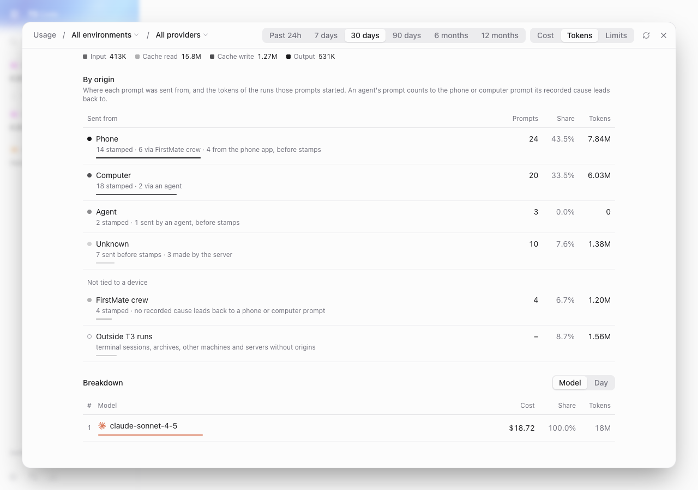
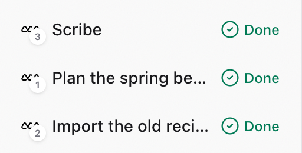
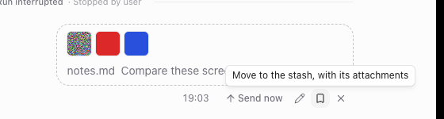

# Fork changes

This fork tracks `pingdotgg/t3code` `main`. Each feature section says what it
does, shows a picture where one helps, then what each upstream sync must carry
forward. Keep this list current. Pictures live in `fork/media/` and show
made-up data. Earlier fork work is archived on the local branch
`archive/fork-legacy-2026-10-19` and is out of scope for syncs; take from it
only on request.

## Desktop identity

The fork's desktop app runs beside the official T3 Code on one Mac. Neither app
can read or migrate the other's database.

|                          | Official                                         | Fork                                        |
| ------------------------ | ------------------------------------------------ | ------------------------------------------- |
| App name                 | T3 Code (Alpha, Beta)                            | T3 Code (Fork)                              |
| Bundle id                | `com.t3tools.t3code`                             | `com.t3tools.t3code.fork`                   |
| Data folder              | `~/.t3`                                          | `~/.t3-fork`                                |
| Electron profile         | `~/Library/Application Support/t3code-v2` (Beta) | `~/Library/Application Support/t3code-fork` |
| First backend port tried | 3773                                             | 3873                                        |

The values are in `apps/desktop/src/forkIdentity.ts`. The app name is
`productName` in `apps/desktop/package.json`. `T3CODE_HOME` still overrides the
data folder.

Four things are still shared with the official app:

- The `t3code://` link scheme. Both apps register it, so macOS picks which app
  opens sign-in and prompt links.
- The `t3` command. A fresh install of either app links `~/.local/bin/t3` to
  its own launcher (the fork's is `~/.t3-fork/bin/t3`) unless a link is
  already there, and Install or Remove in either app's Settings takes over or
  deletes the other app's link.
- The default Tailscale Serve port, 443. Do not turn on Tailscale Serve in both
  apps at the same port.
- The managed policy (`/Library/Application Support/T3Code/policy.json` or the
  `com.t3tools.t3code` managed preferences). A policy written for the official
  app restricts the fork too, except that the fork ignores its update feed
  (`limits.updates.feedUrl`), so it never gets one
  (`apps/desktop/src/updates/DesktopUpdatePolicy.ts`). Upstream's `t3 update`
  command does follow that feed, but the app never runs it: its server is
  desktop-managed (`apps/server/src/cloud/selfUpdate.ts`).

## Usage reaches twelve months


The Usage page on web and desktop has 6 months (`Cmd+Shift+5`) and 12 months
(`Cmd+Shift+6`) periods. Every period draws one stacked bar per day or hour,
because upstream's overlapping lines turn into a smear over long ranges. The
mobile app already draws bars and still
stops at 90 days. The server keeps parsed usage for 367 days instead of 92, so
usage stays after Claude Code deletes old transcripts. History older than what
is on disk or in the saved usage today cannot be recovered; twelve months builds
up from when this build first scans.

Upstream's "N malformed or inconsistent usage record(s) were skipped" sentence
shows as a small muted footnote at the bottom of the page instead of a notice
at the top (`apps/web/src/components/usage/UsagePage.tsx`).

## Usage rows can be muted


On the Usage page, click a provider's dot, icon or name to mute it; click again
to bring it back. The row looks like plain text until you hover it. Muting grays
the row and leaves it in the list, showing what that provider would have added.
Everything else drops it: the headline, the other rows' shares, the chart, the
totals, the by-type bars and the breakdown. Rows follow upstream's order by the
selected metric (cost or tokens); a muted row ranks by what it would have added,
so muting it does not move it.

This is a second control on upstream's own filter, the provider menu in the
Usage header, and they share one saved setting. Keep that setting
(`hiddenProviders`) as the single source when syncing, and keep what the fork
adds: `excludedProviders` in `apps/web/src/state/usage.ts` and the rows in
`apps/web/src/components/usage/UsagePage.tsx`. Upstream's filter also hides a
provider's Limits cards, so a row muted here hides them too. The mobile app
has no row toggles.

## Usage accounts follow the providers tab

Wherever usage lists a provider's accounts (the Usage page's Limits columns,
the sidebar readout, the composer's `/usage-limits` panel, and the mobile app's
Limits view and widget), they go in the order Settings › Providers lists the
provider instances: the default instance first, then the others as saved.
Accounts no listed instance reports, such as hub-only accounts, go after, by
name. Upstream's `collectLimitPools` (#10690) orders accounts by the soonest
reset of their first window kind, so the account with a live five-hour session
jumps to the left; the fork keeps accounts where the providers tab puts them.
Both keep one order for every window row, so columns stay aligned. The rule is
`sortByProvidersTab` and `LimitAccount.providerOrder` in
`packages/shared/src/usageLimits.ts`; syncs must carry it.

## Usage limits in the sidebar

The captain wants usage visible without opening the Usage page, so the web and
desktop sidebar shows a small readout between the Settled row and the bottom
icons: one line per account the Limits view shows, with its provider's icon, a
thin bar in the account's accent colour and the percent left in that account's
own weekly window, or its first window when it has no weekly one. A provider
with several accounts (Claude and Claude2) gets one line each, because each
account resets on its own clock. A provider's lines follow the providers tab
(see [Usage accounts follow the providers tab](#usage-accounts-follow-the-providers-tab)). Model windows such as Weekly · Fable stay on
the page. Each bar carries the Usage page's pace mark: a small line, in a gap
cut from the bar, where the bar would end if usage kept pace with the time
elapsed in that account's window. The tooltip names each account (its display
name, else the provider) with its figure, how much of the window is left and
its reset time, and says what the line means; a click opens the Usage page. It reads the same provider
statuses as the Limits view and fetches nothing, shows nothing until limits
arrive, and leaves out providers muted on the page. The phone web sidebar shows
it too; the mobile app does not.

Upstream code it touches, for syncs: `useLimitPresentations` is the Limits
view's environment and muted-provider filter, moved out of
`UsageLimitsSection` in `apps/web/src/components/usage/UsageLimits.tsx`, and
`saveUsagePagePreferences` now writes through `writeLocalStorageValue` so the
sidebar hears a mute in the same tab (`usagePagePreferences.ts`). The mount is
one line in `SidebarChromeFooter`. Code:
`apps/web/src/components/sidebar/SidebarUsageMini.tsx`.

## Archived usage

Usage includes copies of history from machines and accounts that no longer run
T3. The server setting `usageArchiveDirs` lists the archive folders. It
defaults to `["~/.t3-usage-archive"]` and can be changed in
`~/.t3-fork/userdata/settings.json`. Code: `apps/server/src/usage/usageArchive.ts`.

- Each folder directly under an archive folder is one host, and its name is
  the host label. Inside it, the copy keeps the original machine's layout, such
  as `<host>/home/.claude/projects`.
- These are read: Claude `projects/`, Codex `sessions/`, Grok
  `.grok/sessions/`, and a T3 server's saved usage
  (the newest `usage-scan-cache*.json` in a folder, version 3 on).
  Saved usage still has usage whose transcripts were deleted. Version 3 caches
  are priced at standard speed. OpenCode, Pi and Antigravity copies are not
  read.
- Archived usage is parsed and deduplicated like live history. Live
  directories are read first, so usage that is both live and archived counts
  once and stays credited to the live source.
- A remote that still runs T3 and is connected would be counted again next to
  its archive copy. Archive a host after T3 is removed from it.

## Usage by origin



The captain wants to see the prompts he sent from his phone and the work they
started, so the Usage page on web and desktop has a **By origin** table: for
each origin, the period's prompts and the tokens or cost of the runs they
started. It is built only from what T3 already records (see
[Messages record which client sent them](#messages-record-which-client-sent-them)):
no new meter and no device guessing.

- A prompt is a user-role message. A run belongs to its `userMessageId`;
  messages that steer a running turn do not split it.
- Stamped messages go by `origin`: `mcp` or `bot` is Agent; `mobile` or
  `tablet` devices, and the native app, are Phone; `desktop` is Computer;
  anything else is Unknown. Unstamped messages: `creationSource` `mobile` is
  Phone (labelled as from the phone app, before stamps); `createdBy` `agent`
  or `creationSource` `mcp`/`provider` is Agent; everything else (older web
  messages, server-made messages) is Unknown. Each row's second line says how
  its prompts were read.
- An agent prompt (Agent or crew) follows its recorded cause (see
  [Work records the prompt that caused it](#work-records-the-prompt-that-caused-it)):
  its own `causedBy`, else its thread's. If the chain reaches a Phone or
  Computer prompt within 8 hops, the prompt and its run count there, keeping
  the root's basis and adding `via` (`agent` or `crew`) for who sent it; the
  row reads "6 via FirstMate crew". Any other root (an agent acting on its
  own, a server or unstamped prompt), a missing message or a cycle leaves the
  prompt where it was.
- Agent prompts in a FirstMate crew thread (`crewOf`) with no such chain are
  **FirstMate crew**, shown under "Not tied to a device" with usage no T3 run
  started (**Outside T3 runs**: terminal sessions, archives, other machines,
  servers without origins).
- Tokens are joined before aggregation: a transcript record's native
  `sessionId` finds the provider thread (`nativeThreadRef.nativeId`), and its
  timestamp the turn running then. A record more than five minutes after that
  turn completed, such as a terminal resume, is outside T3. Origins split the
  kept records after dedupe and the model filter, counting a duplicate's merged
  copies once in upstream's `#accumulate` as its bucket does, so with Outside
  T3 runs they add up to the page's totals.

The server sends `origins` on `UsageSummary` (optional; usage rows keyed by
origin, basis, `via`, provider and source with no day, so the payload stays small),
and clients merge the rows with the same source ownership as buckets. The mobile app gets the merged
figures but does not show them yet. Code: `apps/server/src/usage/UsageOrigins.ts`
(classifier, cause chains, SQL, turn index), `attributeOrigin` and `countPrompt` in
`usageAggregation.ts`, `mergeOrigins` in `packages/shared/src/usageMerge.ts`,
and `apps/web/src/components/usage/UsageOriginBreakdown.tsx`.

## Claude banked resets on macOS

Upstream shows and redeems Claude's banked resets (weekly and Fable resets)
using the Claude Code login's access token, but reads that login only from
`<config folder>/.credentials.json`. On macOS, Claude Code keeps it in the
Keychain instead, so upstream skips macOS. It probably does that on purpose, to
avoid Keychain prompts and to avoid handling secrets there. The fork reads it on
macOS too, so Claude accounts there show banked resets the way Codex does.

- Each Claude provider instance reads only its own account's Keychain entry,
  through `/usr/bin/security find-generic-password`. It names the entry the
  way Claude Code does: `Claude Code-credentials`, plus `-` and the first 8 hex
  characters of the SHA-256 of `CLAUDE_CONFIG_DIR` whenever the CLI runs with
  that variable set. The account is `$USER`. The env used is the one the CLI
  itself gets (`makeClaudeEnvironment`).
- Only the access token is used. It stays in memory, and failures carry no
  output, so it never reaches a log, a file or a client. The login is never
  refreshed: a missing, denied, malformed or expired entry just means no
  resets show until Claude Code renews it. Redeeming is still a click.
- macOS may ask once per account to allow the read ("Always Allow").

When syncing, keep upstream's request, parsing and redemption code as is. The
fork's part is `claudeKeychainService` and `readKeychainAccessToken`, called
from the darwin branch of `readAccessToken` in
`apps/server/src/provider/claudeResetCredits.ts`, plus the `cliEnvironment`
that `ClaudeDriver.ts` passes to it. If Claude Code changes how it names the
entry, update `claudeKeychainService` to match.

### Each limit row counts only the resets that refill it

Upstream offers each kind of reset (5-hour, weekly, Fable, full) as its own
option, but the Usage page badges every row with the account's total, so a
Fable-only reset shows on Session and Weekly too and can be redeemed from them.
The fork badges and offers a reset only on the rows it refills: Session gets
5-hour and full resets, Weekly gets weekly and full resets, and Weekly · Fable
(`seven_day_fable`) gets only Fable resets. A weekly row for any other model
Claude scopes (`seven_day_<model>`) gets none, so a second scoped model never
shows the Fable reset. The count, the segment's accessibility label, the
popover's Use buttons (web) and the account screen's reset list (mobile) all
follow it.

Upstream likely means to do the same: open PR pingdotgg/t3code#33553 (for
issue #33509) badges each grant only on the windows Claude says it clears, but it
reworks the server's grant reading and predates the per-kind options. The fork
keeps upstream's reading and only adds a `kind` to each option (`kind` in
`ServerProviderResetCreditOption`, set in `claudeResetCreditsToContract`).
`resetCreditsForWindow` in `packages/shared/src/usageLimits.ts` maps kinds to
rows and treats an option with no known kind as refilling every row. If upstream
lands per-window resets, take its version and drop the fork's `kind`.

## App-bundled CLIs are updated by their app

On macOS, a provider CLI whose real path is inside an app bundle
(`*.app/Contents/...`) is left to that app. T3 shows no Update button for it and
never runs its updater. Upstream already does this for the usual app-bundled
Codex, through the standalone check on `CodexDriver`. The fork guard covers the
rest: providers whose native updater has no such check (Pi's `update --self`,
Claude) and package-manager layouts inside an app. Without it they offer an
update that fails or changes the wrong copy. This works like upstream's handling
of WinGet's Claude, in `packages/provider-core/src/server/maintenanceResolver.ts`.

## `~` in a provider's executable path

A provider path that starts with `~` works for every provider. Upstream's Grok,
Pi, fx, Antigravity, Kiro and ACP registry drivers use a configured path such as
`~/.local/bin/grok` as written. Processes launch without a shell, so
the provider shows as not installed. Here each of those drivers expands a
leading `~` with `expandHomePath` before probing, spawning, resolving
maintenance or reporting status, as Codex, Claude, Muse and OpenCode do upstream.
Cursor never runs its `binaryPath`, so it is unchanged. When a sync finds upstream
expanding `~` in these drivers, keep upstream's.

## Idle agent release is a server setting

The server setting `providerSessionIdleTimeoutMinutes` (whole minutes from 1 to
1440, default 30, `null` is Never) replaces the hardcoded 30-minute idle
release. It has no control in the app: edit
`~/.t3-fork/userdata/settings.json`, for example
`"providerSessionIdleTimeoutMinutes": null`. The running server picks the
change up, including for agents already idle. Firstmate's environment sets it
to Never. This is the server half of upstream
https://github.com/pingdotgg/t3code/pull/25624, without its web and mobile
controls. When a sync finds the PR merged, or an upstream equivalent, drop
this copy and keep upstream's.

## Upstream release indicator


The fork has no update feed, so it never hears about upstream releases. When
`pingdotgg/t3code` publishes a stable release newer than this build, the
sidebar update icon shows "T3 Code vX.Y.Z is out", with links to the release
notes on GitHub and a Dismiss that holds until the next newer release. Nothing
downloads or installs; the captain asks FirstMate to sync the fork. It checks
at start-up and every 6 hours, keeps the last result when GitHub is
unreachable, and stays off whenever an update feed is configured or the
desktop updater is running. Code: `apps/web/src/state/upstreamRelease.ts` and
`apps/web/src/components/sidebar/SidebarUpstreamRelease.tsx`; a later "Ask
FirstMate to update" button belongs in that popover.

## Board


A quick annotation canvas that opens as a "Board" tab in a chat's right panel,
from the panel's launcher or "+" menu (W) or "Open board" in the command palette.
It is Excalidraw (MIT), loaded only when the tab shows. Screenshots pasted with
Cmd+V while focus is in the panel land in the middle of the view. The board is
saved in the client's IndexedDB, one board per client, shared by every chat's
Board tab. "Attach to chat" sends the selection, or the whole board, as a PNG to
the composer of the chat beside the panel, and "Copy" puts the same PNG on the
clipboard. The canvas is marked
`data-editable-canvas` and `role="application"` so its keys (tool letters, Cmd+Z,
Delete) are not taken by type-to-focus or thread undo. Code:
`apps/web/src/components/board/`.

Shared files it touches, for syncs: the `board` surface kind in `rightPanelStore.ts`
(and `closedViewStore.ts`), the launcher and "+" menu entries and tab title and icon
in `RightPanelTabs.tsx`, `RightPanelSurfaceContent.tsx`, `useRightPanelActions.ts`,
the props in `ChatView.tsx` and `PullRequestsPage.tsx`, a command palette item, the
selector in `lib/editableFocus.ts`, the Excalidraw font asset path in
`apps/web/vite.config.ts`, and licence notices. Excalidraw's canvas fonts are
served from the app because the desktop CSP blocks the CDN Excalidraw would
otherwise use. Excalidraw pins Radix Tabs 1.0.2, whose React peer range stops
at 18, and upstream's `strictPeerDependencies` refuses that, so an override in
`pnpm-workspace.yaml` moves it to a 1.1 release that accepts React 19. The
mobile app has no board.

## FirstMate crew in the sidebar


A FirstMate session and the worker threads it launches are grouped above the
sidebar inbox and kept out of Working. The main session is a two-line card: its
project and status, then its title. While it is idle, the status slot reads
"started 1d ago" instead of the last activity time, because age is what says a
long session is due for a fresh one; Working, Waiting and anything that needs
the user show as usual. The age is the thread's, since a `/clear` keeps the
thread. Neither it nor anything in its tree shows a branch line, since a worker's
branch matters little inside FirstMate; other threads and the hover card keep it
(`isThreadMetaLineEmpty` in `apps/web/src/components/Sidebar.logic.ts`). Its crewmates hang below it as a
tree that collapses to a count. Its decisions are not in the sidebar; see
[Bridge](#bridge). A pinned coordinator (see below) gets this card even with
no crew; without any coordinator the sidebar is unchanged.

The main session is always titled "Firstmate", because a generated title for
FirstMate says nothing new. T3 only knows the thread is FirstMate's once it is
pinned as coordinator, which FirstMate does during its first turn, after
upstream's title generation has started; so pinning sets the title and drops
the generation still in flight. A fresh session on it (`/clear`, or
`t3_thread_send` with `freshContext`) sets "Firstmate" again instead of generating;
upstream generates no title there anyway, so a rename by hand lasts until then.
A secondmate is crew of the main session and keeps upstream's titles, as does
every other thread. Upstream code it touches, for syncs: two guards in
`apps/server/src/orchestration-v2/Orchestrator.ts`, on `thread.metadata.update`
and on the initial title in `message.dispatch` (`isPrimaryCoordinator`).

The FirstMate and crew cards have no hover Snooze or Settle (the context menu
still has both, and snoozing or settling takes a thread out of the group). They
drag only as chat context, and crewmate turns raise no sound or notification. A
fresh page load on the home route opens a coordinator whatever its run status,
the most recently updated if there are several, because a restart ends every
run. A thread's Lineage panel lists its Crew or Coordinator.

A coordinator can put a short status on a crewmate's card, such as "Waiting for
captain" or "Testing": `t3_thread_update` with `action:'set_status_label'` and
`statusLabel` (32 characters at most), and `action:'clear_status_label'` to take
it off. The label sits where Working, Done or the age would, so the title stays plain.
Approval, Input, Request, Limited, Failed and Woke still show over it, because a
label can lag behind a thread that needs the user. A label is stored with the
thread (`statusLabel`), thread reads report it, forks drop it, and changing it
does not count as activity. Upstream decoders ignore the field; web and desktop
show it, and mobile has no crew cards. Code: `resolveCrewStatusLabel` in
`apps/web/src/components/sidebar/coordinatorGroup.logic.ts`.

The label, not background work, says whether a crewmate is finished. Crew
threads keep upstream's background rule everywhere: only a task the agent waits
on with `t3_background_wait` holds a thread at Waiting, so a dev server or
monitor a worker left running does not. A worker that ends its turn to wait on
a validation run carries FirstMate's "Testing", and every other wait FirstMate
knows of has its own label, so an unlabelled worker between turns reads as
finished. Mobile shows crew threads with upstream's status and no label.

A crew card reading "Testing" also shows how long it has read that, with the
same running timer Working uses. Upstream only times a thread's own run, so a
card has no clock for anything else; a FirstMate worker in a validation run is
usually idle while it waits, so without one the card cannot say how long the
run has taken. The thread stores when its label was first set
(`statusLabelSince`). Setting the same label again keeps its time, and only a
new label or clearing it resets it.
Other labels, including "Waiting for captain", show no timer. Code: the crew
label slot in `apps/web/src/components/sidebar/SidebarThreadRow.tsx`.

A crew thread names its coordinator at launch: `t3_thread_launch` takes an
optional `parentThreadId`, stored as the thread's `crewOf`. MCP thread reads
report it as `parentThreadId` with `relationshipToParent: "crew"`. It stays out
of the thread's `lineage`, which upstream-built clients such as the App Store
mobile app decode strictly; one unknown lineage value there stops their whole
thread list from syncing. Crew stored in lineage by earlier builds is read back
as `crewOf`. FirstMate passes its
main session's id, and a secondmate's workers pass the secondmate's, which
stays grouped with its own coordinator. The parent must be a thread the caller
can read; naming it grants nothing on it. Unlike `delegate_task` children, a
crewmate's Stop and archive stay independent of its coordinator. Threads
launched without a parent stay out of the group, and mobile does not group
crew. Code: `apps/web/src/components/sidebar/coordinatorGroup.logic.ts`.

A server restart ends the coordinator's session, and nothing inside it can wake
it again. So after each start T3 sends a coordinator one note, attributed to
T3 Code. Its first line is `The T3 server restarted at <serverStartedAt>.`, then
come the crew that had a run cut (or "None of your crew threads had a run
interrupted."), and then that its session ended with whatever lived only in it,
such as background commands, waits and monitors, and to run its session-start
steps again, check what is still running, and report. A thread pinned with
`t3_thread_configure` `coordinator: true` (one per project; pinning moves it,
`false` unpins) gets the note after every start, even with no crew or while
busy, in which case it queues behind the running turn. An unpinned coordinator
gets it only while idle with unarchived crew, and once its project has a pinned
coordinator, only when the restart cut one of its crew's runs. Archived,
settled or snoozed coordinators get none, and the project's continue-after-update
setting (`continueThreadsAfterServerUpdate`) turns notes off together with
restart continuation.

A coordinator whose own turn the restart cut is the exception. When T3 is about
to resume that turn, a separate note would start first and make T3 drop the
resume, so the pinned coordinator's resume message opens with the note instead,
followed by upstream's "Continue where you left off". If T3 declines that
resume when it comes to send it (a Stop the user asked for, a cut `/compact`,
the guard against a turn that keeps crashing the server, newer work on the
thread), the note goes out on its own. When T3 is not resuming the cut turn,
for example a run that was only waiting on background work nobody marked, the
note goes out on its own as usual. So a pinned coordinator gets exactly one
message per start that opens with the restart line, whether it was mid-turn or
idle; an unpinned one T3 resumes gets upstream's resume message alone.

`t3_restart_status`, and the restart request and cancel tools that return the
same status, report `serverStartedAt`: the ISO time the note quotes, set once
per server process. A coordinator compares it with the last one it handled to
tell a restart apart without reading process ids, which also works when it was
told nothing, such as with the setting off. Thread reads report `coordinator`,
and `orchestrator_capabilities` reports `coordinatorRestartNote`. Forks and
side chats drop the pin and the crew link, so forking FirstMate cannot make a
second coordinator. Code: `apps/server/src/orchestration-v2/CoordinatorRestartNote.ts`
and its two calls in `continueRestartedRun`
(`apps/server/src/orchestration-v2/RestartContinuation.ts`).

## A crewmate has no composer

FirstMate steers its workers through its own inbox and a message it sends over
MCP, so a message typed into a worker by accident cuts across that. A crew
thread (the sidebar's crew membership, snoozed or settled too) shows no composer
at all: no message box, model picker or branch row, and no way to unlock one.
While the worker runs, a small Stop button takes its place, and a Resume button
sits beside it (alone once the worker has stopped) whenever the composer's
Resume would show: an interrupted run to continue, or a queue held by Stop.
When the worker asks
for an approval or asks a question, the full box comes back until it is
answered, because feedback and custom answers use it. FirstMate's own thread
and ordinary threads keep their composer, and a thread gets it back once it
leaves the crew (its coordinator or itself archived). This is web and desktop
only: the server takes messages for crew as before, so FirstMate's MCP messages
arrive unchanged, and mobile still shows the composer. Code:
`crewComposerHidden` in `apps/web/src/components/ChatView.tsx`.

## FirstMate's automatic turns are quiet

FirstMate runs a turn each time a worker event wakes it, and each of those
turns used to end with the completion sound. Now, on a pinned coordinator, a
turn that a T3 notification started (background work reporting in, a delegated
task finishing, or T3's restart note) ends without the sound, toast, desktop
notification or the paired phone's completed alert, unless the user sent a message into it. Turns the user starts
alert as before, and so do approval, input, request, failed and usage-limit
states on every thread. Other threads are unchanged, and crew stay silent.

When such a turn needs the user, the agent calls `t3_thread_update` with
`action: "alert_when_done"` (no `threadId` means its own thread) while the turn
runs. That turn's end then alerts as usual. The call fails with `run_not_found`
when the thread has no running turn, and it cannot be taken back. The thread
stores the turn as `alertRunId`, which does not count as activity. Clients
detect the action by `alert_when_done` in the tool's `tools/list` `action` enum.

Upstream alerts whenever any thread's background work reports its end: a
terminal wake ("Command … finished") alerts at once, and a progress wake alerts
after a 5-second grace when no other turn follows (#32520), so the user hears
when unattended work finishes. The fork departs because a coordinator's
automatic turns are supervision, not the user's work: FirstMate's thread had
about 1,700 turns, most of them such wakes, each ending in a ping. The server
puts `latestRunSupervision` on the thread shell and the web and desktop
notification gate treats it like a stopped run. The mobile app is unchanged.
Code: `isSupervisionRunForShell` and its SQL mirror `isSupervisionShellRun` in
`apps/server/src/orchestration-v2/ProjectionStore.ts`, the `quiet` option in
`apps/web/src/components/ThreadNotificationCoordinator.tsx`, and
`alert_when_done` in `apps/server/src/mcp/ThreadMetadataMcpService.ts`.

## Bridge


The right panel's "Bridge" tab (once "Needs me") is the captain's overview
beside any chat: their objectives on top, then what FirstMate needs from them,
then the reports FirstMate pinned, then FirstMate's model routing table, then
the captain's rules for FirstMate. It
opens from the panel's launcher or "+" menu (N), or "Open Bridge" in the
command palette, which still finds it by "needs me". On phone web it opens as a
sheet like the other right-panel tabs. Internal names (`needs-me` surface kind,
`components/needsMe/`) keep the old name.

Each section (Objectives, Needs you, Scheduled, Reports, Model routing, Rules) has a header
with a chevron and its count, where it has one, that collapses and expands it.
Each client remembers what it collapsed in local storage
(`t3code:bridge:collapsed:<section>`), so it survives a reload. Objectives has a
pin in its header: pinned, it stays open and its header cannot collapse it;
unpinned, it collapses like the others. A new client starts pinned, and the pin
is remembered the same way (`t3code:bridge:objectives-pinned`).

Objectives are a short Markdown list FirstMate pushes (see the records below),
shown read-only as one card per top-level bullet: its bold
lead as the card's name over the rest of it, a summary of about two lines, in
full. The cards wrap in a grid, one column in a narrow panel and side by side
as it widens, cards in a row sharing a height. With none set there are no
cards. The tab shows the objectives of the chat's own
environment, else of the first connected environment that has some.

Model routing is FirstMate's routing table (its `config/crew-dispatch.json`: a
"when" sentence naming a kind of work, the harness, model and effort it routes
to, and why, plus a default), pushed as a Markdown table and shown read-only
after the decisions. A wide panel shows the table. Below 36rem (a narrow panel,
phone web) each row stacks instead of scrolling sideways: the first cell as its
title, the middle cells on one line joined by " · ", the last cell beneath. With
none set the section does not show. Like objectives, it is the chat's own
environment's, else the first connected environment's that has one.

Something FirstMate needs from the captain is a decision. FirstMate sends T3
the whole list of them (see the records below), and T3 keeps it apart from
threads: a decision has no thread, agent or model. "Needs you" lists the
decisions waiting now, newest update first, each with its project, title and,
in gray, the time since FirstMate's latest change (an `update` entry), else
since the decision started waiting (`since`, else its raised entry), so an
update an hour ago reads "1h ago" while rewording the raised context does not
reset the age. Rows carry no New or Updated mark. A decision with a return date
still ahead (`wakeAt`) waits under "Scheduled", soonest first, with that day
("back 12 Nov"), and moves up to Needs you by itself when the day comes. A
decision the captain has answered is not listed until FirstMate changes it. The
project is the one the decision names in `projectName`; without one it is the
project of FirstMate's chat. Nothing in the sidebar counts or lists decisions.
The tab lists the decisions of every connected environment, and asks for them
only while it is open.


Opening a row shows FirstMate's messages as sent, an "Updated" divider with the
one-line what-changed before each update, and attachments (pictures inline,
reports and links as file chips, paths relative to FirstMate's project). A file
chip or file link opens the file in a tab of this same panel, as a chat's file
links do: paths are taken relative to the chat beside it, while relative links
still resolve against FirstMate's project (`decisionMarkdownScope`). A host
chat on another environment cannot read FirstMate's files, so there a click
does nothing visible. Option chips and "Later" fill the reply box. "Send to
FirstMate" puts one ordinary user message into FirstMate's chat, queued behind
a running turn as the composer's Queue does or starting a turn when FirstMate
is idle, and takes the decision off the list. If the chat beside the panel is
not FirstMate's, sending switches to it and opens the Bridge beside it. The
toast's Undo takes the message back while it is still queued and reopens the
decision's row with your words restored; once FirstMate has started on it, or
has already left the decision out of its list, it stays sent.

The records, for FirstMate's side:

- `t3_decisions_set` replaces the whole list. Input: `{ replyTo, decisions[] }`.
  `replyTo` is the id of FirstMate's chat thread, where replies are sent; it
  must be a thread on this server. A decision left out is gone, which is how
  FirstMate retires an answered one or parks a blocked one. One that differs in
  any field from the stored one replaces it and shows again, even if the
  captain had answered it; an unchanged one keeps its answer. An identical list
  changes nothing: no file is written and nothing is sent to any client, so
  FirstMate can send the list every time it changes its own records (a call
  takes a few milliseconds). The result is `{ replyTo, decisions[{ id,
  revision, answered }] }`, what T3 stored, where `answered` says the captain
  has replied to that version. Like `t3_objectives_set` it needs a full-access
  client or a live full-access caller thread, and refuses a linked
  environment's caller.
- A decision is `{ id, title, projectName?, since?, question, options[{label}],
  entries[{at, kind: raised|update, changed?, text,
  attachments?[{kind, path, label?}]}], revision, wakeAt? }`: at most 200
  decisions, each `id` once; entry text at most 8,192 characters, 24 entries,
  12 options, 12 attachments per entry. `id` is FirstMate's own id for the
  decision, its task id. `projectName` (at most 200 characters) is the project
  the decision is about, such as the backlog task's repo, which its row shows.
  `since` is when the decision started waiting on the captain, an ISO 8601
  date-time such as `2026-10-26T06:53:24.000Z` (any string `Date.parse` reads
  is accepted; send the full UTC form); the row's age counts from it, falling
  back to the raised entry. `revision` is FirstMate's own, a positive integer
  that grows when the captain should read the decision again. `wakeAt`, in the
  same date form, is the return date of a deferred decision; leave it out of
  one that waits now. An option is its button label only; FirstMate's messages
  explain the options, and an option `detail` from an older sender is ignored.
- T3 keeps the list in `decisions.json` in its data folder, beside
  `settings.json`, so it survives a restart. A file it cannot read starts as an
  empty list, which FirstMate's next call fills.
- `t3_objectives_set` replaces the objectives, which T3 keeps in this
  environment's server settings (`objectives` in `settings.json`), so they
  survive a restart and reach every connected client on the settings stream.
  Input: `{ markdown: string | null }`.
  `markdown` is the whole list, at most 8,192 characters, trimmed and not
  empty, normally one bullet per objective: `- **Name** — a sentence or two`;
  send the list only, with no heading or "Last reviewed" line. `null` clears
  them. Each call replaces the whole value; a `lastReviewed` key from an older
  caller is ignored. The result is `{ objectives: { markdown } | null }`, the
  stored value. Like `t3_environment_preferences_update` it needs
  a full-access client or a live full-access caller thread, and refuses a
  linked environment's caller. The captain cannot edit them in T3.
- `t3_routing_set` replaces the model routing table the same way, kept as
  `modelRouting` in `settings.json`. Input: `{ markdown: string | null }`, the
  whole Markdown table (header row first, one rule per row, the default as the
  last row), at most 8,192 characters, trimmed and not empty; `null` clears it.
  The result is `{ modelRouting: { markdown } | null }`. Same access rules and
  refusals as `t3_objectives_set`. The captain cannot edit it in T3.
- The reply message reads `**Decision · <title>**`, then the line
  `needs-me-task: <id>`, a blank line, the question quoted with `> `, a
  blank line, then the captain's words. Upstream renders user messages without
  raw HTML, so the header is plain Markdown, not a `<details>` fold.
- A reply carries the revision the captain read; if FirstMate updated the
  decision meanwhile, nothing is sent and the captain is told to read the
  update.

Clients read the list on the `subscribeDecisions` stream, as `{ replyTo,
decisions[] }` where an answered decision carries `answered { commandId, at }`,
and reply with `orchestration.replyToDecision` and
`orchestration.undoDecisionReply`, which name the decision by `decisionId`. A
client with no Bridge never subscribes, so it is sent nothing: there is nothing
to hide from the App Store mobile app or app.t3.codes. Decisions raise no
notifications. The mobile app has no Bridge screen yet.

Decisions were once threads with no agent. FirstMate archived every one of them
when it moved to `t3_decisions_set`, and T3 no longer knows them as decisions:
they are ordinary empty threads in the archive.

Code: `packages/contracts/src/decisions.ts`,
`apps/server/src/decisions/Decisions.ts`, `apps/web/src/state/decisions.ts` and
`apps/web/src/components/needsMe/`. Shared files it touches, for syncs: the
`subscribeDecisions` stream in `rpc.ts` and `ws.ts`, with its scope in
`RpcAuthorization.ts` and `RpcInstrumentation.ts`; the two reply RPCs in
`orchestrationV2.ts`, `rpc.ts` and `ws.ts`, with their scopes in
`clientRpcPermissions.ts`, `RpcAuthorization.ts` and `RpcInstrumentation.ts`;
the layer in `orchestration-v2/runtimeLayer.ts`; in `packages/client-runtime`,
`rpc/client.ts`, `state/server.ts` and `state/orchestration.ts`; the tool in
`mcp/toolkits/environment/`, its row in `t3McpToolPresentation.ts` and the
larger `agentContextBudget.json`; on the web, the `needs-me` surface kind in
`rightPanelStore.ts` (and `closedViewStore.ts`), the launcher and "+" menu
entries and tab title and icon in `RightPanelTabs.tsx`,
`RightPanelSurfaceContent.tsx`, `useRightPanelActions.ts`, the prop in
`ChatView.tsx` and a command palette item.
Objectives and model routing: `packages/contracts/src/objectives.ts`, the
`objectives` and `modelRouting` fields in `ServerSettings` and
`ServerSettingsPatch` (`settings.ts`), their whole-value replace in
`applyServerSettingsPatch` (`packages/shared/src/serverSettings.ts`), the tools
in `mcp/toolkits/environment/`, their rows in `t3McpToolPresentation.ts` and the
larger `agentContextBudget.json`. Collapsible sections and the pin live in
`components/needsMe/BridgeSection.tsx`; the routing table's stacked layout is
the `.bridge-routing` block in `apps/web/src/index.css`.

### Reports


Reports are finished reports FirstMate pins for the captain to read, newest pin
first, after the decisions: the title with the day it was pinned, FirstMate's
one-line summary, then the report itself. A file opens in a tab of this same
panel, as a decision's file chips do; a web link opens as any chat link does.
The unpin button beside a report takes it off the list for everyone. On phone
web the section is read-only: the reports open, but there is no unpin. With
none pinned the section does not show. Like objectives, the list is the chat's
own environment's, else the first connected environment's that has some; a
host chat on another environment cannot open the files, so there a file chip
does nothing visible.

The records, for FirstMate's side:

- `t3_reports_pin` pins one report. Input: `{ id, title, summary, location }`.
  `id` is FirstMate's own (at most 200 characters), such as the task id;
  pinning an id again replaces that report and moves it to the top. `title` is
  at most 200 characters, `summary` 500. `location` is an absolute path to the
  report on the server's machine (`/…` or `C:\…`) or an `http(s)://` link, at
  most 2,000 characters; anything else is refused. T3 stamps `pinnedAt`, the
  date the row shows. At most 50 reports are pinned; a new one past that is
  refused until one is unpinned.
- `t3_reports_unpin` unpins one: `{ id }`. An id that is not pinned changes
  nothing.
- Both return `{ reports[{ id, title, pinnedAt }] }`, every report pinned now,
  newest first, so FirstMate sees what the captain unpinned.
- Same access rules and refusals as `t3_objectives_set`.
- T3 keeps them as `pinnedReports` in `settings.json`, keyed by id, so they
  survive a restart and reach every client on the settings stream. A settings
  patch changes one id at a time (`null` unpins it), so FirstMate's pin and the
  captain's unpin never overwrite each other. The captain unpins with an
  ordinary settings update, which needs the settings-write scope.

Code: `PinnedReport` in `packages/contracts/src/objectives.ts`,
`components/needsMe/ReportsSection.tsx` and `bridgeReports` and
`reportLinkMarkdown` in `needsMe.logic.ts`. Shared files it touches, for syncs:
the `pinnedReports` fields in `ServerSettings` and `ServerSettingsPatch`
(`settings.ts`), its per-id merge in `applyServerSettingsPatch`
(`packages/shared/src/serverSettings.ts`), the tools in
`mcp/toolkits/environment/`, their rows in `t3McpToolPresentation.ts`, the
larger `agentContextBudget.json`, and the `reports` id on `BridgeSection.tsx`.

### Rules


Rules are the captain's standing instructions to FirstMate, kept in
FirstMate's own rule files; one is in force only once he approves it. The
Rules section, last in the Bridge, shows every rule FirstMate sends, approved
or not, under its heading (headings in the order they first appear), with a
header count such as "Rules · 160 · 91 to review". Each rule shows its full
text, wrapped, then its id and source file small. An approved rule carries a
solid "Approved" chip with its date. A pending one carries FirstMate's
recommendation (Keep, Keep narrower, Make it a rule, Fact or Drop) as a dashed
chip, with FirstMate's one-line why and any proposed wording beneath the text.

Clicking a dashed chip agrees: it sends FirstMate's chat (the decisions'
`replyTo`, the same chat a decision reply goes to) one message, queued behind a
running turn, and the chip fills as Sent. It stays Sent while FirstMate sends
that rule unchanged; once FirstMate changes it, such as approving it with the
new wording, the new version shows. There is no Undo. To disagree or comment,
the copy button on each rule copies `Rule <id> (<group>): <text>`, plus for a
pending one `Your recommendation: <label> — <note>` and `Proposed wording:
<proposedText>` when there is one, to paste into FirstMate's chat. "To review
only" (remembered per client, `t3code:bridge:rules-to-review-only`) hides the
approved rules; the default shows all. On phone web the section reads the same
in the Bridge sheet and its chips wrap; chips and copy work there too. Like
objectives, the list is the chat's own environment's, else the first connected
environment's that has rules.

The records, for FirstMate's side:

- `t3_rules_set` replaces the whole list. Input: `{ rules: Rule[] }`; an empty
  array clears the section. A rule is `{ id, group, source?, text, status:
  "approved" | "pending", approvedOn? }` (approved; `approvedOn` is
  `YYYY-MM-DD`) or `{ id, group, source?, text, status: "pending",
  recommendation: { choice: "keep" | "keep-narrower" | "make-rule" | "fact" |
  "drop", label, note?, proposedText? } }`. At most 400 rules, each `id` once;
  `text`, `note` and `proposedText` at most 2,000 characters, `id`, `group`
  and `label` 200, `source` 1,000. Anything over a limit is refused with the
  schema's error, never cut. An identical list changes nothing. The result is
  `{ rules, pending, sent[] }`: the stored counts and the ids of pending rules
  the captain has agreed to. Same access rules and refusals as
  `t3_objectives_set`.
- The agreement message is exactly two lines: `Agree with your recommendation
  on rule <id>: <label>.` then `rule-answer: <id> <choice>`, the line
  FirstMate parses. An answer to a rule whose recommendation changed since the
  captain read it, or that is no longer pending, sends nothing and says so.
- T3 keeps the list in `rules.json` beside `decisions.json`, so it survives a
  restart; a file it cannot read starts empty. It is not in `settings.json`,
  so a few hundred rules never ride the settings stream.

Clients read the list on the `subscribeRules` stream (`{ rules[], sent[] }`),
only while a Bridge tab is open, and agree with `orchestration.answerRule`
(`{ ruleId, recommendation, commandId }`; a retry with the same `commandId`
sends nothing twice).

Code: `packages/contracts/src/rules.ts`, `apps/server/src/rules/Rules.ts`,
`apps/web/src/state/rules.ts` and `components/needsMe/RulesSection.tsx` and
`rules.logic.ts`. Shared files it touches, for syncs: the stream and the RPC in
`rpc.ts`, `orchestrationV2.ts` and `ws.ts`, with their scopes in
`clientRpcPermissions.ts`, `RpcAuthorization.ts` and `RpcInstrumentation.ts`;
`replyTo` on the `Decisions` service; the layer in
`orchestration-v2/runtimeLayer.ts`; `rpc/client.ts`, `state/server.ts` and
`state/orchestration.ts` in `packages/client-runtime`; the tool in
`mcp/toolkits/environment/`, its row in `t3McpToolPresentation.ts` and the
larger `agentContextBudget.json`; the `rules` id and `detail` on
`BridgeSection.tsx`.

## Restart registry

Whoever restarts T3 (FirstMate installing a build) first registers the restart,
so no new turn starts and nobody's message is cut off. While it is pending:

- No turn starts on any thread. A send from the composer, `t3_thread_send` or
  any other path queues on its thread, held, even on an idle thread; a steer
  queues instead of joining the running turn, a restart send or `/goal`
  queues without stopping it, and a queue resumed by hand is held again.
  Messages already queued are held too. Nothing is dropped. A workspace launch
  still prepares its worktree and is held when it would start. The one refusal
  is a fork's first message, which needs the immediate start path; promoting a
  queued message to a steer is refused too.
- Turns already running finish normally.
- The web app shows a notice naming the reason, with Cancel restart, and the
  composer's send button reads as Queue.

The restart's holds are kept apart from Stop's and failures': a run held for
the restart has `queueHeld: true` and `restartHold: true`. Only the restart
releases those, and a Stop during the wait takes the hold over, so that queue
stays stopped afterwards. After the restart, server start releases every
restart hold and each thread's queue runs in order with nobody acting; a cancel
releases them the same way. A send that races a cancel can still commit a
restart hold after the release sweep, so whatever writes one (a command's
commit or the queued-run start's own hold) re-checks afterwards and releases
the thread's restart holds when no restart is pending (`releaseStrayRestartHolds`).

MCP tools, on the environment toolkit. Request and cancel need a full-access
client or live full-access caller thread, and refuse a linked environment's
caller, like `t3_objectives_set`; status needs only orchestration access.

- `t3_restart_request` `{ reason }` sets the request (`reason`: trimmed, 1 to
  500 characters, such as `install build 0.1.8`), or replaces only its reason
  when one is pending. `requestedBy` is the caller thread's title or the MCP
  client's label. Returns the status below.
- `t3_restart_status` `{}` returns `{ pending, reason, requestedAt,
  activeTurns, drained, serverStartedAt }`. `activeTurns` counts threads with a
  turn in flight (preparing, starting, running or waiting on a person), in any
  project, including the caller's own; `drained` is `pending` and
  `activeTurns === 0`. `reason` and `requestedAt` (ISO 8601) are null when
  nothing is pending. `serverStartedAt` (ISO 8601) is when this server process
  started, so it changes across the restart the request waited for (see the
  restart note under [FirstMate crew in the sidebar](#firstmate-crew-in-the-sidebar)).
- `t3_restart_cancel` `{}` clears the request and releases its holds. Returns
  the status.

T3 never restarts itself: the requester polls `t3_restart_status` from outside
any turn until `drained`, then quits and relaunches T3. The request lives only
in the server's memory, so a server start clears it, and the held runs persist
in the projection until that start releases them.

Clients read it on the `subscribeRestartRequest` stream (`{ request: {
reason, requestedBy, requestedAt } | null }`) and cancel with
`server.cancelRestartRequest`. The web app follows only its primary
environment. Mobile gets the server-side queueing but shows no notice yet; it
hides Resume on a thread whose queue holds a restart-held run, and its queue
sheet says the queue waits for the restart (`isRestartHeld` in
`packages/client-runtime/src/state/threadWorkflows.ts`).

Code: `packages/contracts/src/restartRequest.ts`, the `restartHold` run field
in `orchestrationV2.ts`, the two RPCs in `rpc.ts` (with their scopes in
`clientRpcPermissions.ts`, `RpcAuthorization.ts` and `RpcInstrumentation.ts`)
and `ws.ts`. In `Orchestrator.ts`: the request state and `requestRestart`,
`cancelRestart`, `restartStatus` and `releaseRestartHolds`; the gate in
`startNextQueuedRun`, `dispatchMessage` (idle threads queue, steers and `/goal`
stops queue) and `prepared-run.release`; the steer-promotion refusal;
`withQueueHold` at the release sites (unattended release, user send,
preparation retry, Stop, queue resume). The recovery kinds in
`ProjectionStore.ts`, the hold strip in `ProviderRuntimeRecoveryService.ts`,
the startup release in `serverRuntimeStartup.ts`, the tools in
`mcp/toolkits/environment/` with rows in `t3McpToolPresentation.ts` and the
larger `agentContextBudget.json`; on the web, `useRestartPendingBanner.tsx`
(a notice in the composer's banner stack, above the message box),
`useRestartPending.ts` and the `restartPending` prop
of `ComposerPrimaryActions.tsx`.

## One-line thread cards



The captain wants each top-level thread on one line. On web and desktop, a
sidebar card outside the FirstMate group is one line: the project's icon (the
dashed speech bubble for a No project thread), then the title (or the project's
agent name), then the status or age. Upstream's card has a project line over a
title line. The card shows neither the model nor the account; the hover card
keeps both. A card with a branch, machine
label or diff keeps that meta line under the title. Otherwise its PR and
terminal badges sit on the title line, which truncates before them, the same
as folder multi-line rows (`isThreadMetaLineEmpty` in
`apps/web/src/components/Sidebar.logic.ts`). The hover card and the
screen-reader label still name the project and the model. FirstMate's coordinator card and its crew keep
the two-line layout.

Every row draws only the account the thread runs on now. Upstream draws up to
two greyed earlier accounts in front of it from `providerInstanceHistory`, to
show that a thread was handed from one provider account to another; here that
history stays in the hover card.

The account badge shows a number, and that applies app-wide on web and desktop,
not just in the sidebar: the composer's model picker, model lists, subagent bar,
lineage and timeline rows all show it. The number is the account's place among
its provider's accounts in Settings › Providers (default first, then as saved,
the order usage limits follow), so Claude, Claude2 and Claude3 read 1, 2 and 3.
Upstream's badge shows the first two letters of the account's name, and every
"ClaudeN" reads CL. A provider with one account shows no number, and an account
accent colour still tints the badge (upstream's main way to tell accounts
apart). Disabled accounts keep their number, but removing an account renumbers
the ones after it, and each environment numbers its own. Screens that print the
account's name beside its icon (the Settings › Providers card, Usage) show the
accent dot without a number, since the name is already there.

Upstream code it touches, for syncs: the card branch of `SidebarThreadRow`
(`oneLine`, `titleOnTopLine`) and `SidebarModelIcon`, which replaces
upstream's `SidebarProviderStack`, in
`apps/web/src/components/sidebar/SidebarThreadRow.tsx`; `accountNumber` on
`ProviderInstanceIcon`, which replaces upstream's `badgeContent`, and on
`ProviderInstanceEntry`, set by the entry helpers in
`apps/web/src/providerInstances.ts` (`numberProviderAccounts`); and each badge
caller passing `entry.accountNumber`. The numbering is `providerAccountNumbers`
in `packages/shared/src/usageLimits.ts`. The mobile app has its own provider
icon and keeps upstream's rows and initials badge. Leave
`resolveThreadProviderStack` and `providerInstanceHistory` as upstream has them:
mobile and the hover card read them.

## Agent names on cards

A project can carry an agent name (**Settings → Projects → Agent name**, or
`agentName` on `t3_project_update`; `null` clears it) for a standing agent such
as a life log. Its thread cards on web and desktop then show the agent name as
their heading in place of the thread title, with no project line, and the hover
card keeps the real title and project. Settled and folder rows keep the thread
title. In Bridge, Needs you shows it in place of the project name, matched by
project title only when that title is unique in its environment. Mobile is
unchanged. The column (`agent_name`) is added by
`apps/server/src/persistence/forkSchema.ts` after upstream's migrations rather
than by a numbered migration, which would collide with upstream's next id. Code:
`resolveThreadCardHeading` in `apps/web/src/components/Sidebar.logic.ts`.

## No repeated project name on cards

This now matters only for FirstMate cards, the one place a card still has a
project line (see [One-line thread cards](#one-line-thread-cards)). When a
thread's title matches its project's name (ignoring case and surrounding
spaces), as for a standing thread named after its project, the card leaves the
project label out of its first line, which keeps the project icon, pin, status
and time. The title line is unchanged, and the hover card and screen-reader label
still name the project. Code: `projectLabel` from `resolveThreadCardHeading`.

## Thread details open hidden

Upstream shows the thread details card on every thread until you hide it. Here a
thread you have not toggled opens with the card hidden, unless **Settings →
Appearance → Show thread details by default** is on. Each thread remembers when
you show or hide it, whichever way the setting points. Code:
`threadDetailsDefaultOpen` in `packages/contracts/src/settings.ts` and
`defaultThreadPanelVisibility` in `apps/web/src/rightPanelStore.ts`, whose
persisted map now keeps open choices too.

## Context window meter

The composer's footer shows a ring for how full the thread's context window
is. Hovering it opens the usage, total processed tokens, cost, the
auto-compact threshold and a Compact context button when the provider has
`/compact`. It shows on web and desktop with no setting; mobile has none.
Upstream's #33131 (8 Nov 2026) deleted it with the Labs toggle that hid it,
"Context window indicator (legacy)". The fork keeps the meter, not the toggle,
because a glance at the composer is the quickest way to see when a long
thread needs compacting.

Upstream's branch `maria/redesign/6-workspace-panes` has its own view of what
fills a Claude thread's context ("feat(web): show what fills a Claude thread's
context window"). If upstream ships a context view like it, drop this meter
for theirs.

For syncs, the meter lives in `apps/web/src/components/chat/ContextWindowMeter.tsx`
and `ContextWindowMeter.logic.ts`, both fork files. Upstream files it touches:
`ComposerFooterControls.tsx` (renders it before the primary actions),
`ChatComposer.tsx` (the context window, thread shell, sync phase and compact
props), `ChatView.tsx` (passes them, and `compactDisabledReason`), and
`compaction.logic.ts` (exports `providerSupportsManualCompaction`), plus a
sentence on the ring in `docs/user/composer.md`. The meter
offers no Refresh context; the fork removed that feature.

## The window grows for the right panel


In the desktop app, opening the right panel (a file link, the Files list, any
surface) widens the window to the right by the panel's width, so the sidebar
and chat keep the widths you chose. Closing it takes the panel's width as it is
then back off. Upstream's panel shares the window, so the window never moves or
resizes on its own. The fork changes that on purpose: the window is kept at a
chosen width, and opening a document used to squeeze the chat to make room.

- The chat column keeps its width and the panel takes the rest of the row, on
  desktop and in the browser alike, so a window resize or a sidebar toggle
  while the panel is open lands on the panel. Only the desktop window resizes
  itself; the browser keeps upstream's per-thread widths, and desktop keeps
  one (`t3code:preview-panel-width`).
- While the window grows or shrinks, the row holds its width, so the chat never
  moves: opening lays the panel out past the window's edge until the window has
  grown, and closing keeps the panel until it has shrunk. A window narrow
  enough for the sheet layout opens the same way, so the sheet never covers
  the chat inside the old window; it shows only when the window cannot grow.
- The hold ends on events, not timers: the window answers each request with the
  content width it resized from and to (or that it could not, or had nothing to
  do), and the hold ends once the viewport reaches that width, less the gap the
  viewport keeps from the content (DevTools docked beside it), learned from a
  request made at rest. Closing ends it in that resize; opening waits until a
  frame at the new width has painted (a one-second cap covers a window that
  draws no frames). A toggle back mid-resize
  keeps holding toward the new state. A resize the window did not ask for (a
  hand resize, maximize, a display change) lets go as the viewport follows it,
  and a thread change lets go at once. Nothing animates or fades.
- macOS shows the grown area a frame or more before the page draws there, in
  the page root's background. Themes paint the root in their chrome colour, so
  on desktop the root takes the panel's background instead, set all the time:
  changing it as the panel opens repaints the whole page and delays the panel.
- Near the screen's right edge the window moves left only as far as it must
  and moves back on close. A screen too narrow for the full width grows as far
  as it can and the chat gives way for the rest. Full screen and maximized
  windows are left alone.
- A hand resize while the panel is open goes to the panel, so closing takes it
  off with the panel. The window's saved size leaves the panel's width at
  opening out, so a restart with the panel open grows once.
- The window follows whether the panel is showing, so switching between a
  thread with the panel open and one without resizes it.
- The growth is converted from CSS pixels to screen points, so it matches the
  panel at any app zoom.

Code: `apps/desktop/src/window/PanelWindowGrowth.ts` (the width arithmetic and
its tests), the `setRightPanelOpen` bridge method,
`apps/web/src/hooks/useRightPanelWindow.ts` (the hold while the window
resizes), and `apps/web/src/hooks/usePreviewPanelInlineSize.ts` (the kept chat
width), each with its browser test.

## A closed Claude session waits for its CLI to exit

Upstream's `/clear` ends the thread's agent session and opens a fresh one. On
the FirstMate thread the old Claude CLI process must be gone first: FirstMate's
session lock belongs to the live process, and a new session that loses it comes
up read-only. Upstream's close only schedules the CLI's SIGTERM, so the fork's
Claude adapter also waits for the process to exit, up to 15 seconds, whenever a
session closes. Code: `awaitExit` in
`apps/server/src/orchestration-v2/Adapters/ClaudeAdapterV2.ts`.

The fork once had a Refresh context button for this. Its first version wrote a
`thread.session-replaced` event; nothing writes it now, and the contracts keep
it so stored events still decode.

## Per-thread environment and instructions

An agent that launches a thread can give it its own environment variables and
instructions. `t3_thread_launch` takes optional `environment` (env vars, at most
64 and 16 KB, never T3's own names) and `instructions` (kept in the agent's
system context, at most 16,000 characters), stored on
the thread so they survive idle release, restarts and forks, though not
delegated children. Values sit in the database, so they must not be secrets. Each
adapter applies them through the channel it already has and declares what it
supports; a launch or later turn that binds something its provider cannot
apply is refused. Kiro's adapter declares neither, so it refuses both. Cursor
takes instructions only, because it runs inside the server process. The other
providers take both. `t3_thread_configure` reads them back with the effective
runtime mode, and `orchestrator_capabilities` reports `threadEnvironment`,
`threadInstructions` and an ACP registry instance's `agentId`. Code:
`apps/server/src/orchestration-v2/RuntimePolicy.ts`.

OpenCode 2 shares one server per instance, so its adapter sets each session's
own environment instead (`PUT /api/session/:id/environment`). That replaces the
server's environment in the session's shells, is kept in memory only, and is not
inherited by subagent sessions. So T3 sends every session, subagents included,
the environment it started the server with minus `OPENCODE_PASSWORD`, plus the
thread's variables. It sends this again after the server restarts. An external
server (`serverUrl`), on either OpenCode adapter, has an environment T3 does not
know or cannot reach, so it takes instructions only. Code:
`packages/provider-opencode/src/server/v2/adapter.ts`.

## Agents answer approvals over MCP

Claude asks for some commands even with full access (its own safety checks and
the user's ask rules). An agent driving T3 over MCP, such as FirstMate, can
answer those so the user never has to. `t3_pending_request` `list` returns
`approvals` next to question `requestIds`, each with its `kind`, `detail`,
`reason` and `override` (`provider_check`, `ask_rule` or `null`); `respond`
takes `decision: "allow" | "deny"` and optional `feedback` on deny, and sends
the same command the Approve and Decline buttons do. Only a full-access caller
other than the asking thread may answer one. The resolved request and its
timeline row record `respondedBy: "agent"`, which web and mobile show as
"answered by agent". `orchestrator_capabilities` reports `approvalResponses`.
Code: `apps/server/src/mcp/toolkits/thread/handlers.ts`.

## Stopped turns close their approvals

Upstream closes only a stopped turn's questions, so an approval such as a Claude
command prompt stays pending forever: the app keeps showing a prompt for a tool
call that no longer exists, and the thread reports a pending request. Here a turn
that ends interrupted, failed or cancelled expires every pending request it
raised. A turn that completes still closes only its questions, because a
background subagent's approval can still be live then. These requests close as
`expired`, not `cancelled`, and the guard that keeps a just-committed answer from
being overwritten covers every request kind. Code: `expireTurnRequests` in
`apps/server/src/orchestration-v2/ProviderEventIngestor.ts` and
`guardRequestClosures` in `EventSink.ts`.

## Waits end on a question or approval

T3 sends an MCP client no event when a thread starts waiting on a question or
approval, so FirstMate used to re-list every watched thread's pending requests
once a second, at about 40 ms of server CPU per check. Now `t3_thread_wait`
takes `settleOnPendingRequest: true` and also returns, at once, when a
question or approval appears that the caller does not know of: one outside
`knownRequestIds`, or, without that list, one not pending when the wait
started. It listens to the thread's `runtime-request.updated` events on the
subscription the wait already holds, so it costs nothing while idle. The
result then carries `settledBy` (`run_ended`, `timeout` or `pending_request`)
and, for a pending request, `pendingRequests` in the shape
`t3_pending_request` `list` returns. Callers without the flag see no change.
Clients detect it by the field in the tool's `tools/list` input schema.
Code: `apps/server/src/orchestration-v2/ThreadManagementService.ts`
(`waitForThread`).

## MCP can mark a thread read

A thread card reads Done until the thread is opened in a client, because Done
clears through `thread.visit`, which only a client sent. `t3_thread_organize`
now has `action: "mark_read"`, the opposite of `mark_unread`: it dispatches
`thread.visit` with `visitedAt` set to now, so the thread reads as seen. It does
not count as the user opening the thread. Clients detect it by `mark_read` in the
tool's `tools/list` `action` enum. Upstream main had no equivalent at
`337c5858c3`. Code: `apps/server/src/mcp/toolkits/thread/handlers.ts`.

## Threads kept for a reader

FirstMate keeps an exploration's thread open after the work ends, until the
user closes it, and posts its own summary into it. Four MCP controls do that
without starting another agent turn:

- **Tags.** `t3_thread_organize` `action: "tag"` or `"untag"` with `tag` (one
  line, up to 64 characters, matched by exact case after trimming) sends the
  existing `thread.tag.set`. Repeating either is a no-op.
- **No automatic settlement.** `action: "disable_auto_settle"` or
  `"enable_auto_settle"` sends the existing `thread.auto-settle.set`. Manual
  settle and snooze still work; an archived thread refuses both actions. While
  it is disabled, idle compaction before the prompt cache expires skips the
  thread too (`IdleCompaction.ts`), so a kept thread stays as its reader left
  it; compaction when the user sends is unchanged.
- **Notes.** `t3_thread_note` `{ threadId, text, clientRequestId }` posts
  `text` (up to 120,000 characters) as a message with no run, no queue entry,
  no provider turn and no wake. The thread and `clientRequestId` name the note:
  a retry, from any session and after a restart, returns the same `messageId`
  with `created: false`; the same id with different text fails
  `invalid_request`. It returns `{ threadId, messageId, sequence, created }`.
  An archived or deleted thread refuses a new note, though a retry of one
  already posted still succeeds. In web, desktop and mobile a note opens
  expanded (other agent messages stay folded to one line), labelled
  "FirstMate note", or "Note from <thread>" when an agent thread sent it, with
  its Markdown rendered; a long one uses the usual "show more" collapse
  (`resolveAgentMessageFold` in `packages/client-runtime/src/userMessage.ts`).
  It also shows in `t3_thread_read`'s `messages` and
  `activity` views, after the latest run's rows. The thread's agent gets every
  note posted since its last prompted turn ahead of its next prompt;
  compaction and `/goal` prompts carry none and wait for the next.
- **Execution fence.** `action: "fence"` with `fenceLabel` (up to 256
  characters, for example a task incarnation) and `expectedWorktreePath` (the
  thread's current worktree path, or `null` for the project folder) marks the
  thread retired from running once its workspace goes back to its owner. It
  refuses a thread that works elsewhere or still has a run, queued message or
  open request. A fenced thread stays readable and takes notes, but sending a
  message or forking it fails, and any run that still reaches turn start fails
  there before a session or worktree is touched, whichever client or schedule
  started it. Unarchive keeps the fence. Fencing again with the same label
  keeps the first `fencedAt`.
- **Seeing and lifting a fence.** The thread shell carries `executionFence`,
  so clients show it. Web and desktop put a "Paused by FirstMate" card with a
  Resume button above the composer, or above a FirstMate worker's Stop and
  Resume controls, since a worker has no composer. Mobile shows "Paused by
  FirstMate" with Resume in the thread's floating status. Resume sends
  `thread.execution-fence.lift`, the one client command that touches the
  fence, and `action: "unfence"` sends the same command; setting a fence
  stays server-only (`thread.execution-fence.set`). Resuming lets the thread
  run in its old worktree path again, which may by then be back with its
  owner.

`t3_thread_list` items and `t3_thread_read`'s `thread` report `tags` and
`autoSettleDisabled`; `thread` also reports `executionFence`
`{ label, worktreePath, fencedAt }` while one is set. Linked servers without
these omit the fields. Clients detect the controls by the `action` enum and
the `t3_thread_note` tool in `tools/list`. Code: `ThreadRetention.ts`,
`appendNote` in `ThreadManagementService.ts`, the `thread.note.append` and
`thread.execution-fence.set`/`.lift` handlers in `Orchestrator.ts` (all in
`apps/server/src/orchestration-v2/`), `apps/server/src/mcp/toolkits/thread/`,
`ExecutionFenceBanner.tsx` in `apps/web/src/components/chat/`, and the
`paused` lifecycle status in `apps/mobile/src/features/threads/`.

## FirstMate's sign-in lasts 10 years

Upstream gives every MCP sign-in a 30-day pass, most likely so a leaked or
forgotten pass does not stay valid forever. Here the pass for the client named
`firstmate` lasts 10 years when its sign-in redirects to loopback (`127.0.0.1`,
`localhost` or `[::1]`); every other client stays at 30 days. Anything able to
read that pass on this machine already runs as the owner and could mint a new
one, and a pass can still be revoked, so the short life added little and a
renewal job was more machinery than it saved. The loopback condition is needed
because the name is only the `client_name` a client registers with, and cloud
apps now sign in through a public URL, so any of them could claim it. FirstMate
signs in locally, so nothing changes for it. Code:
`apps/server/src/auth/EnvironmentAuth.ts` (`FIRSTMATE_SESSION_TTL`) and
`isLoopbackRedirect` in `McpOAuth.ts`.

## Messages record which client sent them

Every user message records the client that sent it, so an outside reader can
count prompts from the phone against the computer without parsing text. This
extends upstream's existing origin stamping: v1 events carried
`metadata_json.origin` `{ surface, appVersion }`, and the v2 orchestrator
dropped it. Here the server stamps `origin: { surface, deviceType, appVersion }`
on the message (`orchestration_v2_projection_messages.payload_json`) and on its
`message.updated` event's `metadata_json`. `surface` comes from the sending
socket (`desktop`, `mobile`, `web`), `deviceType` from that socket's auth
session (`desktop`, `mobile`, `tablet`, `bot`, `unknown`), so a phone browser
reads `web` + `mobile`. Messages sent through T3's MCP tools (FirstMate's
sends and launch briefs, the `t3 thread` CLI) read `surface: "mcp"`,
`deviceType: "bot"`. A client cannot set its own origin, nor upstream's
`linkedSender` label, which only a linked environment's relayed send may carry
(upstream lets a client set it; the fork drops it with `origin`). Server-made messages
(scheduled tasks, continuations) and messages from before this change have
none, which means unknown; nothing is backfilled. A run's sender is its
`userMessageId`'s origin. Code: `withCreationProvenance` in
`apps/server/src/orchestration-v2/ThreadManagementService.ts`, `messageProvenance`
in `Orchestrator.ts`, `clientOrigin` in `apps/server/src/ws.ts`.

## Work records the prompt that caused it

An MCP-sent message is stamped `mcp`/`bot`, which says an agent sent it but
not why. So FirstMate can tie a worker back to the phone or computer prompt
it acted on, `t3_thread_launch` and `t3_thread_send` take an optional
`causedBy`:

```json
"causedBy": { "threadId": "<thread>", "runId": "<run, optional>", "messageId": "<message>" }
```

- The server checks it before doing anything: the thread exists and is not
  deleted, the message is a user-role message (a prompt) in that thread, and,
  when `runId` is given, the message belongs to that run. Any thread an MCP
  caller may read is allowed, in any project. A failure is `invalid_request`
  with a `causedBy: ...` message, and nothing is launched or sent.
- `t3_thread_launch` stores it on the new thread (`thread.causedBy`) and on
  its first message when it has one. `t3_thread_send` stores it on the sent
  message, through queueing and steering. Both are event-sourced:
  `thread.created` and `message.updated` payloads carry it.
- `t3_thread_read` returns the thread's in `thread.causedBy` and each
  message's on its `user_message` items. Absent means none was recorded;
  T3 never infers one. Linked servers without this omit both.
- Only server code sets it: a client's `thread.create` or `message.dispatch`
  loses any `causedBy` it carries. It refers to this environment only, so a
  call forwarded to a linked environment goes without it and the work there
  records no cause.
  `t3_thread_send_attachments` and `delegate_task` do not take it (delegated
  tasks already record their parent run).

Usage follows these links ([Usage by origin](#usage-by-origin)). Code:
`verifyCause` in `apps/server/src/mcp/threadAccess.ts`, `OrchestrationV2CausedBy`
in `packages/contracts/src/orchestrationV2.ts`.

## Queued messages can be stashed



A bookmark button on each queued message, held by Stop or a pending restart or not
held at all, moves it into the prompt
stash with all its images and files and cancels its run. The client downloads
each attachment from the server, stores the bytes, writes the stash entry, then
cancels; a failed download or write leaves the message queued, and a refused
cancel undoes the entry (and any eviction it caused). Guest messages have no
stash, like they have no edit. Web and desktop only: mobile has no prompt stash.

Upstream keeps stashed images as data URLs inside the localStorage entry, shrunk
to fit a per-entry budget, and drops any that still do not fit, keeping only the
name. Here every stash entry keeps image bytes (and a queued message's file
bytes) in IndexedDB, keyed by entry id, with no budget or recompression; the
entry holds only `media` metadata. Composer files are still stashed as pending
upload references. The entry is written only after its bytes are, so a refused
write stashes nothing; the async "saving N images" step and
`finalizeEntryImages` are gone. Entries saved the old way still restore. Stash
menu rows read context chips by their label rather than their link markup. Code:
`apps/web/src/promptStashMedia.ts`, `stashQueuedMessage` in
`apps/web/src/components/chat/promptStashActions.ts`, and the Stash button in
`QueuedRunsControl.tsx`. On syncs, upstream changes to `compressImageForStash`
or the stash entry schema need merging onto this model.

## Telemetry off by default

The fork sends no product analytics and no T3 Connect relay traces unless you
opt in. `T3CODE_TELEMETRY_ENABLED` governs both and defaults to `false` here
(upstream defaults it to `true`): `AnalyticsService.ts` and
`isRelayTracingEnabled` in `packages/shared/src/otelEnvironment.ts`. To turn them
on, set `T3CODE_TELEMETRY_ENABLED=true` in the server's environment. The desktop
app starts its server before it reads your login shell, so a shell-profile
export does not reach an app opened from the Dock: run
`launchctl setenv T3CODE_TELEMETRY_ENABLED true` and restart the app, or start
the app from a terminal that has the variable set. Your own OpenTelemetry export
and the mobile app's crash reports have their own settings.

## Paths in a file open beside it first

A relative path written in a file you are reading, as a link or as inline code
(`scripts/run.md` in `data/demo/report.md`), opens the file beside it
(`data/demo/scripts/run.md`) when that exists, and the path from the project's
top folder (`scripts/run.md`) otherwise. When neither exists, the error view
lists both attempted paths. Paths starting with `./`, `../` or `~/`, absolute
paths, URLs, paths in a file at the project's top folder and paths in chat
messages resolve as before; the existing read rules still decide what may
open. Upstream resolves inline code that has a folder from the top folder
only, and links from the file's folder only.

The choice happens on click: `fallbackFilePath` on the link
(`apps/web/src/markdown-links.ts`), `pickMarkdownFileCandidate` in
`apps/web/src/markdownFileHostPath.ts` (one metadata call for both paths, which
also serves open in editor, copy and reveal), and `alsoTried` on the file
surface for the error view in `FilePreviewPanel.tsx`. Mobile's file viewer
already reads links from the file's folder, has no fallback, and does not make
inline code tappable. On syncs, keep `resolveInlineCodeFileLinkMeta` resolving
from the file's folder.

## Version

The fork keeps upstream's version number. The desktop app sets up an SSH or
WSL remote by downloading upstream's `t3` release for its own version
(`apps/desktop/src/main.ts`), so a version upstream never released, such as
`0.1.5-fork.1`, has nothing to download. The app name, bundle id and
data folder tell the fork apart. A sync to an upstream nightly keeps the stable
version its source carries (upstream stamps nightly versions only when it
builds): a `-nightly.` version would turn the build into upstream's "T3 Code
(Nightly)", with its icons and update track. A sync to a stable tag stamps that
tag's version the way upstream's release does,
`node scripts/update-release-package-versions.ts <version>`, because the tag's
source still carries the previous release; left at it, the build would announce
the very release it contains.

## Build

```sh
node scripts/build-desktop-artifact.ts --platform mac --target dmg --arch arm64
```

The build is unsigned, so electron-builder ad-hoc signs it. It writes
`release/T3-Code-<version>-arm64.dmg` and a `.zip`. Leave
`T3CODE_DESKTOP_UPDATE_REPOSITORY` and `GITHUB_REPOSITORY` unset. With neither
set, the app has no update feed and cannot update itself into the official
app.
Settings → About → Update track (Stable or Nightly, from upstream 0.1.5) then
only saves the track for this app, which says to reinstall it yourself. It
still moves connected machines that run upstream's `t3` to that track.
