# Fork changes

This fork tracks `pingdotgg/t3code` `main`. Each feature section says what it
does, shows a picture where one helps, then what each upstream sync must carry
forward, and ends with how much of it upstream has. A feature that is half in
the [FirstMate fork](https://github.com/dascapytal1559/firstmate/blob/main/FORK.md)
links to that half. The front page lists every feature section in this order. Keep this
list current. Pictures live in `fork/media/` and show made-up data. Fork text on
screen goes through upstream's translation calls, as
[Translating the UI](../docs/internals/i18n.md) describes, or lint fails. The
fork's keys show English in the other languages until someone translates them.
Earlier fork work is archived on the local branch
`archive/fork-legacy-2026-10-19` and is out of scope for syncs; take from it
only on request.

## Its own app

The fork's desktop app runs beside the official T3 Code on one Mac. Neither app
can read or migrate the other's database.

|                          | Official                                         | Fork                                        |
| ------------------------ | ------------------------------------------------ | ------------------------------------------- |
| App name                 | T3 Code (Alpha, Beta)                            | T3 Code (Fork)                              |
| Bundle id                | `com.t3tools.t3code`                             | `com.t3tools.t3code.fork`                   |
| Data folder              | `~/.t3`                                          | `~/.t3-fork`                                |
| Electron profile         | `~/Library/Application Support/t3code-v2` (Beta) | `~/Library/Application Support/t3code-fork` |
| First backend port tried | 3773                                             | 3873                                        |

The values are in `apps/desktop/src/forkIdentity.ts`. The app name is
`productName` in `apps/desktop/package.json`. `T3CODE_HOME` still overrides the
data folder.

Four things are still shared with the official app:

- The `t3code://` link scheme. Both apps register it, so macOS picks which app
  opens sign-in and prompt links.
- The `t3` command. A fresh install of either app links `~/.local/bin/t3` to
  its own launcher (the fork's is `~/.t3-fork/bin/t3`) unless a link is
  already there, and Install or Remove in either app's Settings takes over or
  deletes the other app's link.
- The default Tailscale Serve port, 443. Do not turn on Tailscale Serve in both
  apps at the same port.
- The managed policy (`/Library/Application Support/T3Code/policy.json` or the
  `com.t3tools.t3code` managed preferences). A policy written for the official
  app restricts the fork too, except that the fork ignores its update feed
  (`limits.updates.feedUrl`), so it never gets one
  (`apps/desktop/src/updates/DesktopUpdatePolicy.ts`). Upstream's `t3 update`
  command does follow that feed, but the app never runs it: its server is
  desktop-managed (`apps/server/src/cloud/selfUpdate.ts`).

Upstream: none.

## 6 and 12 months

The Usage page reaches back 6 and 12 months, not just 90 days, and draws every
period as stacked bars, so a long range stays readable.


The Usage page on web and desktop has 6 months (`Cmd+Shift+5`) and 12 months
(`Cmd+Shift+6`) periods. Every period draws one stacked bar per day or hour,
because upstream's overlapping lines turn into a smear over long ranges. The
chart's title names the period, such as "Daily cost over 6 months" or
"Processed tokens, last 24 hours". The
mobile app already draws bars and still
stops at 90 days. The server keeps parsed usage for 367 days, so usage stays
after Claude Code deletes old transcripts. History older than what is on disk or
in the saved usage today cannot be recovered; twelve months builds up from when
this build first scans.

How long the history is kept is upstream's server setting
`usageHistoryRetentionDays` (https://github.com/pingdotgg/t3code/pull/28111),
a number of days or `"unlimited"`, set in `settings.json`. The fork's part is
its default: 367 days instead of upstream's 92, in `ServerSettings` in
`packages/contracts/src/settings.ts`. Upstream's views still stop at 90 days and
draw lines; the 6- and 12-month views and the bars stay the fork's.

Upstream's "N malformed or inconsistent usage record(s) were skipped" sentence
shows as a small muted footnote at the bottom of the page instead of a notice
at the top (`apps/web/src/components/usage/UsagePage.tsx`).

Upstream: partly ([#28111](https://github.com/pingdotgg/t3code/pull/28111)): it
keeps usage history as long as you set, but its views stop at 90 days and draw
lines.

## Mute a provider

Click a provider on the Usage page to leave it out of every figure; its row
stays, greyed, showing what it would have added.


On the Usage page, click a provider's dot, icon or name to mute it; click again
to bring it back. The row looks like plain text until you hover it. Muting grays
the row and leaves it in the list, showing what that provider would have added.
Everything else drops it: the headline, the other rows' shares, the chart, the
by-type bars and the breakdown. Rows follow upstream's order by the
selected metric (cost or tokens); a muted row ranks by what it would have added,
so muting it does not move it.

This is a second control on upstream's own filter, the provider menu in the
Usage header, and they share one saved setting. Keep that setting
(`hiddenProviders`) as the single source when syncing, and keep what the fork
adds: `excludedProviders` in `apps/web/src/state/usage.ts` and the rows in
`apps/web/src/components/usage/UsagePage.tsx`. Upstream's filter also hides a
provider's Limits cards, so a row muted here hides them too. The mobile app
has no row toggles.

Upstream: partly: the provider menu in its Usage header filters the same way;
clicking a row is the fork's.

## Figures that read

On the Usage page the figures you compare sit in columns and fade by size, so
the big ones stand out, and upstream's Totals row is gone.

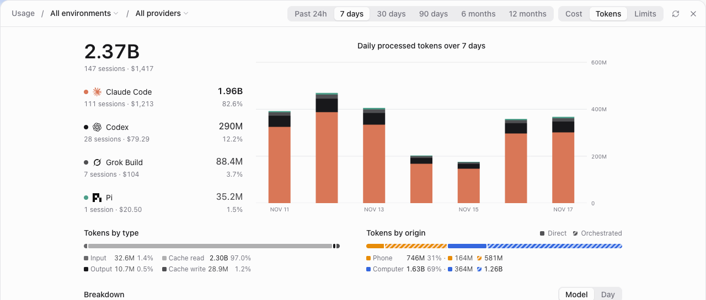

The captain reads the Usage page for where the tokens went, so the Tokens and
Cost tabs on web and desktop put the figures he compares where the eye can
compare them:

- **No Totals row.** Upstream's row of five totals repeats the type bar. Cache
  savings moves beside the **Cost by type** heading.
- **The other figure rides along.** Under the headline the Tokens tab shows the
  sessions and the dollar total, and the Cost tab the sessions and the token
  total. A provider's row shows the tab's figure one size up, then its sessions
  and the other figure, with its share at the right under the figure.
- **Figures fade by size.** The largest figure in a group is at full strength,
  the smallest at 70%, and the rest are placed between by order of magnitude,
  so billions stand apart from millions. On provider rows a figure in the top
  fifth of that scale is bold; in the captain's words, "if it's in a league of
  its own, then it should be separated from the others". The scale never spans
  less than one order of magnitude, so three providers of similar size all stay
  bold rather than being stretched apart.
- **Figures sit in columns.** Tokens by type, Cost by type and Cost by speed
  print each part's share and set the parts two to a line, in the order Input,
  Cache read, Output, Cache write, so every M and B, percent sign and colour
  square is directly above its like. A fifth part (Other, on Cost by type)
  follows the second line where it fits. Tokens by origin sets its figures in
  columns too.
- **The chart is as tall as the provider list.** With four or more providers
  the bars stretch so the chart ends level with the last row. It is never
  shorter than upstream's. Its value labels sit on the right of the bars, and
  its title is centered over them; upstream puts the labels on the left and
  the title flush left.
- **Whole dollars from $100.** The page's standing dollar figures drop cents
  from $100 up (`formatUsdShort`). The chart's tooltip and a model's pop-up
  keep cents.

The mobile app keeps upstream's layout. A model's pop-up uses the same bars,
so its legends take the columns, shares and fade too.

For syncs, the fork's parts are: the provider rows, the headline's second line
and the missing Totals section in
`apps/web/src/components/usage/UsagePage.tsx`; the legend in
`UsageShareBar.tsx` and the segment order in `usageBreakdown.ts`; the legend
in `UsageOriginBreakdown.tsx`; `min-h-56 flex-1` in place of upstream's fixed
`h-56` and the value labels after the plot in `UsageProviderChart.tsx`, with
the chart title's `pr-16 text-center` in `UsagePage.tsx`; the scale in
`usageEmphasis.ts`; and `formatUsdShort` in `packages/shared/src/usageFormat.ts`.

Upstream: none.

## Accounts in your order

Every usage view lists a provider's accounts in the order Settings › Providers
lists them, so an account never jumps around as its reset times change.

Wherever usage lists a provider's accounts (the Usage page's Limits columns,
the sidebar readout, the composer's `/usage-limits` panel, and the mobile app's
Limits view and widget), they go in the order Settings › Providers lists the
provider instances: the default instance first, then the others as saved.
Accounts no listed instance reports, such as hub-only accounts, go after, by
name. Upstream's `collectLimitPools` (#10690) orders accounts by the soonest
reset of their first window kind, so the account with a live five-hour session
jumps to the left; the fork keeps accounts where the providers tab puts them.
Both keep one order for every window row, so columns stay aligned. The rule is
`sortByProvidersTab` and `LimitAccount.providerOrder` in
`packages/shared/src/usageLimits.ts`; syncs must carry it.

Upstream: none.

## Limits in the sidebar

The sidebar shows one small bar per account with what is left of its week and a
pace mark, so you see your limits without opening the Usage page.

The captain wants usage visible without opening the Usage page, so the web and
desktop sidebar shows a small readout between the thread list and the bottom
icons: one line per account the Limits view shows, with its provider's icon, a
thin bar in the account's accent colour and the percent left in that account's
own weekly window, or its first window when it has no weekly one. A provider
with several accounts (Claude and Claude2) gets one line each, because each
account resets on its own clock. A provider's lines follow the providers tab
(see [Accounts in your order](#accounts-in-your-order)). Model windows such as Weekly · Fable stay on
the page. Each bar carries the Usage page's pace mark: a small line, in a gap
cut from the bar, where the bar would end if usage kept pace with the time
elapsed in that account's window. The tooltip names each account (its display
name, else the provider) with its figure, how much of the window is left and
its reset time, and says what the line means; a click opens the Usage page. It reads the same provider
statuses as the Limits view and fetches nothing, shows nothing until limits
arrive, and leaves out providers muted on the page. The phone web sidebar shows
it too; the mobile app does not.

Upstream code it touches, for syncs: `useLimitPresentations` is the Limits
view's environment and muted-provider filter, moved out of
`UsageLimitsSection` in `apps/web/src/components/usage/UsageLimits.tsx`, and
`saveUsagePagePreferences` now writes through `writeLocalStorageValue` so the
sidebar hears a mute in the same tab (`usagePagePreferences.ts`). The mount is
one line in `SidebarChromeFooter`. Code:
`apps/web/src/components/sidebar/SidebarUsageMini.tsx`.

Upstream: none. Open PR [#31597](https://github.com/pingdotgg/t3code/pull/31597)
(by an outside contributor, not merged) adds a different, opt-in usage popover
to the sidebar.

## Archived usage

Usage includes copies of history from machines and accounts that no longer run
T3. The server setting `usageArchiveDirs` lists the archive folders. It
defaults to `["~/.t3-usage-archive"]` and can be changed in
`~/.t3-fork/userdata/settings.json`. Code: `apps/server/src/usage/usageArchive.ts`.

- Each folder directly under an archive folder is one host, and its name is
  the host label. Inside it, the copy keeps the original machine's layout, such
  as `<host>/home/.claude/projects`.
- These are read: Claude `projects/`, Codex `sessions/`, Grok
  `.grok/sessions/`, and a T3 server's saved usage
  (the newest `usage-scan-cache*.json` in a folder, version 3 on).
  Saved usage still has usage whose transcripts were deleted. Version 3 caches
  are priced at standard speed. OpenCode, Pi and Antigravity copies are not
  read.
- Archived usage is parsed and deduplicated like live history. Live
  directories are read first, so usage that is both live and archived counts
  once and stays credited to the live source.
- Archived folders join the live ones (`addArchivedDirs` in `UsageService.ts`)
  before upstream decides whether a provisional read can answer from saved
  usage, so an archived folder must be covered by a complete scan too.
- A remote that still runs T3 and is connected would be counted again next to
  its archive copy. Archive a host after T3 is removed from it.

Upstream: none.

## Phone vs computer split

The Usage page splits tokens and cost by where the work started: on your phone
or your computer, typed by you or started by an agent for you.

The captain wants to see the prompts he sent from his phone and the work they
started, so the Usage page on web and desktop has a **Tokens by origin** bar
(Cost by origin): the period's usage split between phone and computer, direct
or orchestrated. Usage with no phone evidence counts to the computer; in the
captain's words, "the computer is sort of its true back end … ever since we
have T3 code we're starting to add phone label to what would otherwise be
computer". It is built from what T3 records (see
[Which device sent it](#which-device-sent-it))
and what agents claim.

- A prompt is a user-role message. A run belongs to its `userMessageId`,
  until a message typed on a phone or computer steers it: from then on the
  turn counts to that device.
- Stamped messages go by `origin`: `mcp` or `bot` is Agent; `mobile` or
  `tablet` devices, and the native app, are Phone; `desktop` is Computer;
  anything else is Unknown. Unstamped messages: `creationSource` `mobile` is
  Phone (labelled as from the phone app, before stamps); `createdBy` `agent`
  or `creationSource` `mcp`/`provider` is Agent; everything else (older web
  messages, server-made messages) is Unknown.
- An agent prompt (Agent or crew) follows its recorded cause (see
  [Work records its cause](#work-records-its-cause)):
  its own `causedBy`, else its thread's. If the chain reaches a Phone or
  Computer prompt within 8 hops, the prompt and its run count there, keeping
  the root's basis and adding `via` (`agent` or `crew`) for who sent it. A
  chain that ends at an uncaused prompt whose run is claimed (below) counts to
  the claim's device, so work a claimed turn caused inherits it. Any other root
  (an agent acting on its own, a server or unstamped prompt), a missing message
  or a cycle leaves the prompt where it was.
- Work is born labelled, and a typed message re-roots it. Every thread that is
  not a pinned coordinator is one piece of work with an origin over time
  (`workTimeline` in `apps/server/src/usage/UsageOrigins.ts`): its birth (the
  `usageOrigin` T3 bound at launch, else the device its `causedBy` reaches),
  then each message that moves it, in order: a prompt typed on it, a message
  carrying a bound `usageOrigin` (an agent sent it from a typed turn), an
  older agent message whose own `causedBy` is a typed prompt, and a reply typed
  on its crew box (a coordinator message with `crewNote.kind` `reply`). The
  first run of a scheduled task in a thread of its own is that thread's birth.
  A work thread's turn counts by its own prompt when that moves the work (or a
  scheduled run's bound origin), else a run claim on it, else the work's
  origin when it started, else the recorded-cause rule above; a move that
  lands mid-turn splits the turn there. A coordinator's turn keeps the rules
  above. The captain's settle, un-settle, snooze and un-snooze notes are clicks
  (`crewNote.kind` `action`): one never counts as typed, and its turn counts
  where the crew thread's work counted then. Approvals send no message.
- T3 binds by value, through `UsageOrigins.originAt`: where a thread's work
  counted at a moment, read from the turn running then (or ended up to five
  minutes before), segment by segment, else, between turns, a work thread's
  origin or a coordinator's upkeep. `t3_thread_launch`, `delegate_task`,
  `create_threads` and `t3_thread_transfer`'s fork store it on each new thread
  as `usageOrigin` (reason `typed` stored as `inherited`), so a delegated child
  or a fork no longer copies its parent's birth; a provider's own subagent
  child drops its parent's `usageOrigin` and `causedBy` too.
  `t3_thread_launch` with `upkeep: true` (FirstMate's own upkeep, work a
  process set up on the computer runs, such as the bedtime routine) binds
  nothing and stores `computer`, basis `claim`, reason `upkeep`, also over a
  link; it is refused beside `fromThread` or `causedBy`. `t3_thread_send`
  and `t3_thread_send_attachments` store it on the message only when the
  sender's segment was started by a prompt typed in that turn or is a
  voice-journal claim (`reroots`), so only typed input moves work. `schedule_task` stores the creating turn's origin in the fork
  table `usage_scheduled_task_origins`, and an edit from a typed turn rebinds
  it. `t3_restart_request` binds when given `fromThread` and keeps the value on
  the request; the restart note carries it, and each restart continuation
  carries where its cut turn counted (the request's value instead when that
  turn only counted as upkeep, or to no device, in a thread with no origin of
  its own). A value the server bound (`creationSource` `server`) labels its own
  turn and moves no work. Every stored origin keeps `root`, the typed prompt
  (`threadId`, `messageId`) that decided it, copied unchanged as work inherits;
  rules (a journal, upkeep, a terminal) have none, and Usage never adds tokens
  up by it. The calling thread is the MCP caller's own thread; a caller
  outside threads, such as FirstMate's scripts, names it as
  `fromThread: { threadId, at? }`, with `at` when a job that outlived its turn
  began. A thread's agent may name only itself, and never with `at`. Callers
  that name neither bind nothing, and a read failure or a bug in Usage never
  holds work back.
- Tokens are joined before aggregation: a transcript record's native
  `sessionId` finds the provider thread (`nativeThreadRef.nativeId`), and its
  timestamp the turn running then. A record outside its session's turns (a
  worker's background work running on) counts with its thread: its latest
  turn's label, or, when the work thread was moved after that turn started,
  where its work counts at the record's time. Origins split the
  kept records after dedupe and the model filter, counting a duplicate's merged
  copies once in upstream's `#accumulate` as its bucket does, so they add up to
  the page's totals.
- Agents claim what T3 can't trace with `t3_usage_claim`: a target of
  `sessionId` or `directory` (a session run outside T3, such as a pipeline),
  or `threadId` + `runId` (a turn whose prompt has no cause, such as a
  FirstMate wake; `threadId` alone names its turn running now, by the rule
  `originAt` uses), and a value of `causedBy` (counts like an agent prompt with
  that cause), `fromThread` (bound by value now, or at `at`, from where that
  thread's work counts, so a wake about a task follows the task after it is
  re-rooted; refused when that is no device; stored as the device plus
  `bound_json`, its basis and reason) or `device` (counts straight to `phone`
  or `computer`, basis `claim`: FirstMate marks voice-journal work `phone`).
  A session claim may take `from` (an ISO time), for a session resumed for
  different work, such as FirstMate's supervision engine: a record counts to
  the session's latest claim started by then, and a record before every start
  traces as if unclaimed; a claim with no `from` covers the whole session.
  Claims live in the fork table `usage_claims`, one per target and start;
  claiming again replaces one unless `ifUnclaimed` keeps the first (answered
  with `kept`, so a wake drain never overwrites a journal claim), and
  `causedBy: null` removes it. A claimed turn counts there unless its own
  prompt already traces.
- A pinned coordinator's turn (FirstMate's thread, or a secondmate's) that
  no claim names and no person typed (a wake, a background command's update,
  a server prompt, a turn with no prompt) is its upkeep: it counts to the
  computer with reason `upkeep`, keeping its prompt's basis, and work it
  causes inherits that, so FirstMate claims no upkeep. Any claim names the
  turn, even one whose cause traces nowhere, and a typed prompt keeps its
  device. `t3_thread_read`'s `recentRuns` carry each run's
  `userMessageId`, a wake's notification included, so an agent can name a
  wake turn as `causedBy` for work it launches.
- A record in no T3 turn of its own session traces by claim, then by folder.
  A session or folder claim counts as above. Otherwise the
  record's working folder (`cwd`, kept by the scanner for Claude, Codex and Grok)
  decides: a folder named for a T3 session's native id (Claude's scratchpad),
  a thread's worktree, or a claimed folder, deepest first. A worktree counts to
  the latest turn started there by any thread, since slots are reused. A
  record of a T3 session never traces by folder.
- Usage still without a phone or computer settles in `settleOrigin` to the
  computer: `computer`/`default`, keeping `via` for agent work. Usage that can
  never trace says so in its basis: anything before
  `USAGE_ORIGINS_RECORDED_SINCE` (7 Nov 2026, when device stamps shipped) is
  `computer`/`beforeOrigins`, and archived history from other machines and
  account-only usage (a provider account's history, such as Cursor's) are
  `computer`/`archive`. The web folds every row that is not phone into the
  computer, so older servers' `unknown`, `agent` and `crew` rows count there
  too; usage in no origin row stays out of the bar.
- A day's labels are written down once (`UsageClose.ts`). After a Usage read,
  when the open tail (since "closed through", or since
  `USAGE_ORIGINS_RECORDED_SINCE` before the first close) is longer than 48
  hours, the server reads the UTC days it spans and labels every record and
  prompt older than 24 hours by the rules above, in fork tables:
  `usage_closed_session_labels` (a row each time a session's label changes,
  read at each record and at each of its turns' segments and ends, with the
  turn's run and whether it was typed), `usage_closed_prompt_labels` (one per
  prompt) and `usage_close` ("closed through"). Rows keep the label before
  settling plus the `device` it counts to. The close reads every record back
  through the new rows in the same transaction and rolls back, with a warning
  in the log, if any differs. Records of one session at one millisecond share
  a row, so they take the first one's label and are not compared. From then on a record at or before "closed
  through" takes its session's latest row (then settles as below), and a
  prompt its row; only the open tail runs the rules above, so a later claim or
  code change never re-labels a closed day. Only an audited correction does:
  `t3 usage relabel --manifest <file> --dry-run|--apply` (`UsageRelabel.ts`)
  takes each closed row with its old and new label, is refused whole unless
  every row still holds its old one, backs up the closed tables to
  `usage-relabels/` in the state folder, and records the change set with every
  old value in `usage_relabels`, so `--undo <id>` restores it exactly. A dry
  run opens the database read-only; apply is safe beside a running server, and
  Usage reads closed rows on every read, so no cache needs clearing. A session with no row by then (a
  transcript found late) still runs them. `originAt` at a closed time answers
  from the thread's sessions' rows within a turn and its grace, and as upkeep
  for a coordinator between turns; a work thread between turns still reads its
  timeline, since a run claim on its last turn names only that run.
- Every settled record also carries a `reason`, kept on the server: `typed`,
  `inherited`, `journal`, `upkeep` or `terminal` when there is device
  evidence, else what is missing (`unregisteredSession`,
  `unmatchedRegistration` for a registered session whose thread or task
  matched no turn, `unnamedTurn`, `noCause`, `untracedCause`, `noPrompt`,
  `unknownDevice`, `serverPrompt`, `unstamped`, `beforeStamps`, `archive`,
  `accountOnly`; `lateRecord` is no longer produced), plus the claim kind
  (`run`, `session`, `directory`) that decided it, whether a registration or a
  folder matched it, and `cause` when a recorded `causedBy` (a thread's, a
  message's or a claim's) decided it rather than a stored value. The
  read-only MCP tool `t3_usage_reasons` (`days`, default 7, ending `untilDay`
  in `timeZone`) returns those tokens per provider, marks the no-evidence rows
  `byDefault` and totals them in `byDefaultTokens`, and fails rather than
  answer zero when origins cannot be read. `t3 usage reasons` prints the same
  figure from the shell (`--json` for the raw rows), signing in to the running
  server like `t3 thread`.
- The scan cache keeps each record's `cwd` from the fork's v16. Moving from v15
  re-parses live Claude and Codex transcripts changed since 28 Oct 2026, when T3
  turns began; older files keep their saved records, which cannot trace by
  folder. Upstream's own v16 (Codex baseline time) arrived the next night, so
  the fork reads it as v17 and a fork v16 Codex file re-parses once; upstream's
  v17 (Grok turns keyed by time) is the fork's v18, so Grok files from a fork
  v16 or v17 cache re-parse once. Grok lines carry no folder, so its reader
  decodes the session's group folder name (or reads the `.cwd` file Grok writes
  for a name over 255 bytes); the fork's v19 re-parses Grok files changed since
  28 Oct once to add it. On syncs, an upstream cache bump becomes the fork's next
  number, never upstream's.

The server sends `origins` on `UsageSummary` (optional; usage rows keyed by
origin, basis, `via`, provider and source with no day, so the payload stays small),
and clients merge the rows with the same source ownership as buckets. The mobile app gets the merged
figures but does not show them yet. Code: `apps/server/src/usage/UsageOrigins.ts`
(classifier, cause chains, SQL, turn index), `attributeOrigin` and `countPrompt` in
`usageAggregation.ts`, `readOriginReasons` in `UsageService.ts`, `mergeOrigins`
in `packages/shared/src/usageMerge.ts`, `apps/server/src/cli/usage.ts`, and
`apps/web/src/components/usage/UsageOriginBreakdown.tsx`.

FirstMate half, in the FirstMate fork:
[Nightly usage-labels check](https://github.com/dascapytal1559/firstmate/blob/main/FORK.md#nightly-usage-labels-check).

Upstream: none.

## Usage export

`t3 usage export` prints every model call exactly as the Usage page counts it,
one JSON line each, so another program can keep T3's own figures.

So another program (the captain's life archive) can keep exactly T3's figures
without working them out again, `t3 usage export --since <day>` prints the
running server's usage as JSON lines, one per model call, as the Usage page
counts it: deduplicated, aliased, priced and labelled. `--until` (default
today) and `--time-zone` (default the server's) set the window. A line, with
made-up values:

```json
{
  "at": "2026-11-10T09:14:02.511Z",
  "provider": "claude",
  "model": "claude-opus-5-5",
  "sessionId": "5f0c…",
  "callId": "msg_01…:req_01…",
  "tokens": { "input": 12, "cacheRead": 184220, "cacheWrite": 3105, "output": 890 },
  "costUsd": 0.1342,
  "origin": {
    "device": "phone",
    "started": "orchestrated",
    "via": "agent",
    "basis": "stamp",
    "reason": "inherited",
    "cause": true,
    "promptThreadId": "thread-7"
  },
  "final": true
}
```

- `costUsd` is null when no price is known; `origin` is null when the server
  cannot read its T3 prompts. `started` is `direct` when the device's own
  prompt started the work, `orchestrated` (with `via`) when an agent sent it.
  `basis` and `reason` are as in [Phone vs computer split](#phone-vs-computer-split).
- `callId` names the model call the same way in every export, whichever
  transcript T3 read it from: a forked conversation, a deleted old file or a
  reader change can move a call to another `sessionId` or `at`, but not to
  another `callId`. It is the key T3 already drops duplicate copies by: for
  Claude the message and request ids; for other providers their own ids, some
  together with the session id; for an older Codex session that spans files,
  the session, time, model and tokens. It is null when the provider names no
  id. Key a kept record by `(provider, callId)` when it has one, else
  by `(provider, sessionId, at)`.
- `final` is true once the record's label is written down and will not change:
  a close writes down every record older than 24 hours (not a whole day), and a
  transcript found after its time was closed stays not final, since its label
  is still worked out live. Re-export days with records that are not final yet.
  Cost follows T3's price list, which can still change.
- The lines come from `GET /api/usage/export?since=&until=&timeZone=` with a
  session that has the same diagnostics read scope as the Usage page; the
  command signs in with a short-lived, read-only session of that scope. It is
  a route rather than an MCP tool because a week runs to tens of megabytes.

Code: `onRecord` and `toUsageExportRecord` in
`apps/server/src/usage/usageAggregation.ts`, `readRecords` in `UsageService.ts`,
`apps/server/src/usage/usageExportHttp.ts`, `UsageExportRecord` in
`packages/contracts/src/usage.ts`, and `apps/server/src/cli/usage.ts`.

Upstream: none.

## Chart annotations

Dated notes from a file of your own show on the Usage chart: a thin line rises
from the date to a dark chip with your label. The small signpost button at the
top right of the chart, above its scale, switches them off and on.

Put the file at `usage-annotations.json` in the server's data folder
(`~/.t3-fork/userdata/` for the desktop app). It is a list; each note has a
`date` (a calendar day in the chart's time zone), a `label`, and optionally
`"logo": "t3"`, which draws T3's logo after the label:

```json
[
  { "date": "2026-03-04", "label": "Launch" },
  { "date": "2026-05-20", "label": "New editor +", "logo": "t3" }
]
```

- A note shows on every period that covers its day; in Past 24h it sits on the
  hour holding that day's midnight. With several servers selected, each
  server's notes show, once each.
- Chips sit just above the bars under them and clear of each other, beside
  their line when the bars under its centre reach the top. Only when the bars
  leave no room anywhere near it does a chip cover the top of one. Chips never
  take the mouse, so the tooltip works under them.
- The server reads the file on each Usage request, so edits show on the next
  refresh. A missing file means no notes and no button; a file that is not
  such a list is ignored, with a warning in the server log.
- The notes stay on that server and reach only the clients it serves, inside
  the usage summary they already read with the diagnostics read scope. Nothing
  in the repo or a build carries them. The on/off choice is saved per browser.
- The mobile app does not draw them.

Code: `apps/server/src/usage/usageAnnotations.ts` (read in `readSummary` in
`UsageService.ts`), `UsageAnnotation` in `packages/contracts/src/usage.ts`,
`apps/web/src/components/usage/usageAnnotations.ts` (placement) and
`UsageChartAnnotations` in `UsageProviderChart.tsx`.

Upstream: none.

## Banked resets on a Mac

On a Mac, Claude accounts show their banked weekly and Fable resets and let you
redeem them, as Codex accounts already do, and each limit row offers only the
resets that refill it.

Upstream shows and redeems Claude's banked resets (weekly and Fable resets)
using the Claude Code login's access token, but reads that login only from
`<config folder>/.credentials.json`. On macOS, Claude Code keeps it in the
Keychain instead, so upstream skips macOS. It probably does that on purpose, to
avoid Keychain prompts and to avoid handling secrets there. The fork reads it on
macOS too, so Claude accounts there show banked resets the way Codex does.

- Each Claude provider instance reads only its own account's Keychain entry,
  through `/usr/bin/security find-generic-password`. It names the entry the
  way Claude Code does: `Claude Code-credentials`, plus `-` and the first 8 hex
  characters of the SHA-256 of `CLAUDE_SECURESTORAGE_CONFIG_DIR`, or else
  `CLAUDE_CONFIG_DIR`, whenever the CLI runs with one of them set. The account is `$USER`. The env used is the one the CLI
  itself gets (`makeClaudeEnvironment`).
- Only the access token is used. It stays in memory, and failures carry no
  output, so it never reaches a log, a file or a client. The login is never
  refreshed: a missing, denied, malformed or expired entry just means no
  resets show until Claude Code renews it. Redeeming is still a click.
- macOS may ask once per account to allow the read ("Always Allow").

When syncing, keep upstream's request, parsing and redemption code as is, apart
from the windows the fork also reads from that response (see
[Limits stay current](#limits-stay-current)). The fork's part is `claudeKeychainService` and `readKeychainAccessToken`, called
from the darwin branch of `readAccessToken` in
`apps/server/src/provider/claudeResetCredits.ts`, plus the `cliEnvironment`
that `ClaudeDriver.ts` passes to it. If Claude Code changes how it names the
entry, update `claudeKeychainService` to match. Open upstream PR
https://github.com/pingdotgg/t3code/pull/34099 reads the same Keychain entry
the same way; if it lands, take upstream's.

### Each limit row counts only the resets that refill it

Upstream offers each kind of reset (5-hour, weekly, Fable, full) as its own
option, but the Usage page badges every row with the account's total, so a
Fable-only reset shows on Session and Weekly too and can be redeemed from them.
The fork badges and offers a reset only on the rows it refills: Session gets
5-hour and full resets, Weekly gets weekly and full resets, and Weekly · Fable
(`seven_day_fable`) gets only Fable resets. A weekly row for any other model
Claude scopes (`seven_day_<model>`) gets none, so a second scoped model never
shows the Fable reset. The count, the segment's accessibility label, the
popover's Use buttons (web) and the account screen's reset list (mobile) all
follow it.

Upstream likely means to do the same: open PR pingdotgg/t3code#33553 (for
issue #33509) badges each grant only on the windows Claude says it clears, but it
reworks the server's grant reading and predates the per-kind options. The fork
keeps upstream's reading and only adds a `kind` to each option (`kind` in
`ServerProviderResetCreditOption`, set in `claudeResetCreditsToContract`).
`resetCreditsForWindow` in `packages/shared/src/usageLimits.ts` maps kinds to
rows and treats an option with no known kind as refilling every row. If upstream
lands per-window resets, take its version and drop the fork's `kind`.

Upstream: partly: it shows and redeems Claude's banked resets everywhere but
macOS, and offers every reset on every row. Open PRs
[#34099](https://github.com/pingdotgg/t3code/pull/34099) (macOS) and
[#33553](https://github.com/pingdotgg/t3code/pull/33553) (resets per row), both
by outside contributors, not merged.

## Limits stay current

Usage limits show a fresh reading on every check, Refresh included, and say how
old the reading is wherever they appear.

Upstream reads Claude's 5-hour, weekly and per-model windows through the CLI
(`get_usage`) and caches that probe for 5 minutes, so Refresh on the Usage page
could show numbers up to 5 minutes old. Its periodic checks also pause while no
window is in front, and nothing says how old the numbers are. Anthropic computes
the numbers live on each read but limits how often it may be asked, so the fork
keeps the 5-minute interval and changes the rest:

- Claude's windows come from the `/api/oauth/usage` read that banked resets
  already make on every check (`readClaudeOauthUsage` in
  `apps/server/src/provider/claudeResetCredits.ts`, mapped by
  `claudeOauthUsageRateLimits` in `claudeUsageLimits.ts`). Every check,
  Refresh included, shows a fresh reading with no extra request. The CLI's
  cached reading is the fallback when that read fails, and still supplies
  monthly spend, which the read skips (`skip_spend=1`). The merge is in
  `checkClaudeProviderStatus` (`ClaudeProvider.ts`).
- A client coming back to the foreground gets one check if the last one is
  older than the interval, and the interval restarts from it
  (`foregroundReturns` in `apps/server/src/background/BackgroundPolicy.ts`,
  passed through `ProviderHost`, handled by `refreshOnForegroundReturn` in
  `packages/provider-core/src/server/managedProvider.ts`).
- Web and desktop say how old the numbers are wherever they show limits: each
  provider on the Usage page (its oldest account) and each account's popover,
  the composer's usage panel, the thread details panel, and the sidebar bars'
  tooltip (`apps/web/src/components/usage/LimitsUpdated.tsx`). The mobile app
  is unchanged.

When syncing, if upstream changes the usage read or Claude changes the response,
check `claudeOauthUsageRateLimits` against a fresh body; its test holds a
recorded one. If upstream adds its own foreground check or reading age, take
upstream's and drop the fork's.

Upstream: none.

## Limits history

T3 keeps every usage-limits reading in a monthly log, so you can later see how
close each week came to its limit.

Providers only ever answer with the limits as they stand now, so the server
keeps a log of every reading it gets, to show later how close each week came to
its limit. Each time a provider's or a limit source's limits refresh, the
reading goes onto one file per UTC month beside the session register:
`~/.t3-fork/userdata/usage-limits/2026-11.jsonl`. A line, with made-up values:

```json
{
  "v": 1,
  "at": "2026-11-17T01:10:00.000Z",
  "provider": "claude",
  "instanceId": "claude",
  "account": "someone@example.com",
  "windows": [
    {
      "id": "five-hour",
      "kind": "session",
      "label": "5h",
      "usedPercent": 41,
      "resetsAt": "2026-11-17T05:00:00.000Z"
    },
    { "id": "seven-day", "kind": "weekly", "label": "Week", "usedPercent": 12 }
  ]
}
```

- A reading is written when a figure or a reset time moved, and at least hourly
  otherwise while readings come in, plus once per account each time T3 starts.
  A gap means no reading came in: T3 was not running, its provider refresh was
  off or held back in the background, or the account's limits were unavailable
  (those readings are left out). Accounts read through a limit source carry
  `source` (its label) instead of `instanceId`.
- The files are append-only, one per month, and are never pruned. They hold no
  credentials: no tokens and no credential fingerprint.

Code: `apps/server/src/usage/UsageLimitsLog.ts`.

Upstream: none.

## App-bundled tools

A provider CLI that lives inside a Mac app is left for that app to update, so T3
never offers an update that fails or changes the wrong copy.

On macOS, a provider CLI whose real path is inside an app bundle
(`*.app/Contents/...`) is left to that app. T3 shows no Update button for it and
never runs its updater. Upstream already does this for the usual app-bundled
Codex, through the standalone check on `CodexDriver`. The fork guard covers the
rest: providers whose native updater has no such check (Pi's `update --self`,
Claude) and package-manager layouts inside an app. Without it they offer an
update that fails or changes the wrong copy. This works like upstream's handling
of WinGet's Claude, in `packages/provider-core/src/server/maintenanceResolver.ts`.

Upstream: partly: it does this for the usual app-bundled Codex.

## `~` in tool paths

A provider path that starts with `~` works for every provider. Upstream's Grok,
Pi and ACP registry drivers use a configured path such as `~/.local/bin/grok`
as written. Processes launch without a shell, so the provider shows as not
installed. Here each of those drivers expands a leading `~` with
`expandHomePath` before probing, spawning, resolving maintenance or reporting
status, as Codex, Claude, Muse, OpenCode, fx, Kiro and Antigravity do upstream
(fx, Kiro and Antigravity since upstream #35171, which replaced the fork's own
change there). Cursor never runs its `binaryPath`, so it is unchanged. When a
sync finds upstream expanding `~` in these drivers, keep upstream's. Open
upstream PR https://github.com/pingdotgg/t3code/pull/29330 does this for
OpenCode, Grok and Pi, not the ACP registry.

Upstream: partly ([#35171](https://github.com/pingdotgg/t3code/pull/35171), for
fx, Kiro and Antigravity). Open PR
[#29330](https://github.com/pingdotgg/t3code/pull/29330) (by a maintainer, not
merged) covers OpenCode, Grok and Pi.

## Agents kept alive

Idle agents can be kept running for good, or released after a time you choose,
instead of always being closed after 30 idle minutes.

The server setting `providerSessionIdleTimeoutMinutes` (whole minutes from 1 to
1440, default 30, `null` is Never) replaces the hardcoded 30-minute idle
release. It has no control in the app: edit
`~/.t3-fork/userdata/settings.json`, for example
`"providerSessionIdleTimeoutMinutes": null`. The running server picks the
change up, including for agents already idle. Firstmate's environment sets it
to Never. This is the server half of upstream
https://github.com/pingdotgg/t3code/pull/25624, without its web and mobile
controls. Upstream closed that PR on 17 Nov 2026 as not something it wants to
take on, so the setting stays the fork's. If upstream ships an equivalent, drop
this copy and keep upstream's.

Upstream: none. This is the server half of
[#25624](https://github.com/pingdotgg/t3code/pull/25624), by an outside
contributor, which upstream closed unmerged on 17 Nov 2026.

## Upstream release note

The sidebar tells you when upstream T3 Code ships a new release, so you know
when to ask FirstMate to sync the fork.

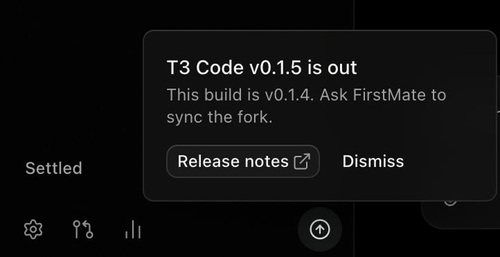

The fork has no update feed, so it never hears about upstream releases. When
`pingdotgg/t3code` publishes a stable release newer than this build, the
sidebar update icon shows "T3 Code vX.Y.Z is out", with links to the release
notes on GitHub and a Dismiss that holds until the next newer release. Nothing
downloads or installs; the captain asks FirstMate to sync the fork. It checks
at start-up and every 6 hours, keeps the last result when GitHub is
unreachable, and stays off whenever an update feed is configured or the
desktop updater is running. Code: `apps/web/src/state/upstreamRelease.ts` and
`apps/web/src/components/sidebar/SidebarUpstreamRelease.tsx`; a later "Ask
FirstMate to update" button belongs in that popover.

Upstream: none.

## Board

A Board tab in the side panel lets you sketch on screenshots and attach the
result to the chat.

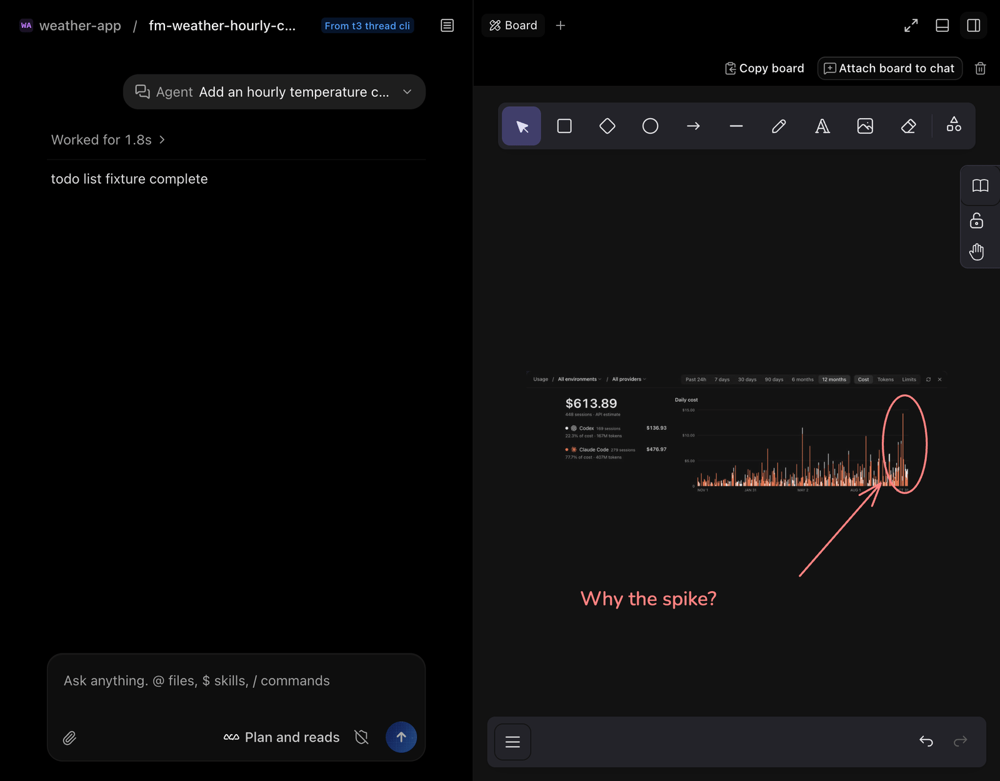

A quick annotation canvas that opens as a "Board" tab in a chat's right panel,
from the panel's launcher or "+" menu (W) or "Open board" in the command palette.
It is Excalidraw (MIT), loaded only when the tab shows. Screenshots pasted with
Cmd+V while focus is in the panel land in the middle of the view. The board is
saved in the client's IndexedDB, one board per client, shared by every chat's
Board tab. "Attach to chat" sends the selection, or the whole board, as a PNG to
the composer of the chat beside the panel, and "Copy" puts the same PNG on the
clipboard. The canvas is marked
`data-editable-canvas` and `role="application"` so its keys (tool letters, Cmd+Z,
Delete) are not taken by type-to-focus or thread undo. Code:
`apps/web/src/components/board/`.

Shared files it touches, for syncs: the `board` surface kind in `rightPanelStore.ts`
(and `closedViewStore.ts`), the launcher and "+" menu entries and tab title and icon
in `RightPanelTabs.tsx`, `RightPanelSurfaceContent.tsx`, `useRightPanelActions.ts`,
the props in `ChatView.tsx` and `PullRequestsPage.tsx`, a command palette item, the
selector in `lib/editableFocus.ts`, the Excalidraw font asset path in
`apps/web/vite.config.ts`, and licence notices. Excalidraw's canvas fonts are
served from the app because the desktop CSP blocks the CDN Excalidraw would
otherwise use. Excalidraw pins Radix Tabs 1.0.2, whose React peer range stops
at 18, and upstream's `strictPeerDependencies` refuses that, so an override in
`pnpm-workspace.yaml` moves it to a 1.1 release that accepts React 19. The
mobile app has no board.

Upstream: none.

## Crew in the sidebar

FirstMate and the workers it launches sit together at the top of the sidebar as
one tree, and each worker's card says what it is doing, such as "Testing" with a
timer.


A FirstMate session and the worker threads it launches are grouped above the
sidebar inbox and kept out of Working. The main session is a two-line card: its
project and status, then its title. While it is idle, the status slot reads
"started 1d ago" instead of the last activity time, because age is what says a
long session is due for a fresh one; Working, Waiting and anything that needs
the user show as usual. The age is the thread's, since a `/clear` keeps the
thread. Neither it nor anything in its tree shows a branch line, since a worker's
branch matters little inside FirstMate; other threads and the hover card keep it
(`isThreadMetaLineEmpty` in `apps/web/src/components/Sidebar.logic.ts`). Its crewmates hang below it as a
tree that collapses to a count.
A pinned coordinator (see below) gets this card even with
no crew; without any coordinator the sidebar is unchanged.

The main session is always titled "Firstmate", because a generated title for
FirstMate says nothing new. T3 only knows the thread is FirstMate's once it is
pinned as coordinator, which FirstMate does during its first turn, after
upstream's title generation has started; so pinning sets the title and drops
the generation still in flight. A fresh session on it (`/clear`, or
`t3_thread_send` with `freshContext`) sets "Firstmate" again instead of generating;
upstream generates no title there anyway, so a rename by hand lasts until then.
A secondmate is crew of the main session and keeps upstream's titles, as does
every other thread. Upstream code it touches, for syncs: two guards in
`apps/server/src/orchestration-v2/Orchestrator.ts`, on `thread.metadata.update`
and on the initial title in `message.dispatch` (`isPrimaryCoordinator`).

No card in the sidebar, crew or not, has hover Snooze or Settle; the context
menu still has both, and snoozing or settling takes a thread out of the group. Upstream
shows both on hover so a thread is put away in one click; the captain asked
for them off so a stray click cannot put a standing agent's thread away
("We don't need the hover to settle or snooze"). Upstream's hover
code stays for syncs: the sidebar passes `hideHoverActions` to every row. The
crew cards drag only as chat context. A fresh
page load on the home route opens a coordinator whatever its run status,
the most recently updated if there are several, because a restart ends every
run. A thread's Lineage panel lists its Crew or Coordinator.

A coordinator can put a short status on a crewmate's card, such as "Testing":
`t3_thread_update` with `action:'set_status_label'` and
`statusLabel` (32 characters at most), and `action:'clear_status_label'` to take
it off. The label sits where Working, Done or the age would, so the title stays plain.
Approval, Input, Request, Limited, Failed and Woke still show over it, because a
label can lag behind a thread that needs the user. A label is stored with the
thread (`statusLabel`), thread reads report it, forks drop it, and changing it
does not count as activity. Upstream decoders ignore the field; web and desktop
show it, and mobile has no crew cards. Code: `resolveCrewStatusLabel` in
`apps/web/src/components/sidebar/coordinatorGroup.logic.ts`.

The label, not background work, says whether a crewmate is finished. Crew
threads keep upstream's background rule everywhere: only a task the agent waits
on with `t3_background_wait` holds a thread at Waiting, so a dev server or
monitor a worker left running does not. A worker that ends its turn to wait on
a validation run carries FirstMate's "Testing", and every other wait FirstMate
knows of has its own label, so an unlabelled worker between turns reads as
finished. Mobile shows crew threads with upstream's status and no label.

A crew card reading "Testing" also shows how long it has read that, with the
same running timer Working uses. Upstream only times a thread's own run, so a
card has no clock for anything else; a FirstMate worker in a validation run is
usually idle while it waits, so without one the card cannot say how long the
run has taken. The thread stores when its label was first set
(`statusLabelSince`). Setting the same label again keeps its time, and only a
new label or clearing it resets it.
Other labels show no timer. Code: the crew
label slot in `apps/web/src/components/sidebar/SidebarThreadRow.tsx`.

A crew thread names its coordinator at launch: `t3_thread_launch` takes an
optional `parentThreadId`, stored as the thread's `crewOf`. MCP thread reads
report it as `parentThreadId` with `relationshipToParent: "crew"`. It stays out
of the thread's `lineage`, which upstream-built clients such as the App Store
mobile app decode strictly; one unknown lineage value there stops their whole
thread list from syncing. Crew stored in lineage by earlier builds is read back
as `crewOf`. FirstMate passes its
main session's id, and a secondmate's workers pass the secondmate's, which
stays grouped with its own coordinator. The parent must be a thread the caller
can read; naming it grants nothing on it. Unlike `delegate_task` children, a
crewmate's Stop and archive stay independent of its coordinator. Threads
launched without a parent stay out of the group, and mobile does not group
crew. Code: `apps/web/src/components/sidebar/coordinatorGroup.logic.ts`.

A server restart ends the coordinator's session, and nothing inside it can wake
it again. So after each start T3 sends a coordinator one note, attributed to
T3 Code. Its first line is `The T3 server restarted at <serverStartedAt>.`; when
no saved restart request was found the next says "No restart request was found.
It may have crashed, been restarted by hand, or followed a machine restart or an
app upgrade." Then come the crew that had a run cut (or "None of your crew threads had a run
interrupted."), and then that its session ended with whatever lived only in it,
such as background commands, waits and monitors, and to run its session-start
steps again, check what is still running, and report. A thread pinned with
`t3_thread_configure` `coordinator: true` (one per project; pinning moves it,
`false` unpins) gets the note after every start, even with no crew or while
busy, in which case it queues behind the running turn. An unpinned coordinator
gets it only while idle with unarchived crew, and once its project has a pinned
coordinator, only when the restart cut one of its crew's runs. Archived,
settled or snoozed coordinators get none, and the project's continue-after-update
setting (`continueThreadsAfterServerUpdate`) turns notes off together with
restart continuation.

A coordinator whose own turn the restart cut is the exception. When T3 is about
to resume that turn, a separate note would start first and make T3 drop the
resume, so the pinned coordinator's resume message opens with the note instead,
followed by upstream's "Continue where you left off". If T3 declines that
resume when it comes to send it (a Stop the user asked for, a cut `/compact`,
the guard against a turn that keeps crashing the server, newer work on the
thread), the note goes out on its own. When T3 is not resuming the cut turn,
for example a run that was only waiting on background work nobody marked, the
note goes out on its own as usual. So a pinned coordinator gets exactly one
message per start that opens with the restart line, whether it was mid-turn or
idle; an unpinned one T3 resumes gets upstream's resume message alone.

`t3_restart_status`, and the restart request and cancel tools that return the
same status, report `serverStartedAt`: the ISO time the note quotes, set once
per server process. A coordinator compares it with the last one it handled to
tell a restart apart without reading process ids, which also works when it was
told nothing, such as with the setting off. Thread reads report `coordinator`,
and `orchestrator_capabilities` reports `coordinatorRestartNote`. Forks and
side chats drop the pin and the crew link, so forking FirstMate cannot make a
second coordinator. Code: `apps/server/src/orchestration-v2/CoordinatorRestartNote.ts`
and its two calls in `continueRestartedRun`
(`apps/server/src/orchestration-v2/RestartContinuation.ts`).

FirstMate halves, in the FirstMate fork:
[Workers listed as crew](https://github.com/dascapytal1559/firstmate/blob/main/FORK.md#workers-listed-as-crew),
[Readable titles](https://github.com/dascapytal1559/firstmate/blob/main/FORK.md#readable-titles),
[Card status](https://github.com/dascapytal1559/firstmate/blob/main/FORK.md#card-status).

Upstream: none.

## The branching animation

When FirstMate starts a worker, its branch draws down into the crew tree, and
when the worker is cleaned up the same motion plays backwards; an optional trace
light rides the branch.

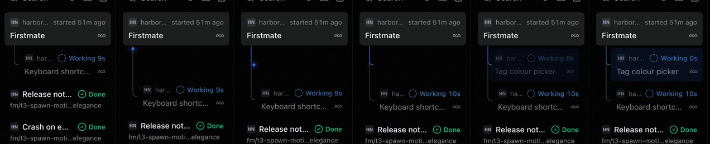

A worker's card used to appear under FirstMate in one frame. Now a space
opens, the branch draws down into it, and the card snaps in on a small spring.
When the worker's thread is archived or deleted, the same motion plays
backwards on a copy of the card: the card un-snaps, the branch un-draws, and the
space shuts. Several workers starting together enter 110 ms apart. Several
leaving together fold away as one tree, and the line never comes apart while
they do: when the last card leaves, the row above gets its trunk back for the
length of the exit, built from the tree's own element so it cannot sit a pixel
off (`createCrewTreeTrunk` in
`apps/web/src/components/sidebar/SidebarCrewTree.tsx`).

It plays once per thread, only for a thread created in the last six seconds by
its server's clock, and only for a row on screen, so a reload, a scroll or
opening the crew tree never replays it. With reduced motion the card fades in
over 180 ms and leaves at once. Every animation is a finite Web Animation that
ends by itself, and none of them changes the layout: they move, clip, fade or
recolour what is already laid out.

**Crew trace light** (Settings → Appearance, off by default,
`crewTraceLightEnabled`) adds an accent light on top without changing any of
that timing. On the way in it rides the tip of the branch as it draws, the
branch stays the accent colour for a moment and then cools, and the card gets
an accent wash. On the way out it rides the branch back up and carries on up
the line to FirstMate's card. Reduced motion drops the light too.

The timeline is one table that both directions read (`UNFOLD` in
`apps/web/src/components/sidebar/crewMotion/crewMotion.logic.ts`).
`crewMotion.ts` beside it sets the stage, `unfold.ts` is the motion and
`traceLight.ts` the light. Mobile has no crew tree, so it has neither the
motion nor the setting.

Upstream code it touches, for syncs:

- `apps/web/src/components/Sidebar.motion.ts`: the list motion's copy of a
  leaving row is now made by `copyRowForMotion`, which the crew motion also
  uses, and the list motion skips every such copy when it measures rows
  (`rowsOf`, where upstream checks its own `exiting` map). Without that, the
  next unrelated list change fades a worker's card back in where it used to
  be. A copy also loses `data-sidebar-row`, so keyboard navigation cannot land
  on one.
- `apps/web/src/components/Sidebar.tsx`: the list motion sits out a commit in
  which a crew motion started (`crewMotionClaimsListPass`), so rows never move
  twice.
- `apps/web/src/components/sidebar/SidebarThreadRow.tsx`: the
  `useCrewRowMotion` call, the `lineRef` it hands the crew gutter, and
  `data-crew-coordinator` on FirstMate's row.
- The setting: `crewTraceLightEnabled` in `ClientSettingsSchema` and
  `ClientSettingsPatch` (`packages/contracts/src/settings.ts`), its row in
  `AppearanceSettingsPanel.tsx`, its search entry in `settingsSearch.ts`, and
  its two lines in `SettingsPanels.tsx` (changed-settings label and reset).

Upstream: none.

## Reply box goes to FirstMate

On a worker's thread, the message box sends your words to FirstMate instead of
the worker, and shows how full the worker's context is.


Upstream treats every thread as a conversation the user can join. FirstMate
steers its workers through its own inbox and a message it sends over MCP, so a
message typed into a worker cuts across that. A crew thread (the sidebar's crew
membership, snoozed or settled too) has no composer: no model picker or branch
row, no way to type to the worker, and no way to unlock one.

In its place is a plain box whose words go to FirstMate, because the captain
reads a worker's report in its thread and wants to answer there: "if I'm ever
like reviewing a workers probe I could just reply right there". Sending puts
one ordinary user message in the worker's coordinator thread, queued behind a
running turn as the composer's Queue does, or starting a turn when the
coordinator is idle. The worker gets nothing. The message reads:

```
**Reply · <worker thread title>**
kept-thread: <worker thread id>

<the captain's words>
```

FirstMate reads the worker from the second line (`bin/fm-t3-worker-reply.sh`
in the FirstMate fork). `kept-thread` is the marker an earlier build sent and
that reader already knows, so it stays. Enter sends and Shift+Enter starts a
new line. The box takes text only, with no attachments, mentions or commands,
and keeps no draft when the user leaves the thread. It also carries the
[context window ring](#context-ring), for the worker's own window and
without Compact, since compacting a worker is FirstMate's call.

While the worker runs, a small Stop button sits above the box, and a Resume
button beside it (alone once the worker has stopped) whenever the composer's
Resume would show: an interrupted run to continue, or a queue held by Stop.
When the worker asks for an approval or asks a question, the full composer
comes back in place of the box until it is answered, because feedback and
custom answers use it. FirstMate's own thread and ordinary threads keep their
composer, and a thread gets it back once it leaves the crew (its coordinator or
itself archived). This is web and desktop only: the server takes messages for
crew as before, so FirstMate's MCP messages arrive unchanged, and mobile still
shows upstream's composer, which types to the worker.

Code: `crewComposerHidden` in `apps/web/src/components/ChatView.tsx`;
`CrewReply` and `CrewComposerGate` in `apps/web/src/components/chat/CrewReply.tsx`,
the message in `CrewReply.logic.ts`, and `CrewRunControls.tsx` beside them. For
syncs: `CrewComposerGate` stands where upstream's `<div className="relative">`
wraps the composer, so the composer's own lines keep upstream's indentation.

FirstMate half, in the FirstMate fork:
[Reply on a worker's thread](https://github.com/dascapytal1559/firstmate/blob/main/FORK.md#reply-on-a-workers-thread).

Upstream: none.

## Settle, never archive

Thread menus offer Settle instead of Archive, Snoozed stays pinned at the bottom
of the sidebar, and settling or snoozing a worker tells FirstMate.


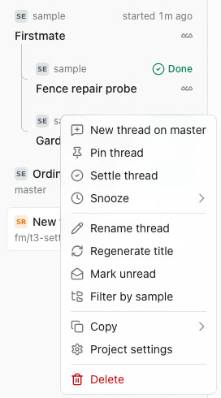

The captain puts a thread away by settling it, because settling can be undone
and archiving is something done to a thread rather than by him: "Archive is
something you do, and what I do is I settle." FirstMate archives a worker's
thread when it cleans the worker up. So on web and desktop the thread menus
(the card's context menu, a multi-selection's menu and the chat header's) offer
Settle and Un-settle and no Archive thread, and the sidebar keeps upstream's
Settled section at its end, where settled threads wait to be found and
un-settled. Archive stays on MCP (`t3_thread_organize`) and wherever upstream
uses it internally; Settings › Archived threads still lists and restores them.
The menus also leave out upstream's per-thread Auto-settle behavior, since
settling is his own act; the server's auto-settle settings still apply if
turned on, and his are off. This reverses the 11/14 choice to drop Settled and
archive instead ("we're still not gonna need settled").

Settle, Un-settle and the Settled section are upstream's
(https://github.com/pingdotgg/t3code/pull/4026). The fork's parts are no
Archive in the captain's menus, Indefinitely first in the snooze menu (see
[Indefinite snooze](#indefinite-snooze)), Snoozed pinned to the bottom, and
[settling telling FirstMate](#settling-or-snoozing-a-worker-tells-firstmate).

The Snoozed row, with its count and chevron, is pinned to the bottom of the
thread list, just above the usage readout, so a long list scrolls under it
instead of pushing it out of sight. Opening it scrolls its last row into view,
which leaves the Settled section just below. It pins to the bottom only, so
scrolling down through Settled carries it away like any section header.

The sidebar's shift guard, which drops a press on a row that just moved or
appeared without the user's input, leaves the pinned header alone: it never
slides under the pointer, and its position as the guard reads it follows the
scroll, so a press on it after a scroll was dropped.

Code it touches, for syncs: the fork's own `SIDEBAR_SETTLED_SHELF` switch
(`apps/web/src/components/sidebar/settledShelf.ts`, now a constant `true`;
upstream has no such switch, so removing it returns these files to upstream's
code), read by
`partitionSidebarThreads`, `getFallbackThreadIdAfterDelete`, the older-settled
scopes, the list items and the multi-selection menu in `Sidebar.tsx`,
`settledOutOfSight` in `CommandPalette.logic.ts`, and both single-thread menus;
the Archive thread and Auto-settle behavior items left out of
`buildThreadActionMenuItems` (`threadActionMenu.logic.ts`), with their menu
handlers in `useThreadActionMenu.ts` and `Sidebar.tsx`, `archiveThread` and
`setThreadAutoSettle` in `useThreadActions.ts`, and the Archive confirmation
setting in `SettingsPanels.tsx` removed (mobile keeps its Archive and
Auto-settle); the Snoozed header's sticky classes and
`toggleSnoozedShelfAndReveal` in `Sidebar.tsx`; the drag projection in
`Sidebar.drag.ts`, which leaves the pinned header where the browser put it;
and `readTops` in `Sidebar.shiftGuard.ts`, which skips sticky rows.

### Settling or snoozing a worker tells FirstMate

When the captain settles, un-settles, snoozes or wakes a crew thread (the
membership the [message box](#reply-box-goes-to-firstmate)
uses), the client posts one ordinary user message to its coordinator, sent the
way that box sends: queued behind a running turn, or starting one when the
coordinator is idle; the worker gets nothing. FirstMate keeps its records of
the workers in step that way. The message reads:

```
**Settled · <worker thread title>**
kept-thread: <worker thread id>
thread-action: settled
```

The other headings and action lines are `**Un-settled · …**` with
`unsettled`, `**Snoozed · …**` with `snoozed until <ISO 8601 UTC, seconds>`
(just `snoozed` when indefinite), and `**Un-snoozed · …**` with `unsnoozed`.
Every client path sends it: the menus, a multi-selection (one message per
thread), `Mod+Shift+S`, the chat's Un-settle and Wake now, dragging a thread
out of Settled or Snoozed, and Undo, which sends the reverse action. Only the
client's own actions send it, so a settle, snooze or archive made over MCP
(FirstMate's own) or by the server's sweeps (auto-settle, a snooze waking on
time or on new activity) never echoes back. Threads that are not crew, and
FirstMate's own thread, send nothing. A failed send shows "Could not tell
FirstMate"; the settle or snooze itself stands. Mobile is not covered: the
captain's phone runs the App Store app.

Code: `useTellCoordinator` in `apps/web/src/hooks/useTellCoordinator.ts`,
called from `settleThread`, `unsettleThread`, `snoozeThread`, `unsnoozeThread`
and the Undo snooze step in `useThreadActions.ts`, and from the chat's
Un-settle and Wake in `useThreadLifecycle.tsx`; the message is
`formatCrewThreadAction` in `apps/web/src/components/chat/CrewReply.logic.ts`.

FirstMate half, in the FirstMate fork:
[Reply on a worker's thread](https://github.com/dascapytal1559/firstmate/blob/main/FORK.md#reply-on-a-workers-thread).

Upstream: partly ([#4026](https://github.com/pingdotgg/t3code/pull/4026)):
Settle, Un-settle and the Settled section are upstream's.

## Indefinite snooze

Every snooze menu starts with Indefinitely: the thread stays snoozed until you
wake it or something new happens on it.

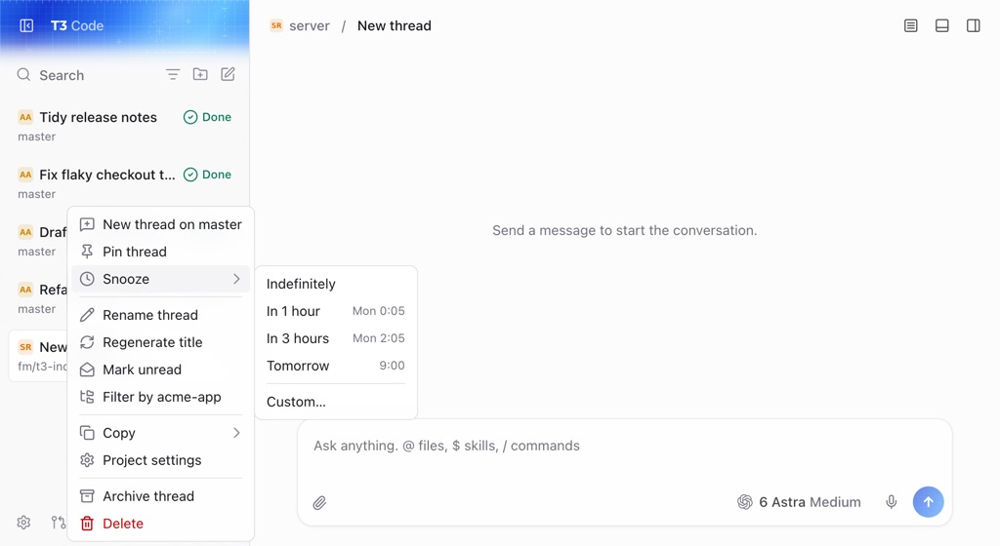

The captain wants to snooze a thread without picking a return time ("I want
the default snooze to be indefinite snooze"). Every snooze menu (the card's
context menu, a multi-selection's menu, the hover button upstream shows, and
the mobile app's swipe menu) starts with Indefinitely, above upstream's presets
and Custom…, which all stay. An indefinitely snoozed thread stays in Snoozed
until someone wakes it, or until whatever already wakes a snoozed thread wakes
it: a new message, a question or approval it raises, a failure, or pinning.
It sorts after timed snoozes and shows the alarm clock with no countdown (the
mobile row reads "Snoozed"); its chat says "Snoozed until you wake it", and a
usage-limit resume armed on it says it resumes when you wake it. Only
fork-built clients offer Indefinitely; stock clients show such a thread with a
countdown of millions of days.

It is stored as a wake time no clock reaches, `9999-12-31T23:59:59.000Z`
(`INDEFINITE_SNOOZE_UNTIL` in `packages/contracts/src/indefiniteSnooze.ts`), so
the wire command, the database and every upstream "snoozed while the wake is in
the future" check stay unchanged. Settings › Snooze options still edits only the
timed presets; Indefinitely is not one of them and always leads the menu
(`INDEFINITE_SNOOZE_PRESET` in `resolveSnoozePresets`,
`packages/client-runtime/src/state/threadSettled.ts`). MCP's
`t3_thread_organize` with `action: "snooze"` and no `snoozedUntil` snoozes
indefinitely (upstream refused it), and thread reads report an indefinite
snooze as `snoozed: true, snoozedUntil: null`.

For syncs: keep the Indefinitely entry first in `resolveSnoozePresets`, the
empty countdown in `snoozeWakeLabel`, the indefinite labels in
`useThreadLifecycle.tsx` and the mobile `ThreadDetailScreen.tsx`, and the MCP
default and read in `toolkits/thread/handlers.ts` and `threadSnooze` in
`OrchestratorMcpService.ts`.

Upstream: none.

## Quiet workers, quiet wakes

Only your own threads alert you: FirstMate's workers stay silent, and
FirstMate's thread sounds only when you started the turn or FirstMate says it
needs you.

T3's thread alerts are the sound, toast and desktop notification chosen under
Thread notifications in Settings (off by default), and the paired phone's
alerts. In the fork they come only from a top-level thread: one that is nobody's
crew, subagent or side chat.

A thread launched as crew (it has a `crewOf`) raises no alert of any kind and
is not published to the phone, in any project and however it is grouped:
snoozed, settled, or after its coordinator is archived or gone. That covers its
approval, input and failed states as well as its turn ends, because its
coordinator answers for it: FirstMate watches its workers for a pending
question or approval and brings what needs the user to its own thread. A
subagent's or side chat's request shows on its parent, as upstream has it, so
it alerts only when that parent is top-level. A worker launched without a
parent is an ordinary thread to T3 and alerts as one.

On a pinned coordinator, a turn alerts at its end only when the user's own
message started it or was sent into it. Every other turn ends quietly:
background work reporting in, a delegated task finishing, T3's restart note, or
a message another agent sent. When such a turn needs the user, the agent calls
`t3_thread_update` with `action: "alert_when_done"` (no `threadId` means its own
thread) while the turn runs, and that turn's end then alerts as usual. The call
fails with `run_not_found` when the thread has no running turn, and it cannot
be taken back. The thread stores the turn as `alertRunId`, which does not count
as activity. Clients detect the action by `alert_when_done` in the tool's
`tools/list` `action` enum. Approval, input, request, failed and usage-limit
states alert on a coordinator as on any other top-level thread.

While the mode includes sound, **Sound for** chooses which alerts play it:
Every thread (the default) or FirstMate only. With FirstMate only, FirstMate's
main thread still sounds, and every other alert, including review guide runs,
still shows its toast or notification, silently. The phone's alerts are not
affected.

Upstream has no crew, so every listed thread is the user's own and alerts.
It also alerts whenever any thread's background work reports its end: a
terminal wake ("Command … finished") alerts at once, and a progress wake alerts
after a 5-second grace when no other turn follows (#32520), so the user hears
when unattended work finishes. The fork departs because a coordinator's
workers report to it, not to the user, and its own automatic turns are
supervision, not the user's work: FirstMate's thread runs thousands of turns,
most of them such wakes, and upstream would alert at the end of each. Other
top-level threads keep upstream's behaviour.

Code: `isTopLevelThread` and `latestRunEndsQuietly` in
`packages/shared/src/agentAwareness.ts`, used by the web and desktop gate
(`apps/web/src/components/ThreadNotificationCoordinator.tsx`) and the phone
relay; `isSupervisionRunForShell` and its SQL mirror `isSupervisionShellRun` in
`apps/server/src/orchestration-v2/ProjectionStore.ts`, which put
`latestRunSupervision` on the thread shell; `alert_when_done` in
`apps/server/src/mcp/ThreadMetadataMcpService.ts`; and the
`notificationSoundScope` client setting, read by `alertPlaysSound` in
`apps/web/src/threadNotifications.ts`.

FirstMate half, in the FirstMate fork:
[Alerts only when needed](https://github.com/dascapytal1559/firstmate/blob/main/FORK.md#alerts-only-when-needed).

Upstream: none.

## Tidy instruction line

FirstMate's fixed "instruction waiting" line to a worker shows as a short
**FirstMate · New instruction** card instead of the raw command.

When FirstMate has a new instruction for a worker, it sends the worker one
fixed line (`: Firstmate instruction waiting: list "$FM_TASK_INBOX"/*.msg …`,
written by `fm_task_inbox_doorbell_line` in FirstMate's
`bin/fm-task-inbox-lib.sh`). In the worker's thread that card now reads
**FirstMate · New instruction** instead of "Agent" and the raw line; expanding
it shows the line as sent. The queued-runs control labels a queued doorbell the
same way. The worker's next step, reading the inbox file, already shows the
instruction itself.

Upstream shows text another agent sent exactly as sent, folded to its first
line under the sender's thread title or "Agent", so the user sees what the
agent was told. The fork departs only for this one line: it is a mechanical
pointer with the same words every time, so showing it says nothing. Only the
display changes; the stored message and what the provider receives are
untouched. The match is the whole line, so a message that merely mentions it
is shown as usual. The mobile app's thread card and queue label it the same
way. Code: `resolveAgentMessageFold` in
`packages/client-runtime/src/userMessage.ts`, used by
`TimelineUserMessageRow.tsx` and `QueuedRunsControl.tsx` in
`apps/web/src/components/chat/`, and by `AgentMessageFoldHeader` in
`apps/mobile/src/features/threads/ThreadFeed.tsx` and `QueuedRunSender` in
`apps/mobile/src/features/threads/ThreadQueueControl.tsx`. If FirstMate changes
the line, change the pattern with it.

Upstream: none.

## A fresh start really ends the old one

Starting FirstMate fresh (`/clear`) always ends its old session, even a busy
one, so two FirstMates never run side by side.

Upstream closes the previous provider session on a fresh start (`/clear`, or
`t3_thread_send` with `freshContext`) only when it has no background work, and
leaves a busy one running: a queued fresh start leaves it up, and one sent to an
idle thread is refused. FirstMate's main session always has background work
(its worker monitor), so its old session kept running beside the new one. It
held FirstMate's session lock and went on dispatching and merging, and its
replies no longer reached the thread.

On a pinned coordinator that is not crew (`isPrimaryCoordinator`), a fresh start
now closes the previous session even when it is busy, ending its process and
background work before the new session's first turn. FirstMate's own records
carry anything it left mid-way to the new session. A fresh message still queues
behind a running turn as before. Every other thread, secondmates included,
keeps upstream's behaviour. Code: `retiresBusySessions` and its two uses in
`apps/server/src/orchestration-v2/Orchestrator.ts` (the queued start and
`message.dispatch`).

FirstMate half, in the FirstMate fork:
[Fresh sessions take over](https://github.com/dascapytal1559/firstmate/blob/main/FORK.md#fresh-sessions-take-over).

Upstream: none.

## Auto clearing (cold clear)

FirstMate's thread starts a fresh session the moment its prompt cache expires,
instead of paying to reload the old one later; the history stays on screen, and
any project can opt its threads in.

Upstream never drops a thread's context on its own: a fresh session is the
user's `/clear` or a caller's `freshContext`, and for a large thread whose
prompt cache has expired it offers compaction, which keeps a summary. That suits
threads whose conversation is the only record of the work. On the pinned
FirstMate thread, the session is replaced by a fresh one the moment its cache
expires (see the clock below), and a new exchange that starts on a cold session
any other way starts fresh too. FirstMate keeps its state in files and rebuilds its context
at session start, about 71k tokens, while reloading or compacting the old
session re-sends all of it, 120k to 750k. A project can opt its own threads in
(**Settings → Projects → Fresh session after quiet**, or `clearAfterQuiet` on
`t3_project_update`): `"cache"` clears when Claude's prompt cache has expired,
and a number clears once the thread has been quiet that many minutes, on any
provider. `null` turns it off. It suits a standing agent such as the life log,
whose messages stand alone, or a search thread that needs no earlier context
after a few minutes. Crew, secondmate and delegated threads stay out even then,
since their context is another agent's work, and FirstMate's own thread keeps
its rule whatever its project says. Every other thread keeps upstream's
behaviour. For a Claude thread this relies on Compact idle threads being set to
Never.

The check runs when a run is about to start, at the two places a run starts, so
every client and route is covered, the stock phone app included. It starts the
run exactly as an armed `/clear` does, which also retires the old session; that
path opens a new native session on every provider. Cold on cache expiry means
the newest usage of the Claude session the run would resume reports a cache
expiry at or before now; a request served fully from cache reports none, so its
time plus one hour, Claude's longest cache lifetime, stands in. Only Claude
reports an expiry, so the cache choice never clears another provider's thread:
xAI documents no fixed cache lifetime for Grok, and OpenAI's depends on the
model and retention policy, which Codex does not report. On FirstMate's thread
the session must also be over 100k, since a smaller one reloads for about the
price of its 71k fresh start; a project's cache choice has no size floor, since
its fresh start is far smaller. Cold after quiet means no run on the thread has
started or ended for that many minutes. Either way it applies only when the run
stays on the same provider. A message from any client or over MCP, T3's restart
note and a scheduled task begin an exchange. These continue the old session
instead: a steer, anything while a run is active or a question or approval is
pending, `/compact`, `/logout` and `/goal`, every other wake (background work, a
delegated task or a pull request watch reporting in, and any wake the old
session buffered), the continuations after a restart, a usage limit or a manual
Continue, and any start while the old session still has background work
running. An armed `/clear`, or a pending fork or merge-back, leaves the start
as it is. Inputs on one thread run one at a time, so two that arrive together
give one fresh session, and the second continues it. A cold scheduled task's
session becomes the thread's conversation, unlike a fresh-session schedule's
side conversation. The divider reads "New session · cache expired" or "New
session · quiet 10 min", above a message or the restart note. The quiet mark
travels in its own field, `freshContextQuietMinutes`, because clients reject a
turn item whose `freshContextReason` holds a value they do not know. The stock
phone app drops both marks, and the fork's phone app shows a plain "New
session" for a quiet clear. If Compact idle threads is turned on, its "When you
return" compaction runs first, reloads the session and leaves it warm, so a
cache clear does not happen.

On FirstMate's thread a check at the next input is not enough: FirstMate's own
worker notifications wake the session from inside its process, so T3 sees that
turn only after the cold reload has been paid. So T3's server keeps a clock
there. After every run ends, and at server start, it waits until the same rule
would hold (`coldAtMs`) on an idle thread, then sends `thread.session.rotate`.
That command becomes a short system note, "T3 started a new session for this
thread…", that starts the run through the same rule, so one function still
decides. It is dropped without a turn if the thread has turned busy (a run, a
queued message, a question, a fork or merge-back, or a pending restart) or the
rule no longer holds, for example because the old session has background work.
The clock does not arm again after the note's own run, however large the fresh
session grows, so it waits for the next real run; and its command id names the
run that ended, so a restart or a repeated event rotates an idle spell at most
once. The at-input rule stays as a backstop and cannot clear twice: whichever
input comes first leaves a small fresh session.
The note's run is a coordinator's supervision run, so its end makes no sound,
notification, toast or badge in any notification mode, and the relay does not
push it. **Start a new session** in FirstMate's context window popover sends the
same command with `requested`, which starts a fresh session at once however warm
the cache, and is refused while FirstMate is busy; **Compact context** steps back
to a link below it there. Other threads keep their popover and their at-input
rule.

Code: `coldClearRule`, `startsFreshWhenCold` and `coldAtMs` in
`apps/server/src/orchestration-v2/ColdClear.ts`, called where
`startNextQueuedRun` and `message.dispatch` start a run in `Orchestrator.ts`;
the clock in `SessionRotationService.ts` and `dispatchSessionRotate` in
`Orchestrator.ts`;
`freshContextReason` and `freshContextQuietMinutes` on user-message and
notification turn items in `packages/contracts/src/orchestrationV2.ts`; and
`FreshSessionRow` in `apps/web/src/components/chat/V2LifecycleRow.tsx`. The
project's setting is the `clear_after_quiet_json` column, added by
`apps/server/src/persistence/forkSchema.ts` like `agent_name`; it replaced
`cold_clear_min_tokens`, a size floor, and a project that had one set now
clears on cache expiry.

FirstMate halves, in the FirstMate fork:
[Auto clearing on a notification](https://github.com/dascapytal1559/firstmate/blob/main/FORK.md#auto-clearing-on-a-notification),
[Pointer to the previous dialog](https://github.com/dascapytal1559/firstmate/blob/main/FORK.md#pointer-to-the-previous-dialog).

Upstream: none. It offers compaction, which keeps a summary.

## Lean Claude startup

A project can start its Claude sessions lean (**Settings → Projects → Lean
Claude startup**, or `leanClaudeStartup` on `t3_project_update`): only T3's
own MCP server and the servers in the folder's own `.mcp.json`, and no skills
list. Each fresh session writes its own startup to the prompt cache, so for a
thread that starts fresh often (see [Auto clearing](#auto-clearing-cold-clear) above) this is a recurring
cost. On a copy of the life log's folder it cut a fresh session's first request
from 51.6k to 39.2k tokens, and what it writes to the cache from 18.9k to 6.5k;
the 32.7k before that is shared with every other T3 Claude session either way.

Everything it trims comes after that shared prefix, and keeping it shared is the
whole constraint: the tool block comes first in every request, so any change to
it means the first request reads nothing from cache and writes all of it. So:

- It passes `strictMcpConfig` with the folder's `.mcp.json` as `--mcp-config` (a
  path, so the folder's credentials stay out of argv), which drops the user's
  servers, plugins' servers and the claude.ai connectors. Servers listed there
  load whether or not the user approved them for the folder.
- T3's own server stays: two of its tools load up front into the tool block.
- The skills option keeps three skills, not none: Claude Code writes a hidden
  skill's text into any built-in tool whose description names it (with no
  skills the Workflow tool grows from about 5k to 23k characters). If a Claude
  Code update ties another tool to another skill, add it to
  `CLAUDE_LEAN_STARTUP_SKILLS`.

Only the Claude adapter reads the setting. Code:
`makeClaudeQueryOptions` and `leanClaudeStartup` in
`apps/server/src/orchestration-v2/Adapters/ClaudeAdapterV2.ts`; the project
flows to it through `RuntimePolicy.ts`.

Upstream: none.

## Bridge

The right panel's "Bridge" tab is the captain's overview beside any chat: their
objectives on top, then FirstMate's model routing table. Both are read-only and
pushed by FirstMate. Upstream's right panel has no tab for an outside agent's
standing information; the fork adds this one so the captain can glance at both
from any thread. It opens from the panel's launcher or "+" menu (N), or "Open
Bridge" in the command palette. On phone web it opens as a sheet like the other
right-panel tabs.

Each section (Objectives, Model routing) has a header
with a chevron and its count, where it has one, that collapses and expands it.
Each client remembers what it collapsed in local storage
(`t3code:bridge:collapsed:<section>`), so it survives a reload. Objectives has a
pin in its header: pinned, it stays open and its header cannot collapse it;
unpinned, it collapses like the others. A new client starts pinned, and the pin
is remembered the same way (`t3code:bridge:objectives-pinned`).

Objectives are a short Markdown list FirstMate pushes (see the records below),
shown read-only as one card per top-level bullet: its bold
lead as the card's name over the rest of it, a summary of about two lines, in
full. The cards wrap in a grid, one column in a narrow panel and side by side
as it widens, cards in a row sharing a height. With none set there are no
cards. The tab shows the objectives of the chat's own
environment, else of the first connected environment that has some.

Model routing is FirstMate's routing table (its `config/crew-dispatch.json`: a
"when" sentence naming a kind of work, the harness, model and effort it routes
to, and why, plus a default), pushed as a Markdown table and shown read-only
after the objectives. A wide panel shows the table. Below 36rem (a narrow panel,
phone web) each row stacks instead of scrolling sideways: the first cell as its
title, the middle cells on one line joined by " · ", the last cell beneath. With
none set the section does not show. Like objectives, it is the chat's own
environment's, else the first connected environment's that has one.

The records, for FirstMate's side:

- `t3_objectives_set` replaces the objectives, which T3 keeps in this
  environment's server settings (`objectives` in `settings.json`), so they
  survive a restart and reach every connected client on the settings stream.
  Input: `{ markdown: string | null }`.
  `markdown` is the whole list, at most 8,192 characters, trimmed and not
  empty, normally one bullet per objective: `- **Name** — a sentence or two`;
  send the list only, with no heading or "Last reviewed" line. `null` clears
  them. Each call replaces the whole value; a `lastReviewed` key from an older
  caller is ignored. The result is `{ objectives: { markdown } | null }`, the
  stored value. Like `t3_environment_preferences_update` it needs
  a full-access client or a live full-access caller thread, and refuses a
  linked environment's caller. The captain cannot edit them in T3.
- `t3_routing_set` replaces the model routing table the same way, kept as
  `modelRouting` in `settings.json`. Input: `{ markdown: string | null }`, the
  whole Markdown table (header row first, one rule per row, the default as the
  last row), at most 8,192 characters, trimmed and not empty; `null` clears it.
  The result is `{ modelRouting: { markdown } | null }`. Same access rules and
  refusals as `t3_objectives_set`. The captain cannot edit it in T3.

Code: `packages/contracts/src/objectives.ts` and
`apps/web/src/components/bridge/`, where the collapsible sections and the pin
live in `BridgeSection.tsx`; the routing table's stacked layout is the
`.bridge-routing` block in `apps/web/src/index.css`. Shared files it touches,
for syncs: the `objectives` and `modelRouting` fields in `ServerSettings` and
`ServerSettingsPatch` (`settings.ts`), their whole-value replace in
`applyServerSettingsPatch` (`packages/shared/src/serverSettings.ts`), the tools
in `mcp/toolkits/environment/`, their rows in `t3McpToolPresentation.ts` and the
larger `agentContextBudget.json`; on the web, the surface kind in
`rightPanelStore.ts` (and `closedViewStore.ts`), the launcher and "+" menu
entries and tab title and icon in `RightPanelTabs.tsx`,
`RightPanelSurfaceContent.tsx`, `useRightPanelActions.ts`, the prop in
`ChatView.tsx` and a command palette item. The surface kind is still
`needs-me`, the tab's first name: each client's saved panel state lists its
open tabs by kind, so a renamed kind would leave a blank tab where the Bridge
was.

FirstMate halves, in the FirstMate fork:
[Routing table on the Bridge](https://github.com/dascapytal1559/firstmate/blob/main/FORK.md#routing-table-on-the-bridge),
[Priorities and objectives](https://github.com/dascapytal1559/firstmate/blob/main/FORK.md#priorities-and-objectives).

Upstream: none.

## Clean restarts

A restart of T3 waits until every running turn has finished and holds new
messages until after it, so nobody's work is cut off.

Whoever restarts T3 (FirstMate installing a build) first registers the restart,
so no new turn starts and nobody's message is cut off. While it is pending:

- No turn starts on any thread. A send from the composer, `t3_thread_send` or
  any other path queues on its thread, held, even on an idle thread; a steer
  queues instead of joining the running turn, a restart send or `/goal`
  queues without stopping it, and a queue resumed by hand is held again.
  Messages already queued are held too. Nothing is dropped. A workspace launch
  still prepares its worktree and is held when it would start. The one refusal
  is a fork's first message, which needs the immediate start path; promoting a
  queued message to a steer is refused too.
- Turns already running finish normally.
- The web app shows a notice naming the reason, with Cancel restart, and the
  composer's send button reads as Queue.

The restart's holds are kept apart from Stop's and failures': a run held for
the restart has `queueHeld: true` and `restartHold: true`. Only the restart
releases those, and a Stop during the wait takes the hold over, so that queue
stays stopped afterwards. After the restart, server start releases every
restart hold and each thread's queue runs in order with nobody acting; a cancel
releases them the same way. A send that races a cancel can still commit a
restart hold after the release sweep, so whatever writes one (a command's
commit or the queued-run start's own hold) re-checks afterwards and releases
the thread's restart holds when no restart is pending (`releaseStrayRestartHolds`).

MCP tools, on the environment toolkit. Request and cancel need a full-access
client or live full-access caller thread, and refuse a linked environment's
caller, like `t3_objectives_set`; status needs only orchestration access.

- `t3_restart_request` `{ reason, causedBy?, fromThread? }` sets the request
  (`reason`: trimmed, 1 to 500 characters, such as `install build 0.1.8`), or
  replaces its reason, cause and origin when one is pending. `causedBy` is the
  prompt whose work the restart installs, checked like `t3_thread_launch`'s;
  `fromThread` names the thread of that work instead, and T3 stores where it
  counts by value (see [Phone vs computer split](#phone-vs-computer-split)). `requestedBy` is
  the caller thread's title or the MCP client's label. Returns the status below.
- `t3_restart_status` `{}` returns `{ pending, reason, requestedAt, causedBy,
  activeTurns, drained, serverStartedAt }`. `activeTurns` counts threads with a
  turn in flight (preparing, starting, running or waiting on a person), in any
  project, including the caller's own; `drained` is `pending` and
  `activeTurns === 0`. `reason` and `requestedAt` (ISO 8601) are null when
  nothing is pending. `serverStartedAt` (ISO 8601) is when this server process
  started, so it changes across the restart the request waited for (see the
  restart note under [Crew in the sidebar](#crew-in-the-sidebar)).
- `t3_restart_cancel` `{}` clears the request and releases its holds. Returns
  the status.

T3 never restarts itself: the requester polls `t3_restart_status` from outside
any turn until `drained`, then quits and relaunches T3. The pending request is
saved to `<stateDir>/restart-request.json`, so the next server start reads what
the restart was for (`restartedFor`) and removes the file; a cancel removes it
too. The held runs persist in the projection until that start releases them.
The restart note carries the request's `causedBy`. A restart continuation
counts where the cut turn counted: to the prompt a person typed, or to that
prompt's `causedBy`; only a turn with neither, in a thread with no cause of its
own, takes the request's. Code: `RestartRequestFile.ts`, `cutRunCause` in
`RestartContinuation.ts`.

Clients read it on the `subscribeRestartRequest` stream (`{ request: {
reason, requestedBy, requestedAt, causedBy? } | null }`) and cancel with
`server.cancelRestartRequest`. The web app follows only its primary
environment. Mobile gets the server-side queueing but shows no notice yet; it
hides Resume on a thread whose queue holds a restart-held run, and its queue
sheet says the queue waits for the restart (`isRestartHeld` in
`packages/client-runtime/src/state/threadWorkflows.ts`).

Code: `packages/contracts/src/restartRequest.ts`, the `restartHold` run field
in `orchestrationV2.ts`, the two RPCs in `rpc.ts` (with their scopes in
`clientRpcPermissions.ts`, `RpcAuthorization.ts` and `RpcInstrumentation.ts`)
and `ws.ts`. In `Orchestrator.ts`: the request state and `requestRestart`,
`cancelRestart`, `restartStatus` and `releaseRestartHolds`; the gate in
`startNextQueuedRun`, `dispatchMessage` (idle threads queue, steers and `/goal`
stops queue) and `prepared-run.release`; the steer-promotion refusal;
`withQueueHold` at the release sites (unattended release, user send,
preparation retry, Stop, queue resume). The recovery kinds in
`ProjectionStore.ts`, the hold strip in `ProviderRuntimeRecoveryService.ts`,
the startup release in `serverRuntimeStartup.ts`, the tools in
`mcp/toolkits/environment/` with rows in `t3McpToolPresentation.ts` and the
larger `agentContextBudget.json`; on the web, `useRestartPendingBanner.tsx`
(a notice in the composer's banner stack, above the message box),
`useRestartPending.ts` and the `restartPending` prop
of `ComposerPrimaryActions.tsx`.

FirstMate halves, in the FirstMate fork:
[Clean T3 restarts](https://github.com/dascapytal1559/firstmate/blob/main/FORK.md#clean-t3-restarts),
[Restart recovery](https://github.com/dascapytal1559/firstmate/blob/main/FORK.md#restart-recovery).

Upstream: none.

## One-line cards

Each sidebar thread is one line: project icon, title, status; account badges
read 1, 2, 3 instead of the account's initials.

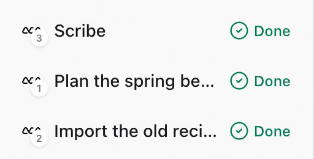

The captain wants each top-level thread on one line. On web and desktop, a
sidebar card outside the FirstMate group is one line: the project's icon (the
dashed speech bubble for a No project thread), then the title (or the project's
agent name), then the status or age. Upstream's card has a project line over a
title line. The card shows neither the model nor the account; the hover card
keeps both. A card with a branch, machine
label or diff keeps that meta line under the title. Otherwise its PR and
terminal badges sit on the title line, which truncates before them, the same
as folder multi-line rows (`isThreadMetaLineEmpty` in
`apps/web/src/components/Sidebar.logic.ts`). The hover card and the
screen-reader label still name the project and the model. FirstMate's coordinator card and its crew keep
the two-line layout.

Every row draws only the account the thread runs on now. Upstream draws up to
two greyed earlier accounts in front of it from `providerInstanceHistory`, to
show that a thread was handed from one provider account to another; here that
history stays in the hover card.

The account badge shows a number, and that applies app-wide on web and desktop,
not just in the sidebar: the composer's model picker, model lists, subagent bar,
lineage and timeline rows all show it. The number is the account's place among
its provider's accounts in Settings › Providers (default first, then as saved,
the order usage limits follow), so Claude, Claude2 and Claude3 read 1, 2 and 3.
Upstream's badge shows the first two letters of the account's name, and every
"ClaudeN" reads CL. A provider with one account shows no number, and an account
accent colour still tints the badge (upstream's main way to tell accounts
apart). Disabled accounts keep their number, but removing an account renumbers
the ones after it, and each environment numbers its own. Screens that print the
account's name beside its icon (the Settings › Providers card, Usage) show the
accent dot without a number, since the name is already there.

Upstream code it touches, for syncs: the card branch of `SidebarThreadRow`
(`oneLine`, `titleOnTopLine`) and `SidebarModelIcon`, which replaces
upstream's `SidebarProviderStack`, in
`apps/web/src/components/sidebar/SidebarThreadRow.tsx`; `accountNumber` on
`ProviderInstanceIcon`, which replaces upstream's `badgeContent`, and on
`ProviderInstanceEntry`, set by the entry helpers in
`apps/web/src/providerInstances.ts` (`numberProviderAccounts`); and each badge
caller passing `entry.accountNumber`. The numbering is `providerAccountNumbers`
in `packages/shared/src/usageLimits.ts`. The mobile app has its own provider
icon and keeps upstream's rows and initials badge. Leave
`resolveThreadProviderStack` and `providerInstanceHistory` as upstream has them:
mobile and the hover card read them.

Upstream: none.

## Agent names on cards

A project can carry an agent name (**Settings → Projects → Agent name**, or
`agentName` on `t3_project_update`; `null` clears it) for a standing agent such
as a life log. Its thread cards on web and desktop then show the agent name as
their heading in place of the thread title, with no project line, and the hover
card keeps the real title and project. Folder rows keep the thread title.
Mobile is unchanged. The column (`agent_name`) is added by
`apps/server/src/persistence/forkSchema.ts` after upstream's migrations rather
than by a numbered migration, which would collide with upstream's next id. Code:
`resolveThreadCardHeading` in `apps/web/src/components/Sidebar.logic.ts`.

Upstream: none.

## No repeated project name

A card whose title is its project's name leaves out the repeated project label.

This now matters only for FirstMate cards, the one place a card still has a
project line (see [One-line cards](#one-line-cards)). When a
thread's title matches its project's name (ignoring case and surrounding
spaces), as for a standing thread named after its project, the card leaves the
project label out of its first line, which keeps the project icon, pin, status
and time. The title line is unchanged, and the hover card and screen-reader label
still name the project. Code: `projectLabel` from `resolveThreadCardHeading`.

Upstream: none.

## Thread details hidden

New threads open without the thread details card; a setting shows it by default
again.

Upstream shows the thread details card on every thread until you hide it. Here a
thread you have not toggled opens with the card hidden, unless **Settings →
Appearance → Show thread details by default** is on. Each thread remembers when
you show or hide it, whichever way the setting points. Code:
`threadDetailsDefaultOpen` in `packages/contracts/src/settings.ts` and
`defaultThreadPanelVisibility` in `apps/web/src/rightPanelStore.ts`, whose
persisted map now keeps open choices too.

Upstream: none.

## Context ring

The composer's footer shows a ring for how full the thread's context window
is. Hovering it opens the usage, total processed tokens, cost, the
auto-compact threshold and a Compact context button when the provider has
`/compact`. It shows on web and desktop with no setting; mobile has none.
Upstream moved context fill out of the composer:
https://github.com/pingdotgg/t3code/pull/33131 (8 Nov 2026) deleted the ring
with the Labs toggle that hid it, "Context window indicator (legacy)", and the
thread details card has an opt-in Context window row instead
(https://github.com/pingdotgg/t3code/pull/26904,
https://github.com/pingdotgg/t3code/pull/27892). The fork's part is the ring in
the composer, always on, not the toggle, because a glance at the composer is
the quickest way to see when a long thread needs compacting. A FirstMate worker's thread, which has no composer,
shows the same ring on its
[reply box](#reply-box-goes-to-firstmate) so the captain can see
how much context each worker holds; there it has no Compact context button.

Upstream's branch `maria/redesign/6-workspace-panes` has its own view of what
fills a Claude thread's context ("feat(web): show what fills a Claude thread's
context window"). If upstream ships a context view like it, drop this meter
for theirs.

For syncs, the meter lives in `apps/web/src/components/chat/ContextWindowMeter.tsx`
and `ContextWindowMeter.logic.ts`, both fork files. Upstream files it touches:
`ComposerFooterControls.tsx` (renders it before the primary actions),
`ChatComposer.tsx` (the context window, thread shell, sync phase and compact
props), `ChatView.tsx` (passes them, and `compactDisabledReason`), and
`compaction.logic.ts` (exports `providerSupportsManualCompaction`), plus a
sentence on the ring in `docs/user/composer.md`. The fork's `CrewReply.tsx`
renders it too. The meter
offers no Refresh context; the fork removed that feature.

Upstream: partly: it had this ring and removed it
([#33131](https://github.com/pingdotgg/t3code/pull/33131)); its thread details
card has an opt-in context row instead
([#26904](https://github.com/pingdotgg/t3code/pull/26904),
[#27892](https://github.com/pingdotgg/t3code/pull/27892)).

## Window grows for the panel

In the desktop app, opening the right panel (a file link, the Files list, any
surface) widens the window to the right by the panel's width, so the sidebar
and chat keep the widths you chose. Closing it takes the panel's width as it is
then back off. Upstream's panel shares the window, so the window never moves or
resizes on its own. The fork changes that on purpose: the window is kept at a
chosen width, and opening a document used to squeeze the chat to make room.


- The chat column keeps its width and the panel takes the rest of the row, on
  desktop and in the browser alike, so a window resize or a sidebar toggle
  while the panel is open lands on the panel. Only the desktop window resizes
  itself; the browser keeps upstream's per-thread widths, and desktop keeps
  one (`t3code:preview-panel-width`).
- Opening draws first, then grows. macOS shows a grown window at once, with the
  page's last frame and a blank strip beside it, and Chromium does not hold a
  resize for the page. So the page's own view is widened past the window's
  edge, the page lays out and draws there at the grown size while the window
  still clips it, and only then does the window grow, over a frame that is
  already there. Closing shrinks the window at once and the page follows.
- The panel joins the layout in the resize that widens the page and leaves in
  the one that narrows it, never before. The chat has no frame at another
  width, and the panel is never laid out inside the old window. A window
  narrow enough for the sheet layout opens the same way, inline once it has
  grown; the sheet shows only when the window cannot grow.
- Nothing is held, timed, animated or faded. The window answers a request once
  it has its bounds and the page has drawn at them (a one-second cap covers a
  page that cannot draw), and the answer settles the layout on what was asked;
  until then the layout follows each resize, so a toggle back, a hand resize
  or a thread change mid-way never leaves the chat at another width.
- Electron's `BrowserWindow` keeps its page view to itself, so on macOS the
  view is sized through the Objective-C runtime (`ffi-rs`). Where that cannot
  be done (another platform, DevTools docked beside the page, a Chromium that
  names the view differently) the window resizes first and the page follows,
  which shows the blank strip for as long as the page takes to draw.
- For the frame between the page drawing and the window growing (about 17 ms)
  the old window already shows the grown layout: the chat header's layout
  buttons take their open look that much early. A surface's first open after
  launch loads its code and data only once it is mounted, as upstream's lazy
  surfaces do, so that one time the window grows with the panel's tabs drawn
  and its body fills in a moment later.
- Near the screen's right edge the window moves left only as far as it must
  and moves back on close. A screen too narrow for the full width grows as far
  as it can and the chat gives way for the rest. Full screen and maximized
  windows are left alone.
- A hand resize while the panel is open goes to the panel, so closing takes it
  off with the panel. The window's saved size leaves the panel's width at
  opening out, so a restart with the panel open grows once.
- The window follows whether the panel is showing, so switching between a
  thread with the panel open and one without resizes it.
- The growth is converted from CSS pixels to screen points, so it matches the
  panel at any app zoom.

Code: `apps/desktop/src/window/PanelWindowGrowth.ts` (the width arithmetic and
the order of page and window, with its tests),
`apps/desktop/src/window/PanelPageView.ts` (the page sized ahead of the window,
and the frame it draws), the `setRightPanelOpen` bridge method,
`apps/web/src/hooks/useRightPanelWindow.ts` (the layout following the page's
resizes), and `apps/web/src/hooks/usePreviewPanelInlineSize.ts` (the kept chat
width), each web hook with its browser test.

Upstream: none.

## Clean session close

When a Claude session closes, T3 waits for its process to exit, so FirstMate's
next session keeps its session lock instead of coming up read-only.

Upstream's `/clear` ends the thread's agent session and opens a fresh one. On
the FirstMate thread the old Claude CLI process must be gone first: FirstMate's
session lock belongs to the live process, and a new session that loses it comes
up read-only. Upstream's close only schedules the CLI's SIGTERM, so the fork's
Claude adapter also waits for the process to exit, up to 15 seconds, whenever a
session closes. Code: `awaitExit` in
`apps/server/src/orchestration-v2/Adapters/ClaudeAdapterV2.ts`.

The fork once had a Refresh context button for this. Its first version wrote a
`thread.session-replaced` event; nothing writes it now, and the contracts keep
it so stored events still decode.

Upstream: none.

## Any agent as a worker

Any agent can be FirstMate's worker: a launched thread gets its own environment
variables and instructions, on every provider that can apply them.

An agent that launches a thread can give it its own environment variables and
instructions. `t3_thread_launch` takes optional `environment` (env vars, at most
64 and 16 KB, never T3's own names) and `instructions` (kept in the agent's
system context, at most 16,000 characters), stored on
the thread so they survive idle release, restarts and forks, though not
delegated children. Values sit in the database, so they must not be secrets. Each
adapter applies them through the channel it already has and declares what it
supports; a launch or later turn that binds something its provider cannot
apply is refused. Kiro's adapter declares neither, so it refuses both. Cursor
takes instructions only, because it runs inside the server process. The other
providers take both. `t3_thread_configure` reads them back with the effective
runtime mode, and `orchestrator_capabilities` reports `threadEnvironment`,
`threadInstructions` and an ACP registry instance's `agentId`. Code:
`apps/server/src/orchestration-v2/RuntimePolicy.ts`.

OpenCode 2 shares one server per instance, so its adapter sets each session's
own environment instead (`PUT /api/session/:id/environment`). That replaces the
server's environment in the session's shells, is kept in memory only, and is not
inherited by subagent sessions. So T3 sends every session, subagents included,
the environment it started the server with minus `OPENCODE_PASSWORD`, plus the
thread's variables. It sends this again after the server restarts. An external
server (`serverUrl`), on either OpenCode adapter, has an environment T3 does not
know or cannot reach, so it takes instructions only. Code:
`packages/provider-opencode/src/server/v2/adapter.ts`.

FirstMate half, in the FirstMate fork:
[Any agent as a worker](https://github.com/dascapytal1559/firstmate/blob/main/FORK.md#any-agent-as-a-worker).

Upstream: none.

## FirstMate answers approvals

FirstMate, or any agent driving T3 over MCP, can allow or deny a worker's
permission prompt itself, so you are not asked.

Claude asks for some commands even with full access (its own safety checks and
the user's ask rules). An agent driving T3 over MCP, such as FirstMate, can
answer those so the user never has to. `t3_pending_request` `list` returns
`approvals` next to question `requestIds`, each with its `kind`, `detail`,
`reason` and `override` (`provider_check`, `ask_rule` or `null`); `respond`
takes `decision: "allow" | "deny"` and optional `feedback` on deny, and sends
the same command the Approve and Decline buttons do. Only a full-access caller
other than the asking thread may answer one. The resolved request and its
timeline row record `respondedBy: "agent"`, which web and mobile show as
"answered by agent". `orchestrator_capabilities` reports `approvalResponses`.
Code: `apps/server/src/mcp/toolkits/thread/handlers.ts`.

FirstMate half, in the FirstMate fork:
[Approvals at once](https://github.com/dascapytal1559/firstmate/blob/main/FORK.md#approvals-at-once).

Upstream: none.

## Stopped turns close approvals

When a turn is stopped or fails, its approval prompts close instead of staying
pending forever.

On the normal path, upstream closes only a stopped turn's questions, so an
approval such as a Claude command prompt stays pending forever: the app keeps
showing a prompt for a tool call that no longer exists, and the thread reports a
pending request. Upstream's Stop fallback for a stalled run
(`settleInterruptedRun`) already cancels every pending request, approvals
included, and closes their cards
(https://github.com/pingdotgg/t3code/pull/30695); that part is upstream's. The
fork's part: here a turn that ends interrupted, failed or cancelled expires
every pending request it raised. A turn that completes still closes only its questions, because a
background subagent's approval can still be live then. These requests close as
`expired`, not `cancelled`, and the guard that keeps a just-committed answer from
being overwritten covers every request kind. A question the adapter keeps open
past the turn (upstream's `retainedRuntimeRequestIds`, such as a background
OpenCode subagent's) stays pending either way; upstream's own question-only
`dismissNativeUserInputs` is folded into this function on syncs. Code:
`expireTurnRequests` in
`apps/server/src/orchestration-v2/ProviderEventIngestor.ts` and
`guardRequestClosures` in `EventSink.ts`.

Upstream: partly ([#30695](https://github.com/pingdotgg/t3code/pull/30695)): its
Stop on a stalled run already closes them.

## Approvals reach FirstMate at once

FirstMate hears a worker's question or approval the moment it appears, without
checking every thread once a second.

T3 sends an MCP client no event when a thread starts waiting on a question or
approval, so FirstMate used to re-list every watched thread's pending requests
once a second, at about 40 ms of server CPU per check. Now `t3_thread_wait`
takes `settleOnPendingRequest: true` and also returns, at once, when a
question or approval appears that the caller does not know of: one outside
`knownRequestIds`, or, without that list, one not pending when the wait
started. It listens to the thread's `runtime-request.updated` events on the
subscription the wait already holds, so it costs nothing while idle. The
result then carries `settledBy` (`run_ended`, `timeout` or `pending_request`)
and, for a pending request, `pendingRequests` in the shape
`t3_pending_request` `list` returns. Callers without the flag see no change.
Clients detect it by the field in the tool's `tools/list` input schema.
Code: `apps/server/src/orchestration-v2/ThreadManagementService.ts`
(`waitForThread`). Open upstream PR
https://github.com/pingdotgg/t3code/pull/24712 adds a similar return on a
pending question or approval to thread waits.

FirstMate half, in the FirstMate fork:
[Approvals at once](https://github.com/dascapytal1559/firstmate/blob/main/FORK.md#approvals-at-once).

Upstream: open PR ([#24712](https://github.com/pingdotgg/t3code/pull/24712), by
an outside contributor, not merged) adds a similar return to thread waits.

## Long sign-in

FirstMate's sign-in to T3 lasts 10 years instead of 30 days, so it never needs
renewing.

Upstream gives every MCP sign-in a 30-day pass, most likely so a leaked or
forgotten pass does not stay valid forever. Here the pass for the client named
`firstmate` lasts 10 years when its sign-in redirects to loopback (`127.0.0.1`,
`localhost` or `[::1]`); every other client stays at 30 days. Anything able to
read that pass on this machine already runs as the owner and could mint a new
one, and a pass can still be revoked, so the short life added little and a
renewal job was more machinery than it saved. The loopback condition is needed
because the name is only the `client_name` a client registers with, and cloud
apps now sign in through a public URL, so any of them could claim it. FirstMate
signs in locally, so nothing changes for it. Code:
`apps/server/src/auth/EnvironmentAuth.ts` (`FIRSTMATE_SESSION_TTL`) and
`isLoopbackRedirect` in `McpOAuth.ts`. Open upstream PR
https://github.com/pingdotgg/t3code/pull/37679 makes the lifetime configurable
instead, one for every client.

Upstream: none. Open PR [#37679](https://github.com/pingdotgg/t3code/pull/37679)
(by an outside contributor, not merged) makes the lifetime configurable instead,
one for every client.

## Which device sent it

Every user message records the client that sent it, so an outside reader can
count prompts from the phone against the computer without parsing text. This
extends upstream's existing origin stamping: v1 events carried
`metadata_json.origin` `{ surface, appVersion }`, and the v2 orchestrator
dropped it. Here the server stamps `origin: { surface, deviceType, appVersion }`
on the message (`orchestration_v2_projection_messages.payload_json`) and on its
`message.updated` event's `metadata_json`. `surface` comes from the sending
socket (`desktop`, `mobile`, `web`), `deviceType` from that socket's auth
session (`desktop`, `mobile`, `tablet`, `bot`, `unknown`), so a phone browser
reads `web` + `mobile`. Messages sent through T3's MCP tools (FirstMate's
sends and launch briefs, the `t3 thread` CLI) read `surface: "mcp"`,
`deviceType: "bot"`. A client cannot set its own origin, nor upstream's
`linkedSender` label, which only a linked environment's relayed send may carry
(upstream lets a client set it; the fork drops it with `origin`). Server-made messages
(scheduled tasks, continuations) and messages from before this change have
none, which means unknown; nothing is backfilled. A run's sender is its
`userMessageId`'s origin. Code: `withCreationProvenance` in
`apps/server/src/orchestration-v2/ThreadManagementService.ts`, `messageProvenance`
in `Orchestrator.ts`, `clientOrigin` in `apps/server/src/ws.ts`.

Upstream: partly: its v1 events recorded the sending client, and its v2
orchestrator dropped that.

## Work records its cause

Each worker records which of your prompts started it, so its work can be traced
back to your phone or computer.

An MCP-sent message is stamped `mcp`/`bot`, which says an agent sent it but
not why. So FirstMate can tie a worker back to the phone or computer prompt
it acted on, `t3_thread_launch` and `t3_thread_send` take an optional
`causedBy`. T3 now binds where launched and steered work counts itself, from
the calling thread (see [Phone vs computer split](#phone-vs-computer-split)); `causedBy` is
still checked, stored and followed for work that has no bound origin:

```json
"causedBy": { "threadId": "<thread>", "runId": "<run, optional>", "messageId": "<message>" }
```

- The server checks it before doing anything: the thread exists and is not
  deleted, the message is a user-role message (a prompt) in that thread, and,
  when `runId` is given, the message belongs to that run. Any thread an MCP
  caller may read is allowed, in any project. A failure is `invalid_request`
  with a `causedBy: ...` message, and nothing is launched or sent.
- `t3_thread_launch` stores it on the new thread (`thread.causedBy`) and on
  its first message when it has one. That first message travels inside
  upstream's `thread.create` `initialMessage`, which carries `causedBy` and
  `origin` for the fork; a new per-message field needs adding there too.
  `t3_thread_send` stores it on the sent
  message, through queueing and steering. Both are event-sourced:
  `thread.created` and `message.updated` payloads carry it.
- `t3_thread_read` returns the thread's in `thread.causedBy` and each
  message's on its `user_message` items. Absent means none was recorded;
  T3 never infers one. Linked servers without this omit both.
- Only server code sets it: a client's `thread.create` or `message.dispatch`
  loses any `causedBy` it carries. It refers to this environment only, so a
  call forwarded to a linked environment goes without it and the work there
  records no cause.
  `t3_thread_send_attachments`, `delegate_task` and `create_threads` do not
  take it; they bind by value from the caller's turn.
- `t3_restart_request` and `t3_usage_claim` take the same checked `causedBy`:
  a restart's note and continuations count to it when the request carries no
  bound origin, and a claimed session, folder or turn counts to it.

Usage follows these links ([Phone vs computer split](#phone-vs-computer-split)). Code:
`verifyCause` in `apps/server/src/mcp/threadAccess.ts`, `OrchestrationV2CausedBy`
in `packages/contracts/src/orchestrationV2.ts`.

FirstMate half, in the FirstMate fork:
[Work records its cause](https://github.com/dascapytal1559/firstmate/blob/main/FORK.md#work-records-its-cause).

Upstream: none.

## Stash a queued message

A queued message can be moved into the prompt stash with all its images and
files.

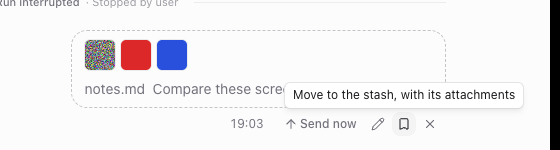

A bookmark button on each queued message, held by Stop or a pending restart or not
held at all, moves it into the prompt
stash with all its images and files and cancels its run. The client downloads
each attachment from the server, stores the bytes, writes the stash entry, then
cancels; a failed download or write leaves the message queued, and a refused
cancel undoes the entry (and any eviction it caused). Guest messages have no
stash, like they have no edit. Web and desktop only: mobile has no prompt stash.

Upstream keeps stashed images as data URLs inside the localStorage entry, shrunk
to fit a per-entry budget, and drops any that still do not fit, keeping only the
name. Here every stash entry keeps image bytes (and a queued message's file
bytes) in IndexedDB, keyed by entry id, with no budget or recompression; the
entry holds only `media` metadata. Composer files are still stashed as pending
upload references. The entry is written only after its bytes are, so a refused
write stashes nothing; the async "saving N images" step and
`finalizeEntryImages` are gone. Entries saved the old way still restore. Code:
`apps/web/src/promptStashMedia.ts`, `stashQueuedMessage` in
`apps/web/src/components/chat/promptStashActions.ts`, and the Stash button in
`QueuedRunsControl.tsx`. On syncs, upstream changes to `compressImageForStash`
or the stash entry schema need merging onto this model. Upstream fixes to its
async step (`finalizeEntryImages`, `pendingImageCount`, orphaned counts after a
reload, cross-tab finalize) have nothing to land on here and are dropped.

Upstream: partly: the prompt stash is upstream's; stashing a queued message, and
keeping every image whole, are the fork's.

## Telemetry off

The fork sends no product analytics and no T3 Connect relay traces unless you
opt in. `T3CODE_TELEMETRY_ENABLED` governs both and defaults to `false` here
(upstream defaults it to `true`): `AnalyticsService.ts` and
`isRelayTracingEnabled` in `packages/shared/src/otelEnvironment.ts`. To turn them
on, set `T3CODE_TELEMETRY_ENABLED=true` in the server's environment. The desktop
app starts its server before it reads your login shell, but it remembers this
variable from the shell and applies it on the next launch
(https://github.com/pingdotgg/t3code/pull/37792), so a shell-profile export
takes effect from the second launch. For it to take effect at once, run
`launchctl setenv T3CODE_TELEMETRY_ENABLED true` and restart the app, or start
the app from a terminal that has the variable set. Your own OpenTelemetry export
and the mobile app's crash reports have their own settings.

FirstMate half, in the FirstMate fork:
[Telemetry warning](https://github.com/dascapytal1559/firstmate/blob/main/FORK.md#telemetry-warning).

Upstream: none. It sends telemetry unless you opt out.

## Links that work

Links and paths in a Markdown file open from that file's own folder, a link to a
heading or line opens there, video plays in the panel, and any file can open in
its default app.

A path written in a Markdown file is read from that file's own folder, and only
there, as GitHub, VS Code and Obsidian read it: in `data/demo/report.md`,
`scripts/run.md` is `data/demo/scripts/run.md` and `../clips/a.mp4` is
`data/clips/a.mp4`. That holds for links, inline-code paths and images, in the
rendered view and the live editor alike, with one exception: docs write
inline-code paths from the repository's top folder, so an inline-code path with
no file beside the document opens from the project's top folder when the file
is there (`rootFallbackPath` in `apps/web/src/markdown-links.ts`, checked on
click). Real links and `./`, `../` paths never fall back. `/…` and `~/…` mean
the host path they name. A path in a chat message reads from the thread's
workspace, with upstream's project-wide search when it misses, as upstream
does. Upstream reads inline code that has a folder from the project's top
folder only (https://github.com/pingdotgg/t3code/pull/16950), and a file at the
top folder also gets the search. When the file is in neither place, the panel
shows the path beside the document.

- One click handler opens a reference from chat, the rendered view and the live
  editor (`openFileReference.ts`). The live editor also makes inline-code paths
  and bare absolute paths clickable, as chat does.
- `notes.md#setup` opens the file at that heading (`revealHeading` on the file
  tab); upstream drops the heading. `[x](notes.md:3)` opens at line 3; upstream's
  sanitizer read `notes.md:` as a scheme and dropped the link
  (`rehypeKeepFileLineLinks` in `packages/shared/src/markdownPipeline.ts`).
- `scripts/../clips/a.mp4` and `clips/a.mp4` are one tab: joined paths drop `.`
  and `..` (`resolvePathLinkTarget` in `packages/shared/src/fileLinks.ts`).
- A video or audio file plays in the side panel. "Open in default app" opens a
  file in the host's own app for its type: in every file chip's right-click
  menu, and as a panel button on media and files the panel cannot show. It
  appears only when the host is this computer, as for Open in editor, since the
  app opens on the host (`OpenInDefaultAppAction.tsx`; the `file-manager`
  launcher without `reveal`).
- Mobile's file viewer already reads a file's paths from its folder; its inline
  code is not tappable there and `..` is not tidied.

On syncs, keep `resolveMarkdownFileLinkMeta`'s `documentDir` (unset only for
chat, which alone sets `workspaceLookupPath`) and `ChatMarkdown`'s `imageBaseDir`
passed through as that folder, not defaulted to `cwd`.

Upstream: partly ([#16950](https://github.com/pingdotgg/t3code/pull/16950)): it
opens inline-code paths from the project's top folder.

## FirstMate edits any file

FirstMate's own thread can edit and save files in any project, which upstream
opens read-only.

Upstream's file panel edits only files inside the open thread's project
folder; any other file on the machine opens read-only, and the server refuses
to save it. The intent is that a link in one thread cannot change files in
another project. FirstMate's own thread is the captain's command center across
every project, so there a file outside its folder is editable and saves like a
project file. Only FirstMate's main thread gets this (a pinned coordinator
that is not crew, `isPrimaryCoordinator`); secondmates, crew and every other
thread keep upstream's rule. The save names its thread, but that is only a
hint: any client that can read threads can see FirstMate's thread id, so the
server also requires the session's terminal permission (`terminal:operate`)
alongside filesystem write. A session with a shell can already change any
file, so that permission is what really authorizes the write; a pairing scoped
to filesystem write without terminal access keeps upstream's rule, and the
file panel opens host files read-only for it. The server writes in place only
a file that already exists, outside Git folders and the server's own state;
truncated reads and attachments stay read-only, and mobile does not edit
files. Code: `hostFileThreadId` in
`apps/web/src/components/files/FilePreviewPanel.tsx`, the `threadId` save
field in `ProjectWriteFileInput`, the `projects.writeFile` handler in
`apps/server/src/ws.ts`, and `resolveHostWriteTarget` in
`apps/server/src/workspace/WorkspaceFileSystem.ts`.

Upstream: none.

## Live Markdown editor

A Markdown file that can be edited opens in the file panel as a rendered page
you type into, like Obsidian's Live Preview. Markdown marks show, dimmed, only
where the caret is; the rest stays drawn. The editor holds the file's exact
text and never converts it, so nothing an agent wrote is reformatted on save,
line endings included; a file that mixes line endings is saved with the one it
uses most once you edit it. Upstream offers a read-only rendered view or a source
editor, and opens Markdown as source.

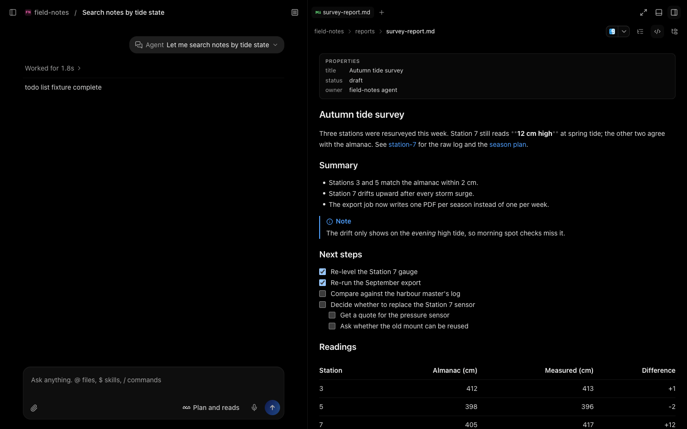

It draws headings, bold, italic, strikethrough, inline code, quotes, callouts,
rules, lists and task boxes, code blocks with colours, tables, images from the
project, Obsidian picture embeds (`![[shot.png|300]]`, found beside the note or
by name in the project), links, frontmatter as a properties card, and
`<details>` blocks. Mermaid, maths, footnotes and other raw HTML show as their
source. A table, and the properties card, turn into their Markdown while the
caret is in them. A line break in
the file stays a line break, so a paragraph wrapped at 80 columns keeps its
short lines.

- The toolbar button still switches to upstream's source editor. Markdown
  opens rendered first (`t3code.renderMarkdown` now defaults to `true`).
- Saving is upstream's: the same save session and the same dot on the tab.
- A change on disk, such as an agent's edit, is applied line by line and
  stays out of the undo history. The caret, the scroll position and undo
  stay, and the changed lines are tinted for two seconds.
- A plain click follows a link, an inline-code path or a bare absolute path:
  a file opens in the panel ([Links that work](#links-that-work)), a web
  address in the browser. Option-click puts the caret in it. `[[wiki-links]]`
  are drawn but do not open. A link to a line (`report.md:42`) scrolls to it
  here; the read-only view still switches to source for that.
- A "Fork editor" badge sits in the file panel's toolbar while the editor
  shows, so it is never mistaken for upstream's read-only preview. Upstream's
  own views (the rendered view, the source editor, other files) carry none.
- Where the panel is at least 560 px wide, the outline is pinned in a column
  left of the page: headings nested by level, kept current as you type, the
  section being read marked (the caret's while it is on screen, otherwise the
  one at the top), a click jumps. The outline button shows or hides the column
  and the choice is remembered (`t3code.markdownOutlinePinned`, on by
  default). The column is on the left because the file explorer already sits
  on the right. A narrower panel, the read-only view and a phone keep the
  outline button's list. Cmd+F finds and replaces. A section or a block folds
  from the chevron beside it.
- A `<details>` block (a `<summary>` line, then Markdown, then `</details>`)
  draws as its summary with a chevron, folding like a heading, and starts
  folded unless it is written `<details open>`; one without a summary reads
  "Details". A click
  on the summary opens or closes it, and the file's text never changes. Up and
  Down stop on its tag lines, which then show as source for editing. Find, the
  outline and a link to a line open a block they land in. The fold keys
  (Cmd+Option+[ and ]) fold the block at the caret; Ctrl+Option+[ and ] fold
  or unfold every block along with the headings. A block opened on disk starts
  as written; one you type stays open. Nested blocks work.

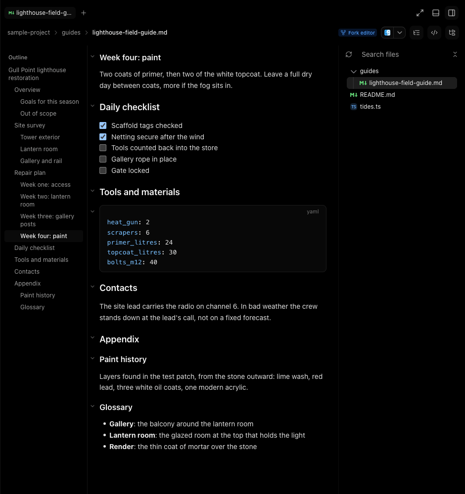

- Keys: Cmd+I italic, Cmd+E inline code, Cmd+Option+X strikethrough, Cmd+L
  toggles a task, Tab nests a list item. Cmd+B bolds only selected text, as
  in the message box; with a bare caret it stays the sidebar toggle.
  Strikethrough avoids Cmd+Shift+X, which is the workspace picker.
- A file that cannot be edited (a read-only connection, a file outside the
  project, a read cut off at 1 MB) and a phone (a narrow window or a touch
  pointer) keep upstream's rendered view, which gains the properties card
  and the outline button.

It is CodeMirror 6 (MIT) with a decoration layer of the fork's own, in a
chunk fetched when a Markdown file first opens this way. Code:
`apps/web/src/components/files/liveMarkdown/`, one file per feature, all
registered in `liveMarkdownEditor.ts`. `LiveMarkdownSurface.tsx` connects the
editor to T3's save path, signed image URLs and link opening.

Shared files it touches, for syncs: in `FilePreviewPanel.tsx` the lazy
import, the `liveMarkdown` flag and the branch that mounts the editor, the
`renderMarkdown` line (a linked line no longer forces source while the editor
shows), the default of `t3code.renderMarkdown`, the outline button with its
ref and column state (`useOutlineColumn`), and the badge; the properties card in `FileMarkdownPreview.tsx`; the selector in
`AppSidebarLayout.tsx` that lets Cmd+B bold a selection; the
`markdownFrontmatterLength` export in
`packages/shared/src/markdownFrontmatter.ts`, whose rule that a leading `---`
block with a blank line and no `key:` line is Markdown, not frontmatter, also
reaches upstream's rendered views on web and mobile through
`maskMarkdownFrontmatter`; the
`githubHeadingSlug` export in `apps/web/src/components/chat/markdownFragments.ts`,
which the outline uses for heading anchors; the pre-bundled packages in
`apps/web/vite.config.ts`; the `@codemirror/*` and `@lezer/*` entries in
`apps/web/package.json`; and a section in `docs/user/composer.md`. If
upstream ships its own editable rendered view, choose one of the two. The
mobile app is otherwise unchanged.

Upstream: none. It offers a read-only rendered view or a source editor.

## Cite from a Markdown file

Selecting text in a Markdown file in the side panel offers Cite the way an
assistant response does: the same floating Cite button, and a Cite item in the
right-click menu on the selection. Both the live editor and the read-only
rendered view have it. Cite puts the thread's citation chip in the composer of
the thread the panel belongs to, with the same comment box, the same 8,000
character limit ("Shorten selection" above it) and the same Escape-removes rule
for a fresh one. Upstream cites assistant responses, and its file comments
(https://github.com/pingdotgg/t3code/pull/3115) send a line range selected in
the source view to the composer as a File comment chip. The fork's part is
citing from the rendered views, quoting the exact selection, and the shared
Cite button and right-click menu.

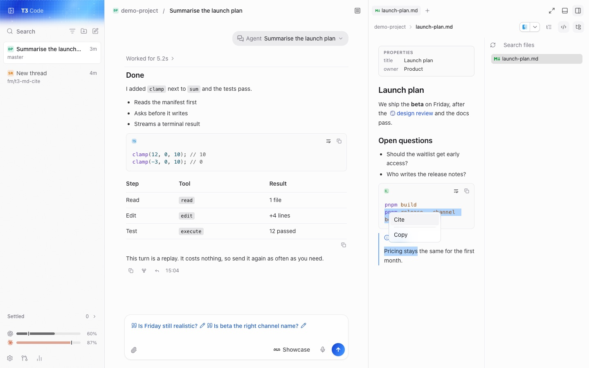

- The agent gets each file quote as `[file-quote-N]` in the message and a
  `<file_citations>` block after it, framed like upstream's
  `<assistant_citations>`: quoted reference material, not instructions. Each
  entry carries the environment, the file's full path, `startLine` and
  `endLine`, the quoted text and the comment. A message with only thread
  citations is sent byte for byte as upstream sends it.
- Lines come from the file. The editor reads them from its own document and
  quotes the Markdown as written. The rendered view quotes the text as shown
  and maps each end of the selection back to its source line by matching
  words; when that fails, or the end is in a block drawn by its own renderer
  (a code block, a table), it takes the lines of the whole block.
- The right-click menu replaces the browser's only when the click lands on the
  selected text. It offers Cite and Copy, plus Cut in the editor; Paste, spell
  suggestions and Look Up are not in it. Tab in the editor still indents.
- The chip and the card in a sent message open the file at the first quoted
  line. A quote from another environment's file does not open.
- In the stored message a file quote is a link like a thread citation, labelled
  `File quote`, with `t3-citation://v1/file/<environment>?path=…` as its target.
  The plain-text forms (thread titles, search, the sidebar draft line, mobile)
  show the quoted text and comment, so mobile displays file quotes but cannot
  create them.

Code: `apps/web/src/components/files/FileSelectionCite.tsx` (both views'
selection readers and the menu), `fileCitation.ts` (line mapping) and
`rehypeSourceLines.ts`. Shared files it touches, for syncs: `FileCitation` and
`Citation` in `packages/contracts/src/assistantCitations.ts`; the file link
format, `<file_citations>` and `parseCitationHref` in
`packages/shared/src/assistantCitations.ts` (`parseAssistantCitationHref` now
returns response citations only); `threadFindText.ts`; the `capture` prop that
replaced `threadRef` on `AssistantSelectionToolbar.tsx`, and its
`tabFocusesCite` switch; the file chip and card in `AssistantCitationChip.tsx`;
the file branch in `AssistantCitationSource.tsx` and
`AssistantCitationCommentEditor.tsx`; the `sourceLines` prop and file card in
`ChatMarkdown.tsx`; `Citation` in place of `AssistantCitation` along the
composer path (`ChatView.tsx`, `ChatComposer.tsx`, `MessagesTimeline.tsx`,
`ComposerPromptEditorTiptap.tsx`, `composer-logic.ts`,
`composer-editor-mentions.ts`); the line argument of `openMention` in
`composerContextActions.ts`; the `CiteInComposerContext` around the right panel
in `ChatView.tsx`; one mount each in `FilePreviewPanel.tsx` and
`LiveMarkdownSurface.tsx`; and a paragraph in `docs/user/composer.md`.

Upstream: partly: citing assistant replies, and line comments from the source
view ([#3115](https://github.com/pingdotgg/t3code/pull/3115)), are upstream's.

## File tabs name their folder

A file tab in the side panel shows the file's folder, dimmed, before its name
(`reports/README.md`), so files that share a name (`README.md`, `index.md`,
`report.md`) tell apart. When the tab runs out of room the folder shortens
first and the file name stays whole; hovering a tab shows the full path. A
file at the project's top folder and an attachment show the name alone. Every
file type gets this, not only Markdown, since all files share the one tab.
Upstream keeps tabs compact with the name alone and the name again on hover.
Code: `fileTabParentFolder` and the file branch of `RightPanelTab` in
`apps/web/src/components/RightPanelTabs.tsx`; file tabs are wider than other
tabs (`max-w-52` instead of `max-w-36`) to make room.

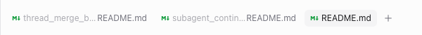

Upstream: none.

## Closing a tab goes back

Closing the active tab in the side panel shows the tab viewed just before it,
the way VS Code and Firefox do, so closing a tab opened from a link in a report
brings the report back. Upstream shows the tab that slides into the closed
tab's place, usually the rightmost when new tabs open at the end. Tab positions,
drag reordering and where new tabs open stay upstream's. "Close to the right"
also lands on the most recently viewed tab that stays, where upstream lands on
the clicked tab; "Close others" and "Close all" are unchanged.

The store keeps each thread's open tabs in the order they were viewed,
`previousSurfaceIds` beside `activeSurfaceId`, updated in one place
(`withViewHistory` in `updateThreadStateMap`) so every path that changes the
active tab feeds it. It is saved with the panel; state saved before it, or a
history with no open tab left, falls back to upstream's position rule. Carry
forward: `previousSurfaceIds`, `lastViewedSurfaceId` and its three callers
(`closeSurface`, `closeTerminal` when the last pane closes,
`closeSurfacesToRight`), and `previousSurfaceIdsFrom` in the migration, all in
`apps/web/src/rightPanelStore.ts`.

Upstream: none.

## Mouse Back and Forward do nothing

The mouse thumb buttons (mouse 4 and 5) take no action anywhere in the app, so
they stay free for whatever the user binds them to outside it. Upstream uses
them as Back and Forward: in the thread view they step the app's history, over
the side panel with a browser tab open they step that tab's history, and on
macOS a swipe (which some mouse drivers send for these buttons) steps the app's
history too.

One capture listener on the window cancels both presses' defaults, which stops
Chromium's history step on mouseup and the focus change on mousedown, so a press
over a menu or the URL bar does nothing either. The preview guest still cancels
the press in the main process, since Chromium would otherwise step the host
app, but no longer steps the tab. Upstream's panel and menu handlers are
removed, and macOS swipes no longer navigate, trackpad three-finger swipes
included. The browser panel's toolbar Back and Forward buttons are unchanged.
Carry forward: `installThumbButtonGuard` in `apps/web/src/thumbButtons.ts`
(installed from `startAppServices`), `beforeMouse` in
`apps/desktop/src/preview/Manager.ts`, and the absent `swipe` listener in
`apps/desktop/src/window/DesktopWindow.ts`.

Upstream: none.

## Version

The fork keeps upstream's version number. The desktop app sets up an SSH or
WSL remote by downloading upstream's `t3` release for its own version
(`apps/desktop/src/main.ts`), so a version upstream never released, such as
`0.1.5-fork.1`, has nothing to download. The app name, bundle id and
data folder tell the fork apart. A sync to an upstream nightly keeps the stable
version its source carries (upstream stamps nightly versions only when it
builds): a `-nightly.` version would turn the build into upstream's "T3 Code
(Nightly)", with its icons and update track. A sync to a stable tag stamps that
tag's version the way upstream's release does,
`node scripts/update-release-package-versions.ts <version>`, because the tag's
source still carries the previous release; left at it, the build would announce
the very release it contains.

## Build

```sh
node scripts/build-desktop-artifact.ts --platform mac --target dmg --arch arm64
```

The build is unsigned, so electron-builder ad-hoc signs it. It writes
`release/T3-Code-<version>-arm64.dmg` and a `.zip`. Leave
`T3CODE_DESKTOP_UPDATE_REPOSITORY` and `GITHUB_REPOSITORY` unset. With neither
set, the app has no update feed and cannot update itself into the official
app.
Settings → About → Update track (Stable or Nightly, from upstream 0.1.5) then
only saves the track for this app, which says to reinstall it yourself. It
still moves connected machines that run upstream's `t3` to that track.
