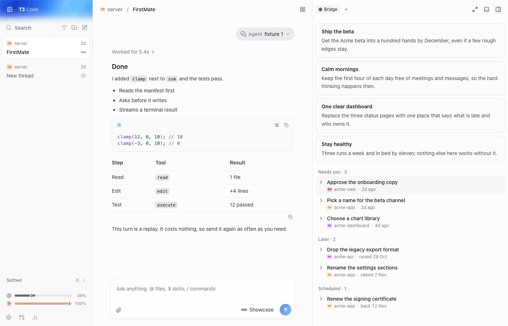
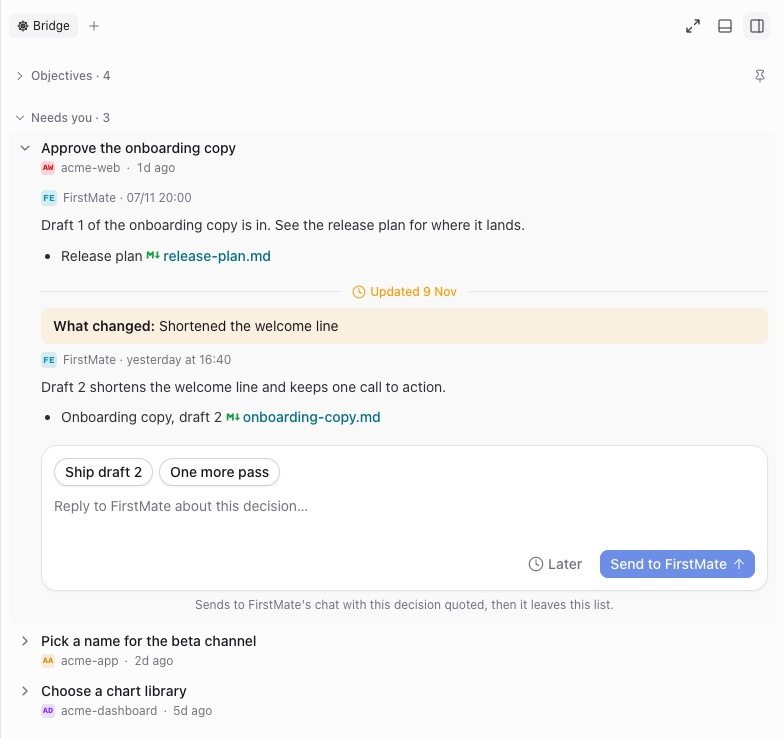

# Fork changes

This fork tracks `pingdotgg/t3code` `main`. Each feature section says what it
does, shows a picture where one helps, then what each upstream sync must carry
forward. Keep this list current. Pictures live in `fork/media/` and show
made-up data. Earlier fork work is archived on the local branch
`archive/fork-legacy-2026-10-19` and is out of scope for syncs; take from it
only on request.

## Desktop identity

The fork's desktop app runs beside the official T3 Code on one Mac. Neither app
can read or migrate the other's database.

|                          | Official                                         | Fork                                        |
| ------------------------ | ------------------------------------------------ | ------------------------------------------- |
| App name                 | T3 Code (Alpha, Beta)                            | T3 Code (Fork)                              |
| Bundle id                | `com.t3tools.t3code`                             | `com.t3tools.t3code.fork`                   |
| Data folder              | `~/.t3`                                          | `~/.t3-fork`                                |
| Electron profile         | `~/Library/Application Support/t3code-v2` (Beta) | `~/Library/Application Support/t3code-fork` |
| First backend port tried | 3773                                             | 3873                                        |

The values are in `apps/desktop/src/forkIdentity.ts`. The app name is
`productName` in `apps/desktop/package.json`. `T3CODE_HOME` still overrides the
data folder.

Three things are still shared with the official app:

- The `t3code://` link scheme. Both apps register it, so macOS picks which app
  opens sign-in and prompt links.
- The default Tailscale Serve port, 443. Do not turn on Tailscale Serve in both
  apps at the same port.
- The managed policy (`/Library/Application Support/T3Code/policy.json` or the
  `com.t3tools.t3code` managed preferences). A policy written for the official
  app restricts the fork too, except that the fork ignores its update feed
  (`limits.updates.feedUrl`), so it never gets one
  (`apps/desktop/src/updates/DesktopUpdatePolicy.ts`). Upstream's `t3 update`
  command does follow that feed, but the app never runs it: its server is
  desktop-managed (`apps/server/src/cloud/selfUpdate.ts`).

## Usage reaches twelve months


The Usage page on web and desktop has 6 months (`Cmd+Shift+5`) and 12 months
(`Cmd+Shift+6`) periods. Every period draws one stacked bar per day or hour,
because upstream's overlapping lines turn into a smear over long ranges. The
mobile app already draws bars and still
stops at 90 days. The server keeps parsed usage for 367 days instead of 92, so
usage stays after Claude Code deletes old transcripts. History older than what
is on disk or in the saved usage today cannot be recovered; twelve months builds
up from when this build first scans.

Upstream's "N malformed or inconsistent usage record(s) were skipped" sentence
shows as a small muted footnote at the bottom of the page instead of a notice
at the top (`apps/web/src/components/usage/UsagePage.tsx`).

## Usage rows can be muted


On the Usage page, click a provider's dot, icon or name to mute it; click again
to bring it back. The row looks like plain text until you hover it. Muting grays
the row and leaves it in the list, showing what that provider would have added.
Everything else drops it: the headline, the other rows' shares, the chart, the
totals, the by-type bars and the breakdown.

This is a second control on upstream's own filter, the provider menu in the
Usage header, and they share one saved setting. Keep that setting
(`hiddenProviders`) as the single source when syncing, and keep what the fork
adds: `excludedProviders` in `apps/web/src/state/usage.ts` and the rows in
`apps/web/src/components/usage/UsagePage.tsx`. Upstream's filter also hides a
provider's Limits cards, so a row muted here hides them too. The mobile app
has no row toggles.

## Usage limits in the sidebar

The captain wants usage visible without opening the Usage page, so the web and
desktop sidebar shows a small readout between the Settled row and the bottom
icons: one line per provider the Limits view shows, with its icon, one thin
bar and the percent left in its weekly window, or its first window when it has
no weekly one. A provider with several accounts (Claude and Claude2) gets one
combined bar, not one per account. Model windows such as Weekly · Fable stay
on the page. Each bar carries the Usage page's pace mark: a small line, in a
gap cut from the bar, where the bar would end if usage kept pace with the time
elapsed in the window (for Claude, the mean of its accounts' elapsed time). The
tooltip adds how much of the window is left and what the line means, plus each
account's figure and reset time; a click opens the Usage page. It reads the same provider
statuses as the Limits view and fetches nothing, shows nothing until limits
arrive, and leaves out providers muted on the page. The phone web sidebar shows
it too; the mobile app does not.

Grok's window carries its length so the pace mark shows for it (upstream's Grok
window has a reset time but no length, so no mark). The length is the period's
end minus start, and a weekly period without a valid start falls back to seven
days. This deviates from upstream's `grokUsageResponseToLimits` in
`packages/provider-grok/src/server/usageLimits.ts`; syncs must carry it.

Upstream code it touches, for syncs: `useLimitPresentations` is the Limits
view's environment and muted-provider filter, moved out of
`UsageLimitsSection` in `apps/web/src/components/usage/UsageLimits.tsx`, and
`saveUsagePagePreferences` now writes through `writeLocalStorageValue` so the
sidebar hears a mute in the same tab (`usagePagePreferences.ts`). The mount is
one line in `SidebarChromeFooter`. Code:
`apps/web/src/components/sidebar/SidebarUsageMini.tsx`.

## Archived usage

Usage includes copies of history from machines and accounts that no longer run
T3. The server setting `usageArchiveDirs` lists the archive folders. It
defaults to `["~/.t3-usage-archive"]` and can be changed in
`~/.t3-fork/userdata/settings.json`. Code: `apps/server/src/usage/usageArchive.ts`.

- Each folder directly under an archive folder is one host, and its name is
  the host label. Inside it, the copy keeps the original machine's layout, such
  as `<host>/home/.claude/projects`.
- These are read: Claude `projects/`, Codex `sessions/`, Grok
  `.grok/sessions/`, and a T3 server's saved usage
  (the newest `usage-scan-cache*.json` in a folder, version 3 on).
  Saved usage still has usage whose transcripts were deleted. Version 3 caches
  are priced at standard speed. OpenCode, Pi and Antigravity copies are not
  read.
- Archived usage is parsed and deduplicated like live history. Live
  directories are read first, so usage that is both live and archived counts
  once and stays credited to the live source.
- A remote that still runs T3 and is connected would be counted again next to
  its archive copy. Archive a host after T3 is removed from it.

## App-bundled CLIs are updated by their app

On macOS, a provider CLI whose real path is inside an app bundle
(`*.app/Contents/...`) is left to that app. An example is ChatGPT.app's Codex,
which `~/.local/bin/codex` links to. T3 shows no Update button for it and never
runs its updater. Without this, Codex offers an update that fails, because
`codex update` cannot update ChatGPT's copy and exits 1. This works like
upstream's handling of WinGet's Claude, in
`packages/provider-core/src/server/maintenanceResolver.ts`.

## `~` in a provider's executable path

A provider path that starts with `~` works for every provider. Upstream's Grok,
Pi, fx, Antigravity, Kiro and ACP registry drivers use a configured path such as
`~/.local/bin/grok` as written. Processes launch without a shell, so
the provider shows as not installed. Here each of those drivers expands a
leading `~` with `expandHomePath` before probing, spawning, resolving
maintenance or reporting status, as Codex, Claude, Muse and OpenCode do upstream.
Cursor never runs its `binaryPath`, so it is unchanged. When a sync finds upstream
expanding `~` in these drivers, keep upstream's.

## Idle agent release is a server setting

The server setting `providerSessionIdleTimeoutMinutes` (whole minutes from 1 to
1440, default 30, `null` is Never) replaces the hardcoded 30-minute idle
release. It has no control in the app: edit
`~/.t3-fork/userdata/settings.json`, for example
`"providerSessionIdleTimeoutMinutes": null`. The running server picks the
change up, including for agents already idle. Firstmate's environment sets it
to Never. This is the server half of upstream
https://github.com/pingdotgg/t3code/pull/25624, without its web and mobile
controls. When a sync finds the PR merged, or an upstream equivalent, drop
this copy and keep upstream's.

## Upstream release indicator


The fork has no update feed, so it never hears about upstream releases. When
`pingdotgg/t3code` publishes a stable release newer than this build, the
sidebar update icon shows "T3 Code vX.Y.Z is out", with links to the release
notes on GitHub and a Dismiss that holds until the next newer release. Nothing
downloads or installs; the captain asks FirstMate to sync the fork. It checks
at start-up and every 6 hours, keeps the last result when GitHub is
unreachable, and stays off whenever an update feed is configured or the
desktop updater is running. Code: `apps/web/src/state/upstreamRelease.ts` and
`apps/web/src/components/sidebar/SidebarUpstreamRelease.tsx`; a later "Ask
FirstMate to update" button belongs in that popover.

## Board


A quick annotation canvas that opens as a "Board" tab in a chat's right panel,
from the panel's launcher or "+" menu (W) or "Open board" in the command palette.
It is Excalidraw (MIT), loaded only when the tab shows. Screenshots pasted with
Cmd+V while focus is in the panel land in the middle of the view. The board is
saved in the client's IndexedDB, one board per client, shared by every chat's
Board tab. "Attach to chat" sends the selection, or the whole board, as a PNG to
the composer of the chat beside the panel, and "Copy" puts the same PNG on the
clipboard. The canvas is marked
`data-editable-canvas` and `role="application"` so its keys (tool letters, Cmd+Z,
Delete) are not taken by type-to-focus or thread undo. Code:
`apps/web/src/components/board/`.

Shared files it touches, for syncs: the `board` surface kind in `rightPanelStore.ts`
(and `closedViewStore.ts`), the launcher and "+" menu entries and tab title and icon
in `RightPanelTabs.tsx`, `RightPanelSurfaceContent.tsx`, `useRightPanelActions.ts`,
the props in `ChatView.tsx` and `PullRequestsPage.tsx`, a command palette item, the
selector in `lib/editableFocus.ts`, the Excalidraw font asset path in
`apps/web/vite.config.ts`, and licence notices. Excalidraw's canvas fonts are
served from the app because the desktop CSP blocks the CDN Excalidraw would
otherwise use. Excalidraw pins Radix Tabs 1.0.2, whose React peer range stops
at 18, and upstream's `strictPeerDependencies` refuses that, so an override in
`pnpm-workspace.yaml` moves it to a 1.1 release that accepts React 19. The
mobile app has no board.

## FirstMate crew in the sidebar


A FirstMate session and the worker threads it launches are grouped above the
sidebar inbox and kept out of Working. The main session is a two-line card: its
project and status, then its title. While it is idle, the status slot reads
"started 1d ago" instead of the last activity time, because age is what says a
long session is due for a fresh one; Working, Waiting and anything that needs
the user show as usual. The age is the thread's, since a `/clear` keeps the
thread. Neither it nor anything in its tree shows a branch line, since a worker's
branch matters little inside FirstMate; other threads and the hover card keep it
(`isThreadMetaLineEmpty` in `apps/web/src/components/Sidebar.logic.ts`). Its crewmates hang below it as a
tree that collapses to a count. Its decisions are not in the sidebar; see
[Bridge](#bridge). A pinned coordinator (see below) gets this card even with
no crew; without any coordinator the sidebar is unchanged.

The main session is always titled "Ahoy!", because a generated title for
FirstMate says nothing new. T3 only knows the thread is FirstMate's once it is
pinned as coordinator, which FirstMate does during its first turn, after
upstream's title generation has started; so pinning sets the title and drops
the generation still in flight. A fresh session on it (`/clear`, or
`t3_thread_send` with `freshContext`) sets "Ahoy!" again instead of generating;
upstream generates no title there anyway, so a rename by hand lasts until then.
A secondmate is crew of the main session and keeps upstream's titles, as does
every other thread. Upstream code it touches, for syncs: two guards in
`apps/server/src/orchestration-v2/Orchestrator.ts`, on `thread.metadata.update`
and on the initial title in `message.dispatch` (`isPrimaryCoordinator`).

The FirstMate and crew cards have no hover Snooze or Settle (the context menu
still has both, and snoozing or settling takes a thread out of the group). They
drag only as chat context, and crewmate turns raise no sound or notification. A
fresh page load on the home route opens a coordinator whatever its run status,
the most recently updated if there are several, because a restart ends every
run. A thread's Lineage panel lists its Crew or Coordinator.

Upstream counts a background command as work only when the agent marks it with
`t3_background_wait`, so an unmarked one leaves a thread reading Done. A
crewmate's card reads Waiting while any background task runs, marked or not,
because crew usually end their turn to wait on a pipeline run. Other threads
and auto-settle keep upstream's rule. Code: `threadWaitsOnBackgroundWork` in
`packages/client-runtime/src/state/models.ts`.

A coordinator can put a short status on a crewmate's card, such as "Waiting for
captain" or "Testing": `t3_thread_update` with `action:'set_status_label'` and
`statusLabel` (32 characters at most), and `action:'clear_status_label'` to take
it off. The label sits where Working, Done or the age would, so the title stays plain.
Approval, Input, Request, Limited, Failed and Woke still show over it, because a
label can lag behind a thread that needs the user. A label is stored with the
thread (`statusLabel`), thread reads report it, forks drop it, and changing it
does not count as activity. Upstream decoders ignore the field; web and desktop
show it, and mobile has no crew cards. Code: `resolveCrewStatusLabel` in
`apps/web/src/components/sidebar/coordinatorGroup.logic.ts`.

A crew card reading "Testing" also shows how long it has read that, with the
same running timer Working uses. Upstream only times a thread's own run, so a
card has no clock for anything else; a FirstMate worker in a validation run is
usually idle while it waits, so without one the card cannot say how long the
run has taken. The thread stores when its label was first set
(`statusLabelSince`). FirstMate re-sends the label about once a minute, so the
same label keeps its time, and only a new label or clearing it resets it.
Other labels, including "Waiting for captain", show no timer. Code: the crew
label slot in `apps/web/src/components/sidebar/SidebarThreadRow.tsx`.

A crew thread names its coordinator at launch: `t3_thread_launch` takes an
optional `parentThreadId`, stored as the thread's `crewOf`. MCP thread reads
report it as `parentThreadId` with `relationshipToParent: "crew"`. It stays out
of the thread's `lineage`, which upstream-built clients such as the App Store
mobile app decode strictly; one unknown lineage value there stops their whole
thread list from syncing. Crew stored in lineage by earlier builds is read back
as `crewOf`. FirstMate passes its
main session's id, and a secondmate's workers pass the secondmate's, which
stays grouped with its own coordinator. The parent must be a thread the caller
can read; naming it grants nothing on it. Unlike `delegate_task` children, a
crewmate's Stop and archive stay independent of its coordinator. Threads
launched without a parent stay out of the group, and mobile does not group
crew. Code: `apps/web/src/components/sidebar/coordinatorGroup.logic.ts`.

A server restart ends the coordinator's session, and nothing inside it can wake
it again. So on each start T3 sends every idle coordinator with unarchived crew
one note, attributed to T3 Code: when the server restarted, which crew had a run
cut, and to run `bin/fm-session-start.sh`. Once a project has a pinned
coordinator, an unpinned one gets the note only if the restart cut one of its
crew's runs. Archived, settled or snoozed coordinators get
none, and neither does one whose own run the restart cut (its restart
continuation wakes it). The project's continue-after-update setting
(`continueThreadsAfterServerUpdate`) switches it off. A thread pinned with
`t3_thread_configure` `coordinator: true` (one per project; pinning moves it,
`false` unpins) gets the note after every start even with no crew or while busy,
thread reads report `coordinator`, and `orchestrator_capabilities` reports
`coordinatorRestartNote`. Forks and side chats drop the pin and the crew link, so
forking FirstMate cannot make a second coordinator. Code:
`notifyCrewCoordinators` in `apps/server/src/orchestration-v2/RestartContinuation.ts`.

## A crewmate has no composer

FirstMate steers its workers through its own inbox and a message it sends over
MCP, so a message typed into a worker by accident cuts across that. A crew
thread (the sidebar's crew membership, snoozed or settled too) shows no composer
at all: no message box, model picker or branch row, and no way to unlock one.
While the worker runs, a small Stop button takes its place. When the worker asks
for an approval or asks a question, the full box comes back until it is
answered, because feedback and custom answers use it. FirstMate's own thread
and ordinary threads keep their composer, and a thread gets it back once it
leaves the crew (its coordinator or itself archived). This is web and desktop
only: the server takes messages for crew as before, so FirstMate's MCP messages
arrive unchanged, and mobile still shows the composer. Code:
`crewComposerHidden` in `apps/web/src/components/ChatView.tsx`.

## Bridge



The right panel's "Bridge" tab (once "Needs me") is the captain's overview
beside any chat: their objectives on top, then what FirstMate needs from them. It
opens from the panel's launcher or "+" menu (N), or "Open Bridge" in the
command palette, which still finds it by "needs me". On phone web it opens as a
sheet like the other right-panel tabs. Internal names (`needs-me` surface kind,
`components/needsMe/`) keep the old name.

Objectives are a short Markdown list FirstMate pushes (see the records below),
shown read-only in one "High level objectives" plate across the panel: one
entry per top-level bullet, its bold lead as the name over the rest of it in
full. Nothing is clamped or folded; resizing the panel sets the measure. With
none set the plate is hidden. The tab shows the objectives of the chat's own
environment, else of the first connected environment that has some.

Something FirstMate needs from the captain is a decision. "Needs you" lists open
decisions, newest update first, each with its project, title and, in gray, the
time since FirstMate's latest change (an `update` entry), else since the call
started waiting (`decision.since`, else its raised entry, else when it was
made), so an update an hour ago reads "1h ago" while rewording the raised
context does not reset the age. Rows carry no New or Updated mark. Undated
snoozes wait under "Later", most recently snoozed first, each with the day the
call was raised ("raised 2 Nov", from the same `since`, raised entry or
creation); dated ones wait under "Scheduled", soonest first, with their wake day
("back 12 Nov"). A settled decision is not listed, even while snoozed. The
project is the one the decision names in `decision.projectName`; without one it
is the thread's own, which is FirstMate's. Nothing in the sidebar counts or
lists decisions.



Opening a row shows the question and options, then FirstMate's messages as
sent, each with "In FirstMate's chat", an "Updated" divider with the one-line
what-changed before each update, and attachments (pictures inline, reports and
links as file chips, paths relative to FirstMate's project). A file chip or
file link opens the file in a tab of this same panel, as a chat's file links
do: paths are taken relative to the chat beside it, while relative links still
resolve against FirstMate's project (`decisionMarkdownScope`). A host chat on
another environment cannot read FirstMate's files, so there a click does
nothing visible. Option chips and "Later" fill the reply box. "Send to
FirstMate" puts one ordinary user message into FirstMate's chat, queued behind
a running turn as the composer's Queue does or starting a turn when FirstMate
is idle, and settles the decision. If the chat beside the panel is not
FirstMate's, sending switches to it and opens the Bridge beside it. The toast's Undo takes the message back while it is still
queued, unsettles the decision and reopens its row with your words restored;
once FirstMate has started on it, it stays sent. A decision thread's own
address opens FirstMate's chat with that decision open in the tab; an answered
one opens FirstMate's chat alone.

The records, for FirstMate's side:

- `t3_thread_launch` with `decisionOf` (FirstMate's thread id) and `decision`
  creates the thread with no turn. It refuses `message`, attachments, `scratch`,
  `parentThreadId` and a workspace strategy other than root. `projectId` and
  the model default to the coordinator's. The thread's title follows
  `decision.title`.
- `decision` is `{ taskId, title, projectName?, since?, question, options[{label,
  detail?}], entries[{at, kind: raised|update, changed?, text,
  message?{thread, id?}, attachments?[{kind, path, label?}]}], revision }`:
  entry text at most 8,192 characters, 24 entries, 12 options, 12 attachments
  per entry. `projectName` (at most 200 characters) is the project the decision
  is about, such as the backlog task's repo, which its row shows; decisions
  without it stay valid. `since` is when the call started waiting on the
  captain, an ISO 8601 date-time such as `2026-10-26T06:53:24.000Z` (any
  string `Date.parse` reads is accepted; send the full UTC form); the row's
  age and the view's "waiting since" count from it, falling back to the raised
  entry. Send it on every `set_decision`, since a replacement without it falls
  back too. `revision` is
  optional on input: given, it is stored as is; omitted, the server stores the
  previous one plus one (1 at launch).
- `t3_thread_update` `set_decision` with `decision` replaces it (and the
  title) and counts as activity; `clear_decision` sets it to null and the view
  says nothing is waiting. Both work only on a thread launched with
  `decisionOf`; the result reports `decisionRevision`. Thread reads report
  `decisionOf` and `decision`; thread lists report `decisionOf` only.
- Snooze, settle and archive are the thread's own: a snoozed decision moves to
  Later (no wake time) or Scheduled (with one), and a settled or archived one
  leaves the tab, snoozed or not.
- `t3_objectives_set` replaces the objectives, which T3 keeps in this
  environment's server settings (`objectives` in `settings.json`), so they
  survive a restart and reach every connected client on the settings stream.
  Input: `{ markdown: string | null, lastReviewed?: "YYYY-MM-DD" }`.
  `markdown` is the whole list, at most 8,192 characters, trimmed and not
  empty, normally one bullet per objective: `- **Name** — a sentence or two`;
  send the list only, with no heading or "Last reviewed" line. `lastReviewed`
  is the calendar day they were last reviewed; leaving it out stores none.
  `markdown: null` clears them and ignores `lastReviewed`. Each call replaces
  the whole value. The result is `{ objectives: { markdown, lastReviewed? } |
  null }`, the stored value. Like `t3_environment_preferences_update` it needs
  a full-access client or a live full-access caller thread, and refuses a
  linked environment's caller. The captain cannot edit them in T3.
- The reply message reads `**Decision · <title>**`, then the line
  `needs-me-task: <taskId>`, a blank line, the question quoted with `> `, a
  blank line, then the captain's words. Upstream renders user messages without
  raw HTML, so the header is plain Markdown, not a `<details>` fold.
- A reply carries the revision the captain read; if FirstMate updated the
  decision meanwhile, nothing is sent and the captain is told to read the
  update.

Each decision is still a thread with no agent whose reply goes to another
thread, which upstream has no notion of, so the server sends decision threads
only to clients that declare the `decisionThreads` capability on their socket
(`clientCapabilities`): the web app, also inside desktop. Every other client,
such as the App Store mobile app or app.t3.codes, gets none in its thread list,
older-settled pages and counts, archive, search or thread families, and a
change to one reaches it as a removal, which clears any it cached. The HTTP
shell snapshot repeats the socket's capabilities so the two agree. MCP is
unaffected, so FirstMate still reads and writes them. Decision threads never
run, so they raise no notifications. The fork also refuses any agent turn on a
decision thread server-side (`message.dispatch` in `Orchestrator.ts`), for a
client that reaches one by id. The fields stay out of `lineage` for the same
reason as `crewOf`, and forks drop them. The shell carries only `decisionOf`,
`decisionUpdatedAt`, `decisionChangedAt`, `decisionSince` and
`decisionProjectName`; the payload rides on the thread read of the open row, so
the thread list stays small. The command palette's thread search still finds
decision threads, and picking one opens it in the tab, or FirstMate's chat
alone for an answered one. The mobile app has no Bridge screen yet.

Code: `packages/contracts/src/threadDecision.ts`,
`apps/server/src/orchestration-v2/DecisionReplyService.ts` (the
`orchestration.replyToDecision` and `orchestration.undoDecisionReply` RPCs) and
`apps/web/src/components/needsMe/`. Shared files it touches, for syncs: the
optional fields in `orchestrationV2.ts`, `orchestratorMcp.ts` and
`threadMetadataMcp.ts`; create, update and the turn refusal in `Orchestrator.ts`;
`ProjectionStore.ts` shells, shell index and older-settled listing; the
capability filter in `ShellStream.ts`, `ws.ts` and `orchestration-v2/http.ts`,
`DECISION_THREADS_CAPABILITY` in `environment.ts`, its query field in
`environmentHttp.ts`, and on clients `appendOrchestrationProtocol` in
`connection/compatibility.ts` (with its caller in `resolver.ts`) and
`shellSnapshotHttp.ts`; the launch handler and tool in
`mcp/toolkits/project/`; `ThreadMetadataMcpService.ts`; on the web, the
`needs-me` surface kind in `rightPanelStore.ts` (and `closedViewStore.ts`), the
launcher and "+" menu entries and tab title and icon in `RightPanelTabs.tsx`,
`RightPanelSurfaceContent.tsx`, `useRightPanelActions.ts`, the prop in
`ChatView.tsx`, a command palette item, the sidebar's visibility filter
(`filterSidebarV2VisibleThreads` in `Sidebar.logic.ts`) and the redirect in
`ThreadRouteView.tsx`. Objectives: `packages/contracts/src/objectives.ts`, the
`objectives` field in `ServerSettings` and `ServerSettingsPatch`
(`settings.ts`), its whole-value replace in `applyServerSettingsPatch`
(`packages/shared/src/serverSettings.ts`), the tool in
`mcp/toolkits/environment/`, its row in `t3McpToolPresentation.ts` and the
larger `agentContextBudget.json`.

## Snooze with no date

A thread can be snoozed with no wake time: it sits on the Snoozed shelf until
someone wakes it, and no timer brings it back. FirstMate parks decisions older
than a day this way, so they wait under the Bridge's Later.
On the shelf, dated snoozes come first, soonest wake first, then undated ones,
newest first, each showing its usual age ("3d") where a dated row shows the
alarm and time left ("in 13d"). A question, approval or
failure still wakes it early, as with a dated snooze. Waking, pinning, settling
or sending a message ends it.

`thread.snooze` takes an absent or null `snoozedUntil`, and so does
`t3_thread_organize` `snooze`. The thread then stores `snoozedAt` with a null
`snoozedUntil`; before this, the two were always set and cleared together.
Undated snoozes hold off auto-settle and limit auto-resume, like dated ones
before they wake. The thread menus have no "No date" choice yet. Upstream-built clients, such
as the App Store mobile app, read a null `snoozedUntil` as awake: the thread
shows in the normal list, without a Woke badge, and nothing wakes it. An
upstream server rejects the command without a date.

For syncs, keep "is it snoozed" in the helpers, not `snoozedUntil != null`:
`apps/server/src/orchestration-v2/ThreadSnooze.ts` on the server, and
`hasSnoozeRecord`, `isUndatedSnooze` and `effectiveSnoozed` in
`packages/client-runtime/src/state/threadSettled.ts` on clients. The command
schema is in `orchestrationV2.ts`; the shelf order is `sortSnoozedThreads` in
`apps/web/src/components/Sidebar.logic.ts`.

## Sidebar cards stay two lines

This one applies to every thread. Upstream gives a card with no branch but a
linked pull request or running terminal a third line holding just that badge and
the model icon. Here the meta line appears only for a branch, machine label or
diff; otherwise those badges sit right-aligned on the title line, which truncates
before them. Folder multiline rows follow the same rule. Code:
`isThreadMetaLineEmpty` in `apps/web/src/components/Sidebar.logic.ts`.

## The window grows for the right panel


In the desktop app, opening the right panel (a file link, the Files list, any
surface) widens the window to the right by the panel's width, so the sidebar
and chat keep the widths you chose. Closing it takes the panel's width as it is
then back off. Upstream's panel shares the window, so the window never moves or
resizes on its own. The fork changes that on purpose: the window is kept at a
chosen width, and opening a document used to squeeze the chat to make room.

- The chat column keeps its width and the panel takes the rest of the row, on
  desktop and in the browser alike, so a window resize or a sidebar toggle
  while the panel is open lands on the panel. Only the desktop window resizes
  itself; the browser keeps upstream's per-thread widths, and desktop keeps
  one (`t3code:preview-panel-width`).
- While the window grows or shrinks, the row holds its width, so the chat never
  moves: opening lays the panel out past the window's edge until the window has
  grown, and closing keeps the panel until it has shrunk.
- Near the screen's right edge the window moves left only as far as it must
  and moves back on close. A screen too narrow for the full width grows as far
  as it can and the chat gives way for the rest. Full screen and maximized
  windows are left alone.
- A hand resize while the panel is open goes to the panel, so closing takes it
  off with the panel. The window's saved size leaves the panel's width at
  opening out, so a restart with the panel open grows once.
- The window follows whether the panel is showing, so switching between a
  thread with the panel open and one without resizes it.
- The growth is converted from CSS pixels to screen points, so it matches the
  panel at any app zoom.

Code: `apps/desktop/src/window/PanelWindowGrowth.ts` (the width arithmetic and
its tests), the `setRightPanelOpen` bridge method,
`apps/web/src/hooks/useRightPanelWindow.ts` (the hold while the window
resizes), and `apps/web/src/hooks/usePreviewPanelInlineSize.ts` (the kept chat
width), each with its browser test.

## A closed Claude session waits for its CLI to exit

Upstream's `/clear` ends the thread's agent session and opens a fresh one. On
the FirstMate thread the old Claude CLI process must be gone first: FirstMate's
session lock belongs to the live process, and a new session that loses it comes
up read-only. Upstream's close only schedules the CLI's SIGTERM, so the fork's
Claude adapter also waits for the process to exit, up to 15 seconds, whenever a
session closes. Code: `awaitExit` in
`apps/server/src/orchestration-v2/Adapters/ClaudeAdapterV2.ts`.

The fork once had a Refresh context button for this. Its first version wrote a
`thread.session-replaced` event; nothing writes it now, and the contracts keep
it so stored events still decode.

## Per-thread environment and instructions

An agent that launches a thread can give it its own environment variables and
instructions. `t3_thread_launch` takes optional `environment` (env vars, at most
64 and 16 KB, never T3's own names) and `instructions` (kept in the agent's
system context, at most 16,000 characters), stored on
the thread so they survive idle release, restarts and forks, though not
delegated children. Values sit in the database, so they must not be secrets. Each
adapter applies them through the channel it already has and declares what it
supports; a launch or later turn that binds something its provider cannot
apply is refused. Kiro's adapter declares neither, so it refuses both. Cursor
takes instructions only, because it runs inside the server process. The other
providers take both. `t3_thread_configure` reads them back with the effective
runtime mode, and `orchestrator_capabilities` reports `threadEnvironment`,
`threadInstructions` and an ACP registry instance's `agentId`. Code:
`apps/server/src/orchestration-v2/RuntimePolicy.ts`.

OpenCode 2 shares one server per instance, so its adapter sets each session's
own environment instead (`PUT /api/session/:id/environment`). That replaces the
server's environment in the session's shells, is kept in memory only, and is not
inherited by subagent sessions. So T3 sends every session, subagents included,
the environment it started the server with minus `OPENCODE_PASSWORD`, plus the
thread's variables. It sends this again after the server restarts. An external
server (`serverUrl`), on either OpenCode adapter, has an environment T3 does not
know or cannot reach, so it takes instructions only. Code:
`packages/provider-opencode/src/server/v2/adapter.ts`.

## Agents answer approvals over MCP

Claude asks for some commands even with full access (its own safety checks and
the user's ask rules). An agent driving T3 over MCP, such as FirstMate, can
answer those so the user never has to. `t3_pending_request` `list` returns
`approvals` next to question `requestIds`, each with its `kind`, `detail`,
`reason` and `override` (`provider_check`, `ask_rule` or `null`); `respond`
takes `decision: "allow" | "deny"` and optional `feedback` on deny, and sends
the same command the Approve and Decline buttons do. Only a full-access caller
other than the asking thread may answer one. The resolved request and its
timeline row record `respondedBy: "agent"`, which web and mobile show as
"answered by agent". `orchestrator_capabilities` reports `approvalResponses`.
Code: `apps/server/src/mcp/toolkits/thread/handlers.ts`.

## Stopped turns close their approvals

Upstream closes only a stopped turn's questions, so an approval such as a Claude
command prompt stays pending forever: the app keeps showing a prompt for a tool
call that no longer exists, and the thread reports a pending request. Here a turn
that ends interrupted, failed or cancelled expires every pending request it
raised. A turn that completes still closes only its questions, because a
background subagent's approval can still be live then. These requests close as
`expired`, not `cancelled`, and the guard that keeps a just-committed answer from
being overwritten covers every request kind. Code: `expireTurnRequests` in
`apps/server/src/orchestration-v2/ProviderEventIngestor.ts` and
`guardRequestClosures` in `EventSink.ts`.

## Waits end on a question or approval

T3 sends an MCP client no event when a thread starts waiting on a question or
approval, so FirstMate used to re-list every watched thread's pending requests
once a second, at about 40 ms of server CPU per check. Now `t3_thread_wait`
takes `settleOnPendingRequest: true` and also returns, at once, when a
question or approval appears that the caller does not know of: one outside
`knownRequestIds`, or, without that list, one not pending when the wait
started. It listens to the thread's `runtime-request.updated` events on the
subscription the wait already holds, so it costs nothing while idle. The
result then carries `settledBy` (`run_ended`, `timeout` or `pending_request`)
and, for a pending request, `pendingRequests` in the shape
`t3_pending_request` `list` returns. Callers without the flag see no change.
Clients detect it by the field in the tool's `tools/list` input schema.
Code: `apps/server/src/orchestration-v2/ThreadManagementService.ts`
(`waitForThread`).

## MCP can mark a thread read

A thread card reads Done until the thread is opened in a client, because Done
clears through `thread.visit`, which only a client sent. `t3_thread_organize`
now has `action: "mark_read"`, the opposite of `mark_unread`: it dispatches
`thread.visit` with `visitedAt` set to now, so the thread reads as seen. It does
not count as the user opening the thread. Clients detect it by `mark_read` in the
tool's `tools/list` `action` enum. Upstream main had no equivalent at
`337c5858c3`. Code: `apps/server/src/mcp/toolkits/thread/handlers.ts`.

## FirstMate's sign-in lasts 10 years

Upstream gives every MCP sign-in a 30-day pass, most likely so a leaked or
forgotten pass does not stay valid forever. Here the pass for the client named
`firstmate` lasts 10 years; every other client stays at 30 days. Anything able to
read that pass on this machine already runs as the owner and could mint a new
one, and a pass can still be revoked, so the short life added little and a
renewal job was more machinery than it saved. The match is on the exact label
`firstmate`, which is the `client_name` FirstMate signs in with. Code:
`apps/server/src/auth/EnvironmentAuth.ts` (`FIRSTMATE_SESSION_TTL`).

## Messages record which client sent them

Every user message records the client that sent it, so an outside reader can
count prompts from the phone against the computer without parsing text. This
extends upstream's existing origin stamping: v1 events carried
`metadata_json.origin` `{ surface, appVersion }`, and the v2 orchestrator
dropped it. Here the server stamps `origin: { surface, deviceType, appVersion }`
on the message (`orchestration_v2_projection_messages.payload_json`) and on its
`message.updated` event's `metadata_json`. `surface` comes from the sending
socket (`desktop`, `mobile`, `web`), `deviceType` from that socket's auth
session (`desktop`, `mobile`, `tablet`, `bot`, `unknown`), so a phone browser
reads `web` + `mobile`. Messages sent through T3's MCP tools (FirstMate's
sends and launch briefs, the `t3 thread` CLI) read `surface: "mcp"`,
`deviceType: "bot"`. A client cannot set its own origin. Server-made messages
(scheduled tasks, continuations) and messages from before this change have
none, which means unknown; nothing is backfilled. A run's sender is its
`userMessageId`'s origin. Code: `withCreationProvenance` in
`apps/server/src/orchestration-v2/ThreadManagementService.ts`, `messageOrigin`
in `Orchestrator.ts`, `clientOrigin` in `apps/server/src/ws.ts`.

## Telemetry off by default

The fork sends no product analytics and no T3 Connect relay traces unless you
opt in. `T3CODE_TELEMETRY_ENABLED` governs both and defaults to `false` here
(upstream defaults it to `true`): `AnalyticsService.ts` and
`isRelayTracingEnabled` in `packages/shared/src/otelEnvironment.ts`. To turn them
on, set `T3CODE_TELEMETRY_ENABLED=true` in the server's environment. The desktop
app starts its server before it reads your login shell, so a shell-profile
export does not reach an app opened from the Dock: run
`launchctl setenv T3CODE_TELEMETRY_ENABLED true` and restart the app, or start
the app from a terminal that has the variable set. Your own OpenTelemetry export
and the mobile app's crash reports have their own settings.

## Version

The fork keeps upstream's version number. The desktop app sets up an SSH or
WSL remote by downloading upstream's `t3` release for its own version
(`apps/desktop/src/main.ts`), so a version upstream never released, such as
`0.1.5-fork.1`, has nothing to download. The app name, bundle id and
data folder tell the fork apart. A sync to an upstream nightly keeps the stable
version its source carries (upstream stamps nightly versions only when it
builds): a `-nightly.` version would turn the build into upstream's "T3 Code
(Nightly)", with its icons and update track.

## Build

```sh
node scripts/build-desktop-artifact.ts --platform mac --target dmg --arch arm64
```

The build is unsigned, so electron-builder ad-hoc signs it. It writes
`release/T3-Code-<version>-arm64.dmg` and a `.zip`. Leave
`T3CODE_DESKTOP_UPDATE_REPOSITORY` and `GITHUB_REPOSITORY` unset. With neither
set, the app has no update feed and cannot update itself into the official
app.
Settings → About → Update track (Stable or Nightly, from upstream 0.1.5) then
only saves the track for this app, which says to reinstall it yourself. It
still moves connected machines that run upstream's `t3` to that track.
