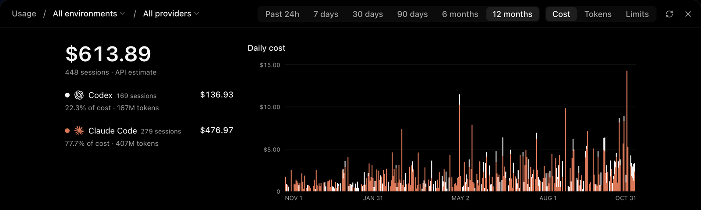
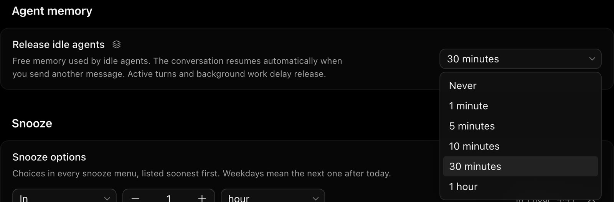
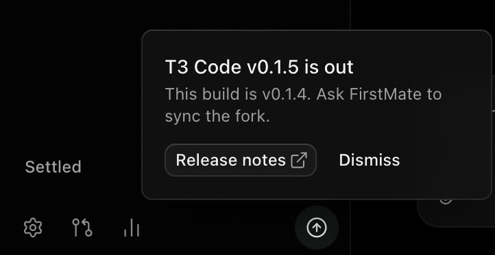
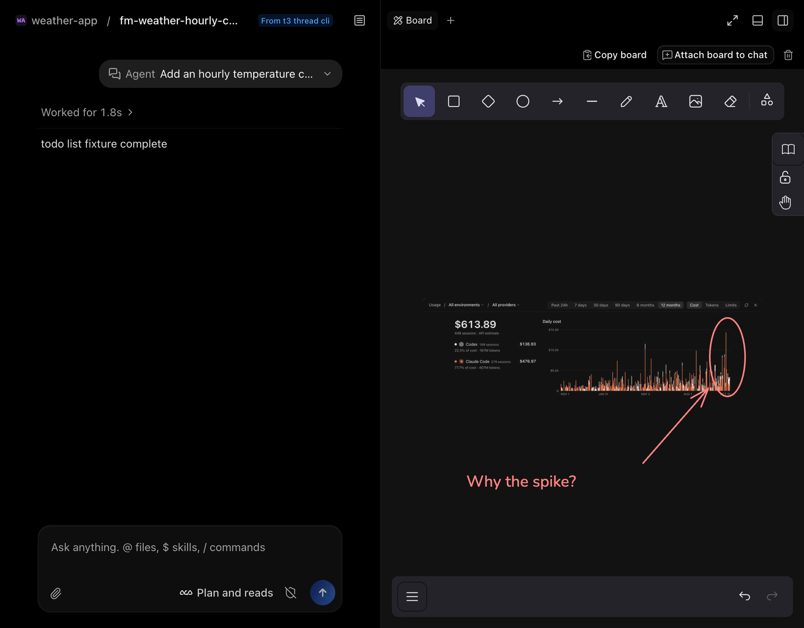
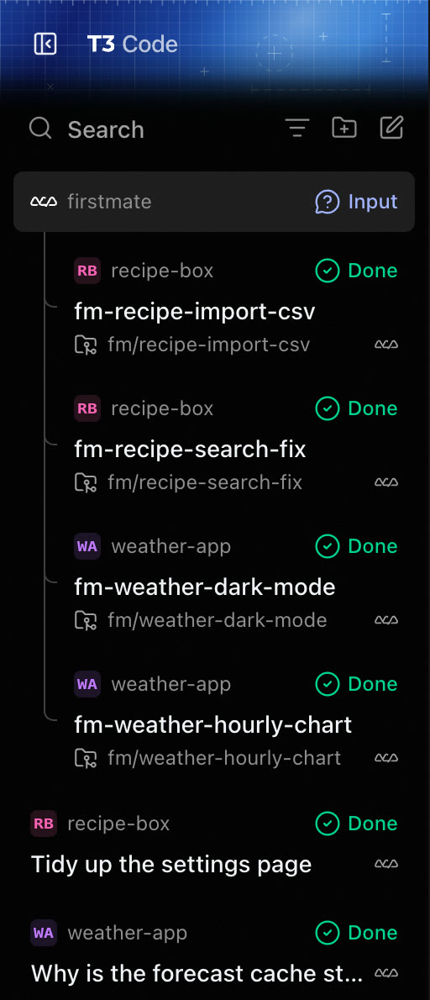

# Fork changes

This fork tracks `pingdotgg/t3code` `main`. Each feature section says what it
does, shows a picture where one helps, then what each upstream sync must carry
forward. Keep this list current. Pictures live in `fork/media/` and show
made-up data. Earlier fork work is archived on the local branch
`archive/fork-legacy-2026-10-19` and is out of scope for syncs; take from it
only on request.

## Desktop identity

The fork's desktop app runs beside the official T3 Code on one Mac. Neither app
can read or migrate the other's database.

|                          | Official                                         | Fork                                        |
| ------------------------ | ------------------------------------------------ | ------------------------------------------- |
| App name                 | T3 Code (Alpha, Beta)                            | T3 Code (Fork)                              |
| Bundle id                | `com.t3tools.t3code`                             | `com.t3tools.t3code.fork`                   |
| Data folder              | `~/.t3`                                          | `~/.t3-fork`                                |
| Electron profile         | `~/Library/Application Support/t3code-v2` (Beta) | `~/Library/Application Support/t3code-fork` |
| First backend port tried | 3773                                             | 3873                                        |

The values are in `apps/desktop/src/forkIdentity.ts`. The app name is
`productName` in `apps/desktop/package.json`. `T3CODE_HOME` still overrides the
data folder.

Two things are still shared with the official app:

- The `t3code://` link scheme. Both apps register it, so macOS picks which app
  opens sign-in and prompt links.
- The default Tailscale Serve port, 443. Do not turn on Tailscale Serve in both
  apps at the same port.

## Usage reaches twelve months



The Usage page on web and desktop has 6 months (`Cmd+Shift+5`) and 12 months
(`Cmd+Shift+6`) periods, drawn as stacked daily bars. The mobile app still
stops at 90 days. The server keeps parsed usage for 367 days instead of 92, so
usage stays after Claude Code deletes old transcripts. History older than what
is on disk or in the saved usage today cannot be recovered; twelve months builds
up from when this build first scans.

Upstream's "N malformed or inconsistent usage record(s) were skipped" sentence
shows as a small muted footnote at the bottom of the page instead of a notice
at the top (`apps/web/src/components/usage/UsagePage.tsx`).

## Archived usage

Usage includes copies of history from machines and accounts that no longer run
T3. The server setting `usageArchiveDirs` lists the archive folders. It
defaults to `["~/.t3-usage-archive"]` and can be changed in
`~/.t3-fork/userdata/settings.json`. Code: `apps/server/src/usage/usageArchive.ts`.

- Each folder directly under an archive folder is one host, and its name is
  the host label. Inside it, the copy keeps the original machine's layout, such
  as `<host>/home/.claude/projects`.
- These are read: Claude `projects/`, Codex `sessions/`, Grok
  `.grok/sessions/`, and a T3 server's saved usage
  (the newest of `usage-scan-cache-v9.json` down to `usage-scan-cache.json`,
  version 3 on).
  Saved usage still has usage whose transcripts were deleted. Version 3 caches
  are priced at standard speed. OpenCode, Pi and Antigravity copies are not
  read.
- Archived usage is parsed and deduplicated like live history. Live
  directories are read first, so usage that is both live and archived counts
  once and stays credited to the live source.
- A remote that still runs T3 and is connected would be counted again next to
  its archive copy. Archive a host after T3 is removed from it.

## App-bundled CLIs are updated by their app

On macOS, a provider CLI whose real path is inside an app bundle
(`*.app/Contents/...`) is left to that app. An example is ChatGPT.app's Codex,
which `~/.local/bin/codex` links to. T3 shows no Update button for it and never
runs its updater. Without this, Codex offers an update that fails, because
`codex update` cannot update ChatGPT's copy and exits 1. This works like
upstream's handling of WinGet's Claude, in
`packages/provider-core/src/server/maintenanceResolver.ts`.

## `~` in a provider's executable path

A provider path that starts with `~` works for every provider. OpenCode, Grok,
Pi, fx, Antigravity and the ACP registry used a configured path such as
`~/.local/bin/opencode` as written. Processes launch without a shell, so
the provider showed as not installed. Each of those drivers now expands a
leading `~` with `expandHomePath` before probing, spawning, resolving
maintenance or reporting status, as Codex, Claude and Muse already did. Cursor
never runs its `binaryPath`, so it is unchanged. When a sync finds upstream
expanding `~` in these drivers, keep upstream's.

## Idle agent release is a setting (carried upstream PR)



You choose how long an idle agent is kept before T3 releases it, including
Never. This carries upstream https://github.com/pingdotgg/t3code/pull/25624
unchanged: the server setting `providerSessionIdleTimeoutMinutes` (default 30,
`null` is Never) replaces the hardcoded 30-minute idle release, shown under
Settings → Threads → Agent memory. Firstmate's environment sets it to Never.
When a sync finds the PR merged, or an upstream equivalent, drop this copy and
keep upstream's.

## Upstream release indicator



The fork has no update feed, so it never hears about upstream releases. When
`pingdotgg/t3code` publishes a stable release newer than this build, the
sidebar update icon shows "T3 Code vX.Y.Z is out", with links to the release
notes on GitHub and a Dismiss that holds until the next newer release. Nothing
downloads or installs; the captain asks FirstMate to sync the fork. It checks
at start-up and every 6 hours, keeps the last result when GitHub is
unreachable, and stays off whenever an update feed is configured or the
desktop updater is running. Code: `apps/web/src/state/upstreamRelease.ts` and
`apps/web/src/components/sidebar/SidebarUpstreamRelease.tsx`; a later "Ask
FirstMate to update" button belongs in that popover.

## Board



A quick annotation canvas that opens as a "Board" tab in a chat's right panel,
from the panel's launcher or "+" menu (W) or "Open board" in the command palette.
It is Excalidraw (MIT), loaded only when the tab shows. Screenshots pasted with
Cmd+V while focus is in the panel land in the middle of the view. The board is
saved in the client's IndexedDB, one board per client, shared by every chat's
Board tab. "Attach to chat" sends the selection, or the whole board, as a PNG to
the composer of the chat beside the panel. The canvas is marked
`data-editable-canvas` and `role="application"` so its keys (tool letters, Cmd+Z,
Delete) are not taken by type-to-focus or thread undo. Code:
`apps/web/src/components/board/`.

Shared files it touches, for syncs: the `board` surface kind in `rightPanelStore.ts`
(and `closedViewStore.ts`), the launcher and "+" menu entries and tab title and icon
in `RightPanelTabs.tsx`, `RightPanelSurfaceContent.tsx`, `useRightPanelActions.ts`,
the props in `ChatView.tsx` and `PullRequestsPage.tsx`, a command palette item, the
selector in `lib/editableFocus.ts`, the Excalidraw font asset path in
`apps/web/vite.config.ts`, and licence notices. Excalidraw's canvas fonts are
served from the app because the desktop CSP blocks the CDN Excalidraw would
otherwise use. The mobile app has no board.

## FirstMate crew in the sidebar



A FirstMate session and the worker threads it launches are grouped above the
sidebar inbox and kept out of Working. The main session shows as one line led
by its model icon; its crewmates hang below it as a tree that collapses to a
count. Crewmate cards have no hover Snooze or Settle (the context menu still
has both), and crewmate turns raise no sound or notification. Opening the app
on the home route jumps to a FirstMate session that is still working or waiting
on input. Without FirstMate the sidebar is unchanged.

The main session is the newest worktree-less thread at the root of a FirstMate
checkout. A crewmate is a thread an agent launched over MCP from the
`firstmate` client, read from `linkOrigin`, which the server now stamps on
launches from every signed-in OAuth client (`linked: false` for an ordinary
one); older launches are recognised by an `fm-` title. Code:
`apps/web/src/components/sidebar/coordinatorGroup.logic.ts`,
`apps/server/src/mcp/linkOrigin.ts`.

## Per-thread environment and instructions

An agent that launches a thread can give it its own environment variables and
instructions, for any provider. `t3_thread_launch` takes optional `environment`
(env vars) and `instructions` (kept in the agent's system context), stored on
the thread so they survive idle release, restarts and forks. Each adapter
applies them through the channel it already has and declares what it
supports; a launch or later turn that binds something its provider cannot
apply is refused. `t3_thread_configure` reads them back with the effective
runtime mode, and `orchestrator_capabilities` reports `threadEnvironment`,
`threadInstructions` and an ACP registry instance's `agentId`. Code:
`apps/server/src/orchestration-v2/RuntimePolicy.ts`.

OpenCode 2 shares one server per instance, so its adapter sets each session's
own environment instead (`PUT /api/session/:id/environment`). That replaces the
server's environment in the session's shells, is kept in memory only, and is not
inherited by subagent sessions. So T3 sends every session, subagents included,
the environment it started the server with minus `OPENCODE_PASSWORD`, plus the
thread's variables. It sends this again after the server restarts. An external
server (`serverUrl`) has an environment T3 does not know, so it stays
unsupported. Code: `packages/provider-opencode/src/server/v2/adapter.ts`.

## Agents answer approvals over MCP

Claude asks for some commands even with full access (its own safety checks and
the user's ask rules). An agent driving T3 over MCP, such as FirstMate, can
answer those so the user never has to. `t3_pending_request` `list` returns
`approvals` next to question `requestIds`, each with its `kind`, `detail`,
`reason` and `override` (`provider_check`, `ask_rule` or `null`); `respond`
takes `decision: "allow" | "deny"` and optional `feedback` on deny, and sends
the same command the Approve and Decline buttons do. Only a full-access caller
other than the asking thread may answer one. The resolved request and its
timeline row record `respondedBy: "agent"`, which web and mobile show as
"answered by agent". `orchestrator_capabilities` reports `approvalResponses`.
Code: `apps/server/src/mcp/toolkits/thread/handlers.ts`.

## Usage statistics carry no account ids

Product analytics still go to T3, but nothing sent derives from an account.
`distinct_id` is the hashed per-install anonymous id, not the Codex workspace
or Claude machine id (`apps/server/src/telemetry/Identify.ts`). The
`install.owner_observed` event is gone: the server no longer reads the linked
T3 Connect account or provider logins for it, and clients no longer send the
`clientOwner` and `clientDevice` connection parameters. When syncing, drop any
upstream code that reintroduces account-derived analytics ids.

## Version

The fork keeps upstream's version number. The desktop app sets up an SSH or
WSL remote by downloading upstream's `t3` release for its own version
(`apps/desktop/src/main.ts`), so a version upstream never released, such as
`0.1.5-fork.1`, has nothing to download. The app name, bundle id and
data folder tell the fork apart.

## Build

```sh
node scripts/build-desktop-artifact.ts --platform mac --target dmg --arch arm64
```

The build is unsigned, so electron-builder ad-hoc signs it. It writes
`release/T3-Code-<version>-arm64.dmg` and a `.zip`. Leave
`T3CODE_DESKTOP_UPDATE_REPOSITORY` and `GITHUB_REPOSITORY` unset. With neither
set, the app has no update feed and cannot update itself into the official
app.
Settings → About → Update track (Stable or Nightly, from upstream 0.1.5) then
only saves the track for this app, which says to reinstall it yourself. It
still moves connected machines that run upstream's `t3` to that track.
